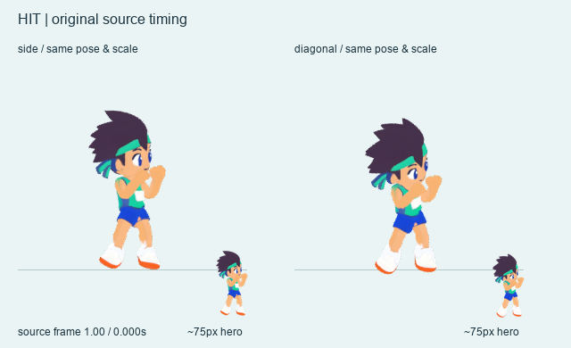

# Tori continuous motion / two-view preproduction

Prepared 2026-10-17 KST for the next running-tour integration. **Not loaded by
`app/` and separate from the tower-defense release.**

이 폴더는 다음 러닝 개선에 사용할 **동작 제작·검토 자료**입니다. 현재 게임에는 연결되지 않았습니다.
기존 토리 원본을 보존한 두 시점 촬영이며, 점프·달리기 속도·동작 전환은 아래 연결 조건을 먼저 해결해야 합니다.

### 바로 보는 동작

같은 피격 동작을 측면·사선으로 비교합니다. 큰 보기 아래의 작은 캐릭터는 약75px 검토용입니다.

[넘어짐 연속 동작](review/fall-two-view.webp) · [달리기 연속 동작](review/run-two-view.webp) ·
[전체 75px급 프레임 비교](review/contact-104.png)

## Source and preservation

- Untouched source: [tori-game-motions.fbx](../tori/tripo/2026-10-12/motion/tori-game-motions.fbx),
  3,858,348 bytes; 4,701 vertices / 9,398 polygons.
- SHA-256: `e6d3417b3727bf13fcf987d6e2400e78fa0f9414c2db51e325bc69019ae2314e`.
- Original Tripo task: `15d4e91d-7b0c-4471-af5a-8fcf70d73920`.
- Face, hair, clothes, topology, skin weights, rest rig and all six source actions
  preserved. Reuses the existing rest-space material repair; no replacement art.
- Editable working copy: `tori-two-view-authoring.blend`, packed textures and two
  named cameras. Actual source/copy checks: `preservation-check.json`.
- **New Tripo tasks / credits: 0 / 0.** No source-file writes or game-code changes.

## Full source motion and timing

The FBX imports at 24 fps. Full intervals are retained, with no invented action
keys. Loop samples omit the repeated endpoint; one-shots retain their end pose.

| Action | Source frames | Original duration | Sampling |
|---|---:|---:|---:|
| run | 1–31 | 1.250 s | 12 fps |
| idle | 1–369 | 15.333 s | 6 fps |
| jump | 1–54 | 2.208 s | 12 fps |
| hit_to_body_01 → hit | 1–32 | 1.292 s | 12 fps |
| fall | 1–73 | 3.000 s | 12 fps |
| cheer | 1–291 | 12.083 s | 8 fps |

`bake-manifest.json` records exact samples, camera targets, ground anchors, foot
positions and projected bounds. `sprite-manifest.json` maps time samples to unique
cells; exact duplicate RGBA frames share a cell without losing elapsed time.
Preview endpoints add an explicit 100 ms review hold beyond source duration.

## Image / anchor contract

- Transparent **256×256** cells; **180 pixels per world unit** for both views.
- Ground anchor **(128, 218)**; normalized origin **(0.5, 0.8515625)**.
- Each clip keeps its initial horizontal hip and visible sole as a fixed anchor.
  No per-frame sole chasing, fit-to-frame scaling or artificial pose rotation.
- Side offset `[-8,-5,0]`; diagonal `[-7.698,-5.391,3.420]` (about 20° elevation),
  matching the two existing pilot views.
- `groundDeltaPx` retains source contact deviations; it is not a perfect-contact
  certification. Game displacement/colliders must remain separate from padding.
- The initial probe clipped late diagonal fall toes. The final bake uses one
  consistent smaller scale / larger margin across all clips, preserving motion.

## Review / handoff

- **`review/contact-104.png`**: same poses in both views, approximately **75 px**
  neutral hero height. Pose height changes naturally.
- `review/contact-128.png`: larger chronological contact sheet.
- `review/{run,idle,jump,hit,fall,cheer}-two-view.webp`: actual timed animations,
  enlarged view plus a 75 px inset; no fake cross-action blending.
- `sheets/tori-{side,diagonal}-{action}.webp`: candidate lossless sprite atlases.
- `source-inspection.json`, `bake-manifest.json`, `sprite-manifest.json` and
  `preservation-check.json`: source, samples, hashes and validation.
- Reproducible raw PNGs, superseded probes, logs and Blend backups are Git-ignored.

## Explicit integration gates

1. **Jump adoption is deferred:** the original `jump` is repeated small hops,
   not a finished single high obstacle jump. No synthetic dash/landing was added.
2. Hit recoils and recovers to its source **guard** pose, not the run/idle pose;
   interrupted run↔hit transitions still need a deliberate bridge.
3. Fall is a stumble and sideways ground collapse. Falling off a platform still
   needs game-world displacement. Cheer now includes raise and return.
4. Source run cycle is **1.25 s**; the current game plays it much faster. Decide
   game playback speed separately after contact/ground-speed comparison.
5. Two-camera offline appearance is reviewable. Runtime scene alignment, loop
   closure, transitions, collisions and mobile performance are **not verified**.

## Reproduce and rights

From repository root with Blender 4.5.14 LTS and Python/Pillow, run in order:
`tools/inspect_source.py`, `tools/bake.py`, `tools/pack.py` (Python),
`tools/finalize_scene.py`, `tools/validate_source.py`.
Finish with `tools/record_delivery.py` (Python) to refresh the output ledger.
For Blender scripts use `blender --background --factory-startup
--python-exit-code 1 --python character-art/runner-v6-preproduction/<script>`.
Every script writes only this package. The reused material recipe's path and
hash are recorded. No network or paid service is called.

Existing [Tripo rights record](../tori/tripo/2026-10-12/USAGE_AND_RIGHTS.md) and
[motion source record](../tori/tripo/2026-10-12/motion/README.md) apply.
The Mixamo-named preset came from Studio; no separate Adobe motion was downloaded.
The character art is not relicensed MIT/CC0 by the code license. Blender is the
processing tool. No account screenshot, credential or signed URL is included.
