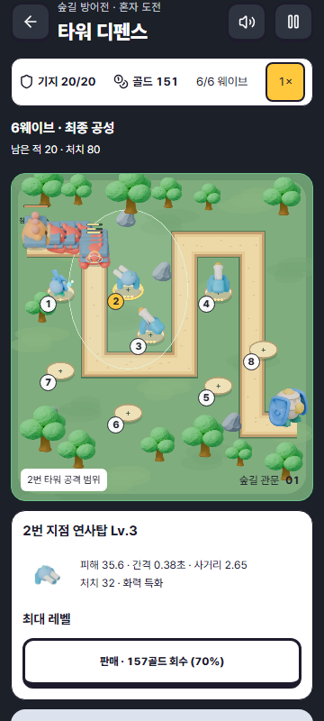
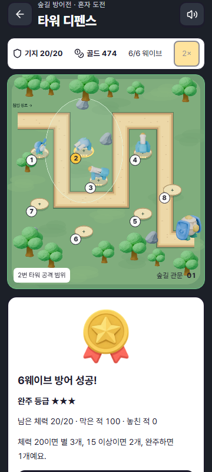
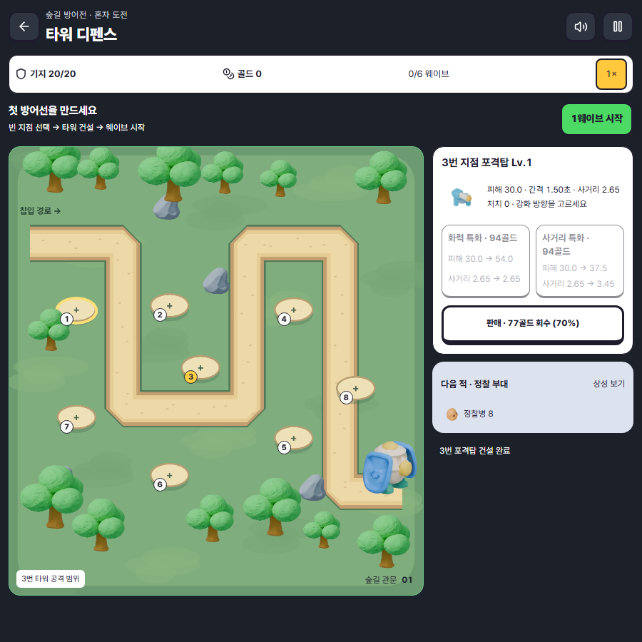

# 숲길 방어전 전투 제작과 검수 기록

2026-10-16 작업. 통합 기준 main `3f08bf1fe900e688df2b8e0b60fe56b51856e273`.
이 기록은 로컬 구현과 검수 증거다. main 반영과 공개 배포 SHA/CI는 실제 발행 후 별도로 기록한다.

## 목적과 제작 기준

사용자가 제공한 Threads 사례와 영상은 장면·행동·결과가 일치하는 게임 제작을 요구한다.
이번 첫 대상은 **디펜스 한 판 전체**다. 러닝·밀어내기까지 모두 완성했다는 보고가 아니다.
[레퍼런스 원문·관찰·차용 결정·후속 순서](../../phase2/GAME_QUALITY_REFERENCE_DECISIONS.md)를 기준으로 작업했다.

Kingdom Rush의 경로/건설 지점, Bloons TD 6의 구매/라운드/강화,
Infinitode 2의 선택 범위, Element TD 2의 감속/범위 공격 관계를 비교했다.
Outpost Assault의 실제 공개 코드를 읽어 발사·비행·충돌·사망을 별도 상태로 처리하는 구조를 적용했다.
상용 스크린샷이나 Outpost 아트를 게임 에셋으로 복사하지 않았다.

## 실제로 달라진 동작

- 기존 SVG 정지 그림 중심 전장을 Phaser 3.90.0의 WebGL/Canvas 장면으로 교체했다.
  게임 규칙은 기존 독립 도메인에서 1/60초 단위로 처리하고, React는 HUD를 100ms 간격으로 갱신한다.
  엔진은 디펜스 입장 시에만 지연 로드한다.
- 타워 3종은 8방향 조준·발사 반동·포구 효과를 갖고, 적 4종은 이동·피격·사망 프레임을 갖는다.
  아이콘도 실제 전장 모델의 같은 렌더를 사용한다.
- 투사체가 도착해야 체력을 깎는다. 연사/냉각은 원래 표적을 추적하고,
  포격은 발사 시 예측한 지점에 떨어져 그때 범위 안에 있는 적에게 피해를 준다.
  사망한 표적에 중복 보상을 주거나 이미 판 타워의 처치를 새 타워에 더하지 않는다.
- 적을 놓치면 출구에서 기지 손상이 보인다. 패배하면 물리 판정을 멈추되 마지막 손상 효과는 수명을 마치고 사라진다.
- 6웨이브, 100마리, 시작 180골드, 20체력, 기존 건설비/보상/업그레이드 분기는 유지한다.
  승리는 별·남은 체력·막은 적·놓친 적으로 설명한다. 훈련 기록이나 앱 포인트에 합산하지 않는다.
- 전장을 휴대폰 너비에 맞추고 데스크톱에서는 옆에 건설 패널을 배치한다.
  패널이 전장을 덮는 sticky 동작을 없앴다. 8개 지점은 각각 44px 터치 영역을 갖는다.
- OS의 모션 감소 설정에서도 눌린 지점이 움직이지 않도록 전역 버튼 효과와의 충돌을 수정했다.
  키보드 버튼·사거리·상태 텍스트는 유지한다. 화면 흔들림과 입자는 줄일 수 있다.
- 소리 켜기/끄기, 일시정지, 준비 상태 저장, 이어하기, 저장 없는 나가기, 새 판을 유지한다.
  v1 저장을 읽으며 기존 저장 키나 기록을 초기화하지 않는다.
- 에셋 실패에는 Kenney/도형 대체 그래픽, 엔진 로딩 실패에는 기존 SVG 전장을 사용한다.

## 제작물과 비용

- 기존 유료 Tripo Studio 원본을 Blender 4.5.14에서 분리·변형·애니메이션·렌더했다.
  새 Tripo 태스크/충전은 없으며 이번 추가 사용은 **0크레딧**이다.
  API 잔액 0은 확인했지만 Studio의 현재 잔액은 이 기록으로 주장하지 않는다.
- 애니메이션 atlas **11개**와 UI preview **7개**, 총 **18 WebP / 730,028B**.
  128px 셀, 8방향, 6행, 접지점 `(0.5, 0.68)`. atlas에는 528셀, 456개의 고유 프레임이 있다.
- 편집 가능한 `.blend` 7개와 재생성 스크립트, 원장, 프레임 검증 결과를
  [character-art/defense-v5](../../../character-art/defense-v5/README.md)에 보관한다.
  `.blend` 6,075,235B는 제작 원본이며 브라우저 전송량에 포함되지 않는다.
- 자체 파형/잡음 합성 WAV 3개는 총 26,592B다. 외부 음원을 추출하지 않았다.
- [공개 출처](../../../app/public/game/defense-v5/CREDITS.md), Phaser/EventEmitter3 MIT 전문,
  기존 Kenney CC0, Tripo 원장을 함께 보존한다. 엔진의 MIT를 생성 아트의 라이선스로 확대하지 않는다.
- 로컬 production build의 디펜스 지연 묶음은 1,496.18kB, gzip 344.83kB였다.
  위 수치는 엔진 포함 JS이고 이미지/음향 크기와 구분한다. 전체 앱 용량이나 네트워크 실측이 아니다.

## 실행 검증

런타임: Node 24.19.0. 앱 타입 검사와 production build 통과.

| 검증 | 결과와 범위 |
|---|---|
| 도메인 규칙 19개 | 비행 중 무피해, 도착 피해, 포격 예측/회피, 중복 보상 차단, 판매 후 소유권, 감속/장갑, 패배, 이벤트 수명/상한, 기존 저장 복원/손상 거절 |
| Artwork 3개 | 전장과 일치하는 preview, 이미지 실패 대체 |
| 디자인/라이선스 16개 | 전역 색상 토큰, 모션 규칙, 실제 설치 버전과 라이선스 전문/의존성 고지 |
| Desktop 전체 판 | WebGL의 실제 전투 픽셀 변화 → 1웨이브 저장 → Canvas2D 이어하기 → 6웨이브 승리 → 결과 기록 → 새 판. 36.6초 검사 실행 |
| Phone 360px 전체 판 | 같은 실제 전투/저장/승리/재시작 경로, Canvas2D. 15.0초 검사 실행 |
| Desktop 장애 경로 | Tripo/Kenney 파일 동시 누락에서도 진행. reduced-motion 눌림 좌표/판매/나가기/무건설 패배. 6.2초 |
| Phone 320px 장애 경로 | reduced-motion 실제 터치, 44px 영역, 무건설 패배, 결과 후 나가기, 가로 넘침 없음. 7.0초 |
| 독립 브라우저 터치 | 320×740에서 일반/모션 감소 각각 지점 2·3·5·8을 180ms 누르고 뗐을 때 선택 성공. 지점 겹침 0, 누락 에셋 0 |
| 독립 WebGL 진입 | 390×844 건설→1웨이브→2배. 누락 에셋 0, 페이지 오류 0, Pretendard와 전장 토큰 읽기 확인 |

자동 브라우저 4건은 총 약 1.1분에 통과했다. 이 시간은 플레이 분량이 아니다.
긴 판은 가상 시계로 프레임 사이 시간을 전진시키면서 실제 1/60 물리 단계를 모두 수행한다.
골드·적 체력·승리 상태를 주입하지 않는다. 별도로 실시간 프레임 구간의 이미지 차이와 atlas 셀 차이를 검사한다.
소프트웨어 WebGL의 렌더링 지연을 해결하려고 타임아웃을 늘리지 않았고,
긴 전체 판에는 실제 지원하는 Canvas2D 대체 경로를 사용했다.

### 같은 규칙에서의 구매 전략 비교

별도 실험 도구 `.tools/probe-tower-defense-balance.mjs`로 돈을 추가하지 않고
1/60초 고정 간격으로 실행했다. [전체 구매 정책·웨이브별 영수증](../../phase2/defense-balance-v5.json)에
실제 도메인 파일 SHA256과 성공한 구매 순서를 기록했다. 이 실험은 CI 검사를 추가하지 않는다.

| 정책 | 결과 | 기지 / 처치 / 누수 | 실제 전투 시간 | 잔여 골드 / 누적 지출 |
|---|---|---|---|---|
| 연사·포격·냉각 혼합 | 6웨이브 승리 | 20 / 100 / 0 | 148.65초 | 474 / 1,016 |
| 연사 단일 | 6웨이브 승리 | 16 / 98 / 2 | 202.12초 | 375 / 1,085 |
| 포격 단일 | 6웨이브 승리 | 20 / 100 / 0 | 134.48초 | 367 / 1,123 |
| 냉각 단일 | 2웨이브 패배 | 0 / 0 / 20 | 99.00초 | 50 / 170 |

혼합은 적은 지출로 무손실 방어, 포격 단일은 더 빠른 정리를 보였다.
연사 단일은 장갑 적 2마리를 놓쳤다. 냉각은 공격 보조 성격이 실제 결과에도 나타났다.
포격 단일도 완벽한 방어가 가능하므로 혼합만 정답이라고 안내하지 않는다.
이는 명시한 네 정책의 비교이며 최적 전략 탐색이나 사람의 재미 검증은 아니다.

### 수정 중 발견한 실패

1. 데스크톱 media query가 좁은 부모 안에서도 2열을 켜 전장을 축소했다. 실제 게임 작업면/container 기준으로 변경했다.
2. 일반 눌림 효과가 지점의 중앙 정렬 transform을 바꿨고, reduced-motion의 `!important` 규칙도 이를 덮었다.
   눌림 중 위치 보존과 실제 터치 회귀로 수정했다.
3. 인접 지점의 터치 영역이 겹쳤다. 화면 투영 높이와 지점 간격을 수정하고 320px에서 겹침 0을 확인했다.
4. 패배 시 마지막 효과가 정지할 수 있었다. 판정 시간과 남은 연출 시간을 분리했다.
5. headless software WebGL/시계 정지 시점/부동소수 표시 경계 때문에 초기 검사 일부가 실패했다.
   실제 지원 렌더 경로·준비 화면에서의 시계 설정·HUD 표본 오차만 보정했다. 게임 판정은 약화하지 않았다.

### 다시 실행

```powershell
cd app
npm run test:e2e:tower-defense
```

기본은 전용 Vite 서버를 4253에 열고 종료한다. 이미 준비한 서버가 있으면 `TD_BASE_URL`을 지정한다.
저장소 CI dedicated browser 작업에도 같은 검사를 연결했다. CI 실행 결과는 로컬 통과와 별도다.

## 실제 화면







## 남아 있는 품질 관문

- 실물 iPhone/Safari의 혼잡 구간 프레임 시간·입력 지연·음향 체감은 측정하지 않았다.
  데스크톱 모바일 에뮬레이션이나 WebGL 정상 로드를 실기 성능 보증으로 보고하지 않는다.
- 여러 전략의 승패 차이와 기술적인 완주를 확인했지만, 실제 이용자의 재미·재방문 효과는 아직 검증하지 않았다.
- 단계별 강화는 실제 피해/사거리/간격과 등급 표시로 구별된다. 타워 레벨마다 별도 모델을 제작한 상태는 아니다.
- 서버/친구 경기를 이번 디펜스에 추가하지 않았다. 기존 밀어내기 서버의 동접·재접속 상태도 이번 검증 대상이 아니다.
- 다음 대상은 러닝 투어의 장애물 예고·지속 제스처·카메라/착지 일치, 이어서 밀어내기의 공격/낙하/무한 리젠이다.
  이번 디펜스 수정으로 그 게임들까지 검수 완료 처리하지 않는다.
