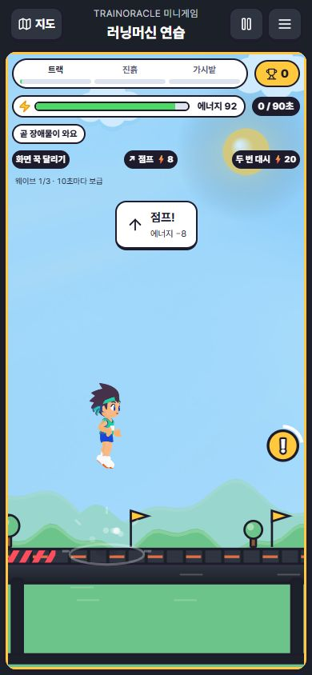
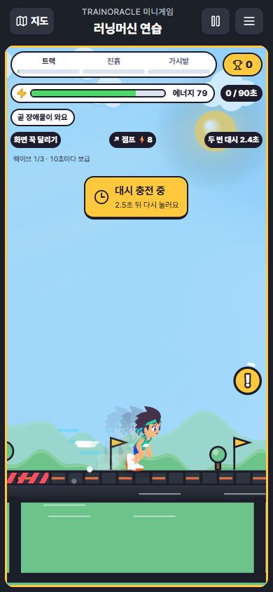

# 미니게임 입력·이펙트 개선 — 2026-10-15

통합 담당: Codex. 작업 브랜치: codex/minigame-friend-race, PR #366.
기준: b925b2d4. 기존 게임 PR의 후속 UI 개선이며 게임 규칙·계정·훈련·서버 변경은 없다.

## 반영
- 지도·경기·로비는 180ms 등장, 모달은 작은 이동/확대, 강화 선택지는 45ms 간격으로 등장한다. 입력과 게임 진행은 애니메이션 완료를 기다리지 않는다.
- 누름 피드백은 90ms, 키보드 초점 표시를 통일했다. 버튼 테두리 두께를 줄이던 active 규칙을 없애 주변 배치 이동을 막았다.
- 엔진이 실제 수락한 점프·대시에만 성공과 실제 에너지 비용을 650ms 표시한다. 공중/충전/에너지 부족/출발 전 입력은 이유를 1.4초 표시한다. 연속 입력은 이전 타이머를 취소하며, 메뉴·일시정지·나가기에는 표시를 지운다.
- 점프·착지 바닥 링, 대시 잔광, 장애물 통과 광선을 0.36초 이내로 그린다. 새 파티클 배열 없이 한 개의 짧은 효과만 유지한다. 대시 전용 합성 효과음과 출발 표시도 추가했다.
- 강화 장착에 기존 Tripo 발판/캡슐/코어를 선택 종류별로 연결했다. 새 모델 생성·추가 크레딧 사용은 0이다. 스프링 장착 시에만 기존 jump-pad FX 39,630B를 추가 로드한다. 이전 v3 묶음 135,734B에 이 선택 로드를 포함하면 175,364B다. GLB는 게임 런타임에 넣지 않는다.
- 시스템/게임 동작 줄이기는 새 모션을 끄고 정적인 안내를 남긴다. 새 캔버스 효과는 낮은 품질에서도 생략한다.

## 확인
- 관련 Vitest 5파일 18개 통과: action-feedback, party-art, UpgradeChoice, draw.contract, gestures.
- 결함 주입: 점프 횟수 비교 >를 >=로 바꾸자 성공/거절 판정 검사 2개가 실패했다. 원본 복원 후 위 18개 전체 통과.
- Node 24.19.0 TypeScript 검사 및 Vite 배포 빌드 통과. 기존 폰트 경로·혼합 import·대형 chunk 경고는 남아 있다.
- 실제 앱 390×844 브라우저: 홈→게임→연습→시작, 점프 성공(에너지 −8), 대시 후 재입력(충전 중)을 확인했다. 아래 이미지는 고정 상태 fixture가 아닌 실제 입력 화면이다.
- 브라우저 prefers-reduced-motion=reduce에서 카드 animationName=none, 버튼 transitionDuration=0s 확인. 검수용 media override는 원복했다.
- 새 전체 90초 경기, 실제 휴대폰 터치, 새 2인 네트워크 경기는 이번 검수 범위에 포함하지 않는다.

## 전달 및 배포 경계
관련 파일과 이 기록만 PR #366에 포함한다. 기존 .scratch 자료는 보존하며 업로드하지 않는다.
변경 전 b925b2d4 CI는 실패, deploy-pages는 skipped였다. 새 커밋의 CI는 별도 실행 결과를 따른다. 이 기록은 정식 Pages 배포 완료 증거가 아니다. 검사 우회 병합/게시를 하지 않는다.
