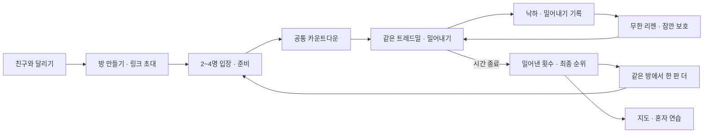

# 친구와 밀어내는 트레드밀 경쟁 — 구현 기획

작성: 2026-10-14 · 코드 확인 기준: `378a704e` (PR #365 병합).

**상태: 방향 채택에 따른 구현 기획. 친구 방·동시 출발·순위는 아직 구현하거나 배포하지 않았다.** 이 문서의 인원·시간·보관 기간은 구현자가 검증할 초안이다. 오너의 확정 수치로 인용하지 않는다.

후속 오너 결정: **“경쟁의 경우 밀어내기로 하자.”** 기존의 각자 달린 뒤 점수로 승자를 정하는 경쟁안을 아래 규칙으로 교체했다. 밀치기 조작·시간 제한·방어 수치는 작업자 제안이며 실제 플레이 검증이 필요하다.

최신 오너 정정: **“시간 끝날 때까지 무한리젠 겟엠프드 참고하라구.”** 시간 종료까지 리젠 횟수 제한 없이 같은 라운드에 복귀한다. 이전 작업자가 임의로 넣은 목숨 3개·최종 탈락·최후 생존 승리·남은 목숨 비교는 모두 폐기한다. 목숨이나 부활 횟수를 소모하는 시스템을 다시 도입하지 않는다.

## 요청과 방향

오너 후속 요청:

> 추천안대로 하되, 동시 친구랑 게임접속이 가능할 수 있는 것. 기록을 비교할 수 있거나 랭킹할 수 있게하는 걸로 해.

기존의 읽기 쉬운 장애물, 행동이 달라지는 장애물, 다시 익혀 도전하는 코스, 절제된 2.5D 방향을 유지한다. 경쟁은 **정해진 시간 동안 상대를 밀어 떨어뜨리고 계속 리젠하며 공방하는 경기**다. 낙하는 득점 사건이며 경기 참가 자격을 없애지 않는다. 초대·공통 출발·같은 방 재대결은 유지한다. 역할·포지션과 영구 능력치 격차를 만들지 않는다. 혼자 모드의 완주/점수와 경쟁의 승패는 구분한다.

`HAZARD_APPROACH_AND_DEPTH_PLAN.md`의 이전 '실시간 서버/멀티플레이 제외'는 당시 장애물 수정 범위다. 이번 친구 경기 기획에서는 동시 접속과 방 상태 공유가 새 범위다. 기존 계정·훈련 데이터 공개 제한을 해제한다는 뜻은 아니다.

## 레퍼런스를 가져오는 방식

| 확인 자료 | 관찰 | 적용하는 판단 |
|---|---|---|
| [겟앰프드 공식 게임모드 안내](https://getamped.game.onstove.com/sub_main/menu/information/view/info_mode.ws)와 [도그파이트 안내 이미지](https://gaweb.juneinter.com/getamped/gameinfo/mode_con04.gif) | 공식 이미지 하단은 일정 시간 동안 쓰러뜨린 상대 수로 승패를 가린다고 설명한다 | 시간제 경쟁과 공격 성과 비교를 참고한다. 생존자 한 명을 고르는 규칙으로 대체하지 않는다 |
| [공식 로얄럼블 안내 이미지](https://gaweb.juneinter.com/getamped/gameinfo/mode_con06.gif) | 사망 후 부활해 계속 대전에 참여하는 설명과 부활 대기 화면이 있다 | 사망 후 빠르게 재합류하는 반복 공방을 참고한다. 시간 종료까지 무한 리젠은 사용자의 명시적 요구로 채택한다 |
| [Speed Run 4 Reddit 의견](https://www.reddit.com/r/roblox/comments/11xbmcj/opinions_on_speed_run_4/) | 여러 번 완주하거나 자신의 기록에 도전하는 의견과, 쉽고 오래가지 않는다는 의견이 함께 있다 | 맵을 많이 만들기보다 익힐 패턴과 재도전 이유를 만든다. 친구 비교만 붙이면 재미가 해결된다고 가정하지 않는다 |
| [SpeedRunners 공식 소개](https://www.nintendo.com/us/store/products/speedrunners-switch/) | 최대 4명의 경쟁과 장애물을 넘는 달리기를 설명한다 | 작은 친구 방과 즉각적인 재대결 흐름을 참고한다. 이번 밀어내기 규칙은 오너 후속 결정이며 이 자료에서 재미가 입증된 것으로 해석하지 않는다 |
| [앞서 검토한 SpeedRunners Reddit 토론](https://www.reddit.com/r/patientgamers/comments/10dnqy2/) | 이전 조사에서 가족·친구 플레이와 선택의 재미를 검토했다. 이번 직접 열기는 시간 초과였다 | 재방문 효과가 입증됐다는 주장에는 쓰지 않는다. 위 공식 자료와 실제 플레이테스트로 범위를 확인한다 |

Reddit의 소수 경험담은 대표 표본이나 유지율 자료가 아니다. '같이 한 번 더'가 실제로 일어나는지는 제품에서 별도로 검증한다.

## 첫 버전의 한 판

1. 지도에서 **혼자 달리기 / 친구와 달리기**를 고른다. 친구 기능을 혼자 플레이의 필수 절차로 넣지 않는다.
2. 방을 만들면 초대 링크를 복사하거나 기기 공유 메뉴를 연다. 링크를 연 친구는 해당 방으로 바로 간다. 로그인·친구목록 등록을 최초 경험의 필수 단계로 두지 않는 것을 목표로 한다.
3. 대기실에 캐릭터·게임용 별명·준비 여부·접속 상태를 표시한다. 방장은 2명 이상이 준비됐을 때 출발을 누른다. 시작을 예약하면 참가자와 경기 조건을 잠근다.
4. 서버가 정한 시작 시각으로 카운트다운한다. 같은 트레드밀 위에서 서로 보이고 부딪힌다. 출발 에너지·능력치는 같고 좌우 시작 자리는 재대결 때 교대한다. 시작 보호 동안은 밀칠 수 없다. 중간에 들어온 사람은 다음 판 대기실로 간다.
5. 화면에는 **남은 시간·밀어낸 횟수·내 낙하 횟수**를 표시한다. 떨어지면 짧은 대기 뒤 횟수 제한 없이 리젠한다. 결과에는 밀어내기 순위와 낙하·회피 기록을 비교한다. 개인 모드의 점수·콤보·장애물 통과 수는 경쟁 득점과 구분한다.
6. **한 판 더**는 같은 방·초대 링크를 유지하고 새 라운드를 만든다. **같은 코스 재도전**을 기본으로 하고, 방장이 코스를 바꾸면 모두의 준비를 해제한다.

라운드는 **제한시간이 끝날 때까지 계속**한다. 누군가 떨어지거나 화면에 한 명만 보인다고 끝내지 않으며 목표 처치 수를 채웠다고 조기 종료하지 않는다. 첫 시범의 제한 90초·낙하 후 대기 2초·복귀 보호 2초는 검수 전 시작값이다. 시간 종료와 함께 입력·충돌·리젠을 멈추고 확정 기록으로 순위를 보여준다. 연장전·서든데스는 넣지 않는다. 같은 방 즉시 재대결과 이후 선택형 3라운드 시리즈 방향은 유지한다.

## 낙하 → 리젠 → 재공방

- 서버가 낙하를 한 번 확정하면 본인의 낙하 횟수를 1 올리고 `respawning` 상태로 바꾼다. 이때 몸통과 공격 판정은 사라진다. 같은 낙하 이벤트의 재수신·중복 입력·아래쪽 체류로 추가 득점/낙하를 기록하지 않는다.
- 시간이 남아 있으면 `2 · 1 · 복귀`를 보여주고 중앙 안전 구간에 재등장한다. 3회·10회 이상 떨어져도 이 절차는 같다. 뒤쪽 낙하선이나 장애물 내부에 생성하지 않는다. 복귀 예정 위치를 미리 표시하고, 양쪽 시작 조건이 치우치지 않게 검수한다.
- 에너지는 공통 시작량으로 복구하고 밀림·경직·진행 중 공격·누르고 있던 입력은 초기화한다. 경기 시간·밀어내기 득점·낙하 횟수는 유지한다. 기존 강화 프리셋은 경기의 현재 구간과 같게 적용한다. 새 판으로 초기화하지 않는다.
- 보호 중에는 반투명/외곽선으로 상태를 알리고 밀치기를 **받지도 가하지도 못하게** 한다. 장애물의 피격·밀림도 보호하되, 벨트 이동과 직접 조작은 계속되고 낙하선 자체는 유효하다. 안전한 복귀 위치와 보호 길이를 함께 검증한다.
- 리젠 직후에는 대시 공격을 자동 재개하지 않는다. 공격 버튼 연타·누른 상태가 복귀 순간 타격으로 이어지지 않아야 한다. 보호가 끝나면 새 입력으로 공격한다.
- 여러 명이 동시에 복귀하면 공통 안전 구간의 구분된 후보 위치에 배치한다. 일반 접촉은 통과하고 보호 동안 상호 공격이 없어야 한다. 위치 선정은 서버가 한다.
- 고의 낙하는 에너지를 채워주지만 공격 기회를 잃고 낙하 횟수에 남는다. 이를 반복하는 편이 승리에 유리해지면 복구량·보호 시간을 조정한다. 리젠 횟수 제한으로 해결하지 않는다. 최초 시범에는 추가 공격력·복수 버프·부활 아이템을 넣지 않는다.
- 정상 플레이에 최종 탈락·강제 관전 상태는 없다. 시간이 끝난 라운드에서는 예약된 리젠을 취소하고 결과로 이동한다.

## 밀치기와 방어 — 첫 시범 규칙

| 기존 조작 | 경쟁에서의 행동 | 선택의 비용 |
|---|---|---|
| 화면 꾹 누르기 | 앞으로 달려 뒤쪽 낙하선에서 여유 확보 | 에너지 소모 |
| 손 떼기 | 회복하며 뒤로 밀림 | 상대가 접근할 기회 |
| 위/대각선 위 스와이프 | 점프해 장애물과 지상 밀치기 회피 | 에너지 소모, 착지 시 노출 |
| 더블탭 | 대시 중 근접한 상대와 몸통이 닿으면 어깨 밀치기 | 에너지·재사용 대기, 빗나가도 환급 없음 |

- 원거리 지정 공격을 만들지 않는다. 공통 월드에서 몸통이 근접하고 높이 범위가 겹쳐야 적중한다. 대시는 한 번에 첫 유효 상대 한 명만 밀친다. 공중에서 공격은 발동하지 않으며, 충분히 높이 점프한 상대에게 지상 공격은 닿지 않는다.
- 밀치기는 상대를 벨트 뒤쪽으로 밀어낸다. 단순 전진 충돌로 상대를 앞쪽 안전지대로 밀어주는 것과 구분되도록 어깨 돌림·충격 방향을 보여준다. 이 모션의 직관성을 첫 2인 테스트에서 확인한다.
- 보통의 접촉은 강제 밀침·몸으로 길막을 만들지 않는다. 공격이 없는 겹침은 통과시키고, 작은 시각적 깊이 차이·색 테두리로 두 캐릭터를 구분한다. 이 깊이 차이는 숨은 회피 레인이 아니다.
- 피격 후 짧은 밀치기 보호를 주고 연속 경직을 제한한다. 보호 중에도 바닥 이동·달리기·장애물 판정은 계속된다. 보호를 이용한 무적 대시 연타가 최선이 되지 않는지 검사한다.
- 같은 서버 틱의 상호 공격은 같은 사전 상태에서 계산해 양쪽에 동시에 적용한다. 메시지가 먼저 도착한 사람에게 공격 우선권을 주지 않는다.
- 중앙에서 첫 한 방으로 바로 낙하하지 않도록 이동량을 검수한다. 뒤쪽에 몰렸더라도 회복용 에너지·점프·대시가 남아 있으면 역전할 여지가 있어야 한다.
- 뒤쪽 낙하선을 넘으면 낙하 기록 후 리젠한다. 경쟁용 장애물은 밀림·감속을 주며 기존 가시 즉사 규칙은 그대로 가져오지 않는다. 혼자 모드의 가시 규칙은 유지한다.

## 실제 함께한다는 느낌

- 대기실에서 들어오고 준비하는 상태가 서로 보인다.
- 상대 캐릭터가 같은 트레드밀 위에 보이고, 접근·회피·피격·밀림이 양쪽 화면에서 일치해야 한다. 이름/색 표시는 머리 위에 작게 두고 발과 장애물을 가리지 않는다.
- 카메라는 내 캐릭터를 느슨하게 따라가되 근접한 상대와 뒤쪽 위험 경계를 읽을 수 있는 범위를 유지한다. 갑작스러운 줌이나 화면 회전으로 공격을 숨기지 않는다.
- 상대를 떨어뜨리면 `밀어내기 +1`과 상대의 복귀 예고를 보여준다. 서버가 시간 종료와 최종 기록을 확정하기 전 승리 화면을 띄우지 않는다.
- 리젠 대기 동안 경기 상황과 복귀 위치를 볼 수 있고 곧 조작에 돌아온다. 계속 졌다는 이유로 관전자로 바뀌지 않는다. 상대 모습은 확정된 공유 상태를 사용하며 가짜 고스트를 넣지 않는다.

## 순위 규칙

경쟁의 득점 기준은 **상대를 밀어 떨어뜨린 횟수**다. 첫 판정안은 시간 종료 시 밀어내기 횟수 많은 순, 동점이면 본인의 낙하 횟수 적은 순, 둘 다 같으면 공동 순위다. 동점 규칙은 작업자 제안이며 겟앰프드 공식 규칙으로 표시하지 않는다. 개인 모드의 장애물 점수·콤보·생존 시간은 승패를 뒤집지 않는다.

| 결과 그룹 | 비교 순서 |
|---|---|
| 상대 밀치기로 낙하 유발 | 공격자 밀어내기 +1, 낙하자 낙하 +1, 낙하자는 리젠 |
| 스스로 낙하·공격 기여 없는 장애물 낙하 | 본인 낙하 +1, 누구에게도 밀어내기 점수를 주지 않고 리젠 |
| 같은 틱 서로 밀어 떨어짐 | 유효한 공격 기여가 있으면 양쪽 모두 득점. 양쪽 리젠하며 경기는 계속 |
| 제한시간 종료 | 밀어내기 횟수 → 본인 낙하 적은 순 → 공동 순위. 리젠 대기자도 같은 기록 기준으로 집계 |
| 중도 포기·복귀 유예 초과 | 기권/연결 종료로 별도 표시. 정상 순위 제외, 남은 사람의 낙하 파밍 표적으로 두지 않음 |
| 미출발 | 순위 제외. 2명 미만이면 라운드 취소 |
| 서버 장애·공유 판정 불일치 미해결 | 경기 무효/확인 중. 클라이언트 주장으로 승자 선정 금지 |

시간은 서버에서 동일한 고정 틱 단위로 판정한다. 한 번의 낙하에 공격자 한 명만 득점한다. 첫 기여 판정안은 낙하 전 짧은 유효 기간 내 마지막으로 밀치기가 적중한 상대이며, 기간은 2인 테스트로 결정한다. 유효 기록이 없으면 환경/자발 낙하다. 리젠 시 이전 공격 기여를 지워 다음 낙하로 넘기지 않는다. 별명·입장 순서·업로드 속도로 동점을 깨지 않는다. 전체 공개 순위·현금성 보상·포인트(P)·실훈련 기록은 연결하지 않는다.

서버의 마감 시각 이하에 발생한 낙하만 집계하고 이후 공격·낙하는 제외한다. 마감 틱의 전 참가자 사건을 함께 처리한 뒤 최종 점수를 확정하며 예약된 리젠은 취소한다. 리젠 대기 중이라는 이유로 점수를 깎거나 순위를 내리지 않는다. 기권/연결 종료로 유효 참가자가 2명 미만이 되면 정상 승부 대신 경기 중단으로 표시한다. 낙하 때문에 생기는 리젠 대기는 이 조건에 포함하지 않는다.

예: A가 다섯 번 떨어져도 계속 리젠한다. 종료 시 A가 상대를 7번, B가 5번 떨어뜨렸으면 A가 이긴다. 출발 전에는 '시간이 끝날 때까지 더 많이 밀어내세요. 떨어져도 계속 돌아와요'로 설명한다.

## 공정한 출발 조건

- `courseId + courseRevision + rulesVersion + roundId`가 같아야 같은 순위로 비교한다. 매 판 새 캐릭터 능력으로 시작한다. 꾸미기는 외형만 바꾼다.
- 최초 친구 경기는 **공통 강화 프리셋**을 사용한다. 현재 개인 모드의 무제한 강화 선택 대기·구간 재시도·중간 저장 복구는 경쟁 결과에 넣지 않는다. 판 안에서 함께 강화되는 연출은 유지한다.
- 개인 모드의 선택하는 재미는 유지한다. 친구 경기의 자유 강화는 이후 **모두에게 같은 선택 시간과 후보**를 주는 방식으로 추가할 수 있다.
- 데이터가 새로 배포돼도 진행 중 방은 같은 규칙 버전으로 끝낸다. 구버전 클라이언트가 해당 규칙을 지원하지 않으면 새로고침을 안내하고 준비를 허용하지 않는다.
- 기존 맵 에셋과 고정 패턴을 바탕으로 밀치기용 코스를 별도 버전으로 만든다. 개인용 가시 즉사·재시도 규칙을 그대로 재사용하지 않는다. 공통 시드 생성기는 최초 범위에 넣지 않는다.
- 서버가 공통 위치·에너지·공격 재사용·충돌·낙하 기여·득점·리젠·마감을 진행 중에 판정한다. 클라이언트 재접속으로 기록을 지우거나 보호 시간을 새로 지급하지 않는다. 각 클라이언트가 독립적으로 한 판을 끝내고 나중에 비교하는 방식으로 밀치기를 대체하지 않는다. 입력 순번·대상 라운드·유효 시간·명령 빈도를 검증하고 중복 명령을 거절한다. 재생 로그는 판정 감사와 오류 재현에 사용한다. 이것만으로 봇/치팅 전부를 막았다고 주장하지 않는다.

## 이탈과 연결 문제

| 상황 | 동작 |
|---|---|
| 출발 전 방장이 나감 | 준비 중인 참가자에게 방장 이전. 사람이 없으면 방 종료 |
| 친구가 준비 없이 대기 | 방장은 미준비 참가자를 다음 판 대기로 보내고 준비된 2명 이상으로 시작 가능. 강제로 준비 처리하지 않음 |
| 출발 예약 후 네트워크 지연 | 서버 시각 차이와 시작 수신 여부 확인. 늦게 수신한 플레이어를 0초로 뒤늦게 시작시켜 같은 순위에 넣지 않음 |
| 플레이 중 메뉴·나가기 | `이번 경기 포기하고 나가기` 확인. 혼자 모드의 `저장하고 나가기`와 구분 |
| 화면 숨김·연결 끊김 | 입력 유지 상태를 풀고 공통 경기·리젠 시계를 계속 진행. 연결 끊김 자체로 무적/자리 고정을 주지 않음. 복귀 시 서버의 누적 기록·상태 복구. 초기 복귀 유예 5초 초과 시 연결 종료로 순위에서 제외하고 리젠 취소. 단순 버튼 포커스 이동만으로 종료하지 않음 |
| 결과 수신 실패 | 서버가 확정한 라운드 결과를 재조회. 클라이언트의 임의 점수 제출로 대체하지 않음 |
| 새로고침 | 라운드 상태와 본인 참가권을 복구. 이미 끝난 판을 새 출발로 바꾸지 않음. 경기 복구가 불가능하면 명확한 종료 상태로 전환 |
| 다른 참가자가 끝나지 않음 | 서버의 라운드 마감으로 대기 종료. 무한 결과 대기 금지 |
| 재대결 중 옛 결과 도착 | roundId가 다르면 새 라운드에 반영하지 않음 |

유예·마감 숫자는 모바일 통화/브라우저 전환 및 느린 기기에서 검증 후 정한다. 방 동기화가 개인 모드의 일시정지·저장 기능을 퇴행시키지 않게 분리한다.

## 서버와 데이터 범위

2026-10-14 읽기 전용 확인에서 연결된 Supabase 프로젝트가 존재하고, 코드에는 계정별 개인 게임 진행 저장 경로가 있다. **현재 공개 계정 기능은 별도 관문으로 보류 중**이다. 개인 진행 저장 경로가 친구 방·초대·랭킹을 이미 지원한다는 증거는 없다. 이번 조사에서 DB나 Edge를 변경하지 않았다.

구현안은 게임 전용 방·참가권·라운드·결과를 분리한다. 초대 링크는 방 참여 권한이고, 본인 준비/결과 제출 권한은 별도의 참가 토큰으로 확인한다. 호스트 작업은 호스트 권한을 확인한다. 방 목록이나 모든 사용자의 기록을 공개 조회하게 만들지 않는다. 초대 토큰은 추측이 어려워야 하며 원문을 분석 이벤트·오류 로그에 넣지 않는다.

최초 서버 보관 초안은 **방과 최근 경기 결과 24시간**이다. 방 안에서만 비교하고, 실명·이메일·훈련·건강 정보는 수집하지 않는다. 만료 시 접근 차단과 실제 삭제 작업을 함께 구현한다. 입장 화면에 공유 대상·보관 기간을 알린다. 장기 친구 기록·기기 간 별명 유지·전체 랭킹은 별도 저장/공개 설계 후 확장한다.

밀치기 경쟁에는 **진행 중 공통 판정 서버와 입력/상태 동기화**가 필요하다. 기존 1~2Hz 진행 표시안은 대기실·부가 통계에만 쓸 수 있으며, 몸통 충돌 구현안에서는 폐기한다. 표시 프레임과 서버 판정/전송 주기는 분리하고 내 움직임의 예측·서버 결과 보정과 상대 움직임 보간을 검증한다. 정확한 주기와 지연 허용치는 2인 시범 측정 후 정한다.

기존 Supabase는 방·참가권·확정 결과 저장 후보이며, Realtime 메시지 전달만으로 권위 있는 물리 서버가 생기지는 않는다. 경기 서버 런타임 선정과 비용 검증은 미완료다. [Realtime 권한 문서](https://supabase.com/docs/guides/realtime/authorization)와 [Edge 인증 문서](https://supabase.com/docs/guides/functions/auth)는 방별 접근 참고 자료다. 기존 계정 공개 관문을 우회하려고 익명 테이블 읽기나 계정 게이트 해제를 사용하지 않는다.

비용은 동시 방 수·방당 판정 시간·메시지 빈도/크기·재접속·보관량으로 다시 산정한다. 이전 2Hz 상태 공유의 메시지 수를 밀치기 경쟁 비용으로 인용하지 않는다. 첫 구현은 1:1로 제한해 실제 다른 네트워크의 두 기기에서 판정과 비용을 확인한 뒤 4인으로 확대한다.

## 장애물·맵·2.5D와 합치는 범위

1. 이미 반영된 화면 밖부터 이어지는 장애물 접근을 보존한다.
2. 기본 허들과 구분되는 **대시로 부수는 가벼운 장벽**을 시범으로 넣는다. 행동 차이가 읽혀야 하며 대시 충전·에너지 때문에 피할 수 없는 패턴은 채택하지 않는다. 점프로 우회할 수 있는지 여부를 판정과 그림에 일치시킨다.
3. **낮은 도약 발판 → 다음 장애물**을 시범으로 검토한다. 자동 도약/직접 점프를 동시에 넣지 말고 하나의 명확한 규칙을 검증한다. 첫 친구 경기의 필수 신규 콘텐츠로 모두 묶지 않는다.
4. 물웅덩이와 복합 패턴은 이후 추가한다. 기존 소품을 재사용하고 맵의 실루엣·노면·배치로 구분한다. 장식 장애물과 실제 충돌물은 분명하게 다르게 보이게 한다.
5. 2.5D는 전방 지연 추적을 유지하면서 원근을 미세하게 변하게 한다. 정밀 점프 직전에는 흔들림을 억제하고 대시·안전 구간에서 속도감을 준다. HUD와 친구 상태는 고정하고 모션 감소 설정을 존중한다.

새 카메라는 주행면·캐릭터 발·장애물 바닥을 함께 투영해야 한다. 좁은 화면에서 빈 여백이 생기거나 장애물이 덮이면 불합격이다. 기존 기획의 ±3%/±1% 수치는 테스트 시작값이며 합격 기준이 아니다.

## 구현과 검수 순서

| 단계 | 끝난 것으로 볼 증거 |
|---|---|
| 1. 2인 공통 물리·밀치기·무한 리젠 | 근접/높이/에너지·회피·공격 비용·보호 확인. 3회/10회 이상 낙하해도 시간 내 계속 복귀, 중복 낙하/득점 방지, 공격 기여 만료/리젠 초기화, 환경 낙하, 상호 낙하 득점, 리젠 대기 중 종료 금지, 보호 중 공격/피격 금지, 마감 후 득점/리젠 금지 검증. 표시 주사율로 결과가 달라지지 않음 |
| 2. 2인 초대방·지연 | 별도 기기/네트워크에서 링크 입장·동시 출발·밀침·승패 일치. 지연·지터·패킷 유실·중복 입력을 주입해 순간이동 피격/이중 밀침/서로 다른 승자 방지 확인. localStorage 공유나 모의 응답만으로 완료 판정 금지 |
| 3. 4인·재대결·이탈 | 방 인원 제한, 호스트 이전, 늦은 입장, 재전송, 옛 라운드 결과, 연결 종료, 동일 링크 재대결 확인 |
| 4. 가독성과 움직임 | 최대 대시·전방 위치·작은 휴대폰에서 접근부터 판정까지 연속. 친구 UI가 발/장애물을 가리지 않음. 모션 감소·가로 화면 확인 |
| 5. 공개 반영 | DB/Edge 권한·보관 안내·배포 버전 확인. 공개 주소에서 2개 독립 세션이 같은 방과 확정 순위를 보는 증거 |

첫 테스트의 핵심은 방을 만드는 데 성공했는지, 친구가 들어올 수 있는지, 한 판 뒤 자발적으로 같은 방에서 다시 시작하는지다. 지표는 초대→입장 완료, 준비→출발 완료, 결과→재대결, 연결 종료율을 따로 본다. 분석 수집은 별도 고지·최소 수집 검토 후 넣으며, 현재 구현에 추적 SDK가 있다고 가정하지 않는다.

## 이번 산출물과 미완료

- 완료: 기존 코드·계정 공개 경계·연결된 서버 존재 확인, 친구 경기의 흐름·순위·경기 조건·이탈·검수 계약 문서화.
- 미구현: 친구 방, 공통 판정 서버, 밀치기·회피·무한 리젠·밀어내기 득점/순위, 신규 장애물, 새 2.5D 투영, 배포.
- 첫 구현 우선순위: **2명이 제한시간 내 횟수 제한 없이 밀어내고 리젠하며, 시간이 끝나면 양쪽에 같은 밀어내기 기록·승패가 나오고 재대결하는 것.** 4인 확대·장애물/카메라 개선은 같은 흐름을 깨지 않게 차례로 검증한다.
