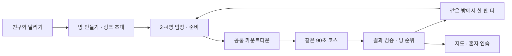

# 친구와 동시에 달리는 미니게임 — 구현 기획

작성: 2026-10-14 · 코드 확인 기준: `378a704e` (PR #365 병합).

**상태: 방향 채택에 따른 구현 기획. 친구 방·동시 출발·순위는 아직 구현하거나 배포하지 않았다.** 이 문서의 인원·시간·보관 기간은 구현자가 검증할 초안이다. 오너의 확정 수치로 인용하지 않는다.

## 요청과 방향

오너 후속 요청:

> 추천안대로 하되, 동시 친구랑 게임접속이 가능할 수 있는 것. 기록을 비교할 수 있거나 랭킹할 수 있게하는 걸로 해.

기존의 읽기 쉬운 장애물, 행동이 달라지는 장애물, 다시 익혀 도전하는 코스, 절제된 2.5D 방향을 유지한다. 친구 기능은 **초대방에서 함께 출발하고, 같은 조건의 결과를 비교하고, 같은 방에서 다시 도전하는 흐름**으로 구체화한다. 역할·포지션과 영구 능력치 격차를 만들지 않는다.

`HAZARD_APPROACH_AND_DEPTH_PLAN.md`의 이전 '실시간 서버/멀티플레이 제외'는 당시 장애물 수정 범위다. 이번 친구 경기 기획에서는 동시 접속과 방 상태 공유가 새 범위다. 기존 계정·훈련 데이터 공개 제한을 해제한다는 뜻은 아니다.

## 레퍼런스를 가져오는 방식

| 확인 자료 | 관찰 | 적용하는 판단 |
|---|---|---|
| [Speed Run 4 Reddit 의견](https://www.reddit.com/r/roblox/comments/11xbmcj/opinions_on_speed_run_4/) | 여러 번 완주하거나 자신의 기록에 도전하는 의견과, 쉽고 오래가지 않는다는 의견이 함께 있다 | 맵을 많이 만들기보다 익힐 패턴과 재도전 이유를 만든다. 친구 비교만 붙이면 재미가 해결된다고 가정하지 않는다 |
| [SpeedRunners 공식 소개](https://www.nintendo.com/us/store/products/speedrunners-switch/) | 최대 4명의 경쟁과 장애물을 넘는 달리기를 설명한다 | 작은 친구 방과 즉각적인 재대결 흐름을 참고한다. 갈고리·공격·상대 충돌까지 복제하지 않는다 |
| [앞서 검토한 SpeedRunners Reddit 토론](https://www.reddit.com/r/patientgamers/comments/10dnqy2/) | 이전 조사에서 가족·친구 플레이와 선택의 재미를 검토했다. 이번 직접 열기는 시간 초과였다 | 재방문 효과가 입증됐다는 주장에는 쓰지 않는다. 위 공식 자료와 실제 플레이테스트로 범위를 확인한다 |

Reddit의 소수 경험담은 대표 표본이나 유지율 자료가 아니다. '같이 한 번 더'가 실제로 일어나는지는 제품에서 별도로 검증한다.

## 첫 버전의 한 판

1. 지도에서 **혼자 달리기 / 친구와 달리기**를 고른다. 친구 기능을 혼자 플레이의 필수 절차로 넣지 않는다.
2. 방을 만들면 초대 링크를 복사하거나 기기 공유 메뉴를 연다. 링크를 연 친구는 해당 방으로 바로 간다. 로그인·친구목록 등록을 최초 경험의 필수 단계로 두지 않는 것을 목표로 한다.
3. 대기실에 캐릭터·게임용 별명·준비 여부·접속 상태를 표시한다. 방장은 2명 이상이 준비됐을 때 출발을 누른다. 시작을 예약하면 참가자와 경기 조건을 잠근다.
4. 서버가 정한 시작 시각으로 카운트다운한다. 각자 화면에서 같은 순서의 장애물과 동일한 에너지로 달린다. 중간에 들어온 사람은 다음 판 대기실로 간다.
5. 결과에는 **완주/탈락, 버틴 시간, 점수, 충돌 횟수, 최고 콤보**를 비교한다. 승패 이유를 한 줄로 보여준다.
6. **한 판 더**는 같은 방·초대 링크를 유지하고 새 라운드를 만든다. **같은 코스 재도전**을 기본으로 하고, 방장이 코스를 바꾸면 모두의 준비를 해제한다.

첫 버전의 기본 길이는 현재 게임과 같은 90초다. 다음 단계에서 선택형 3라운드 시리즈를 추가한다. 짧은 체험판으로 축소하거나 무한 파밍을 요구하지 않는다.

## 실제 함께한다는 느낌

- 대기실에서 들어오고 준비하는 상태가 서로 보인다.
- 주행 화면에는 작고 고정된 친구 상태 줄을 둔다. `민트 · 달리는 중`, `파랑 · 완주`, `노랑 · 탈락`처럼 표시한다. 캐릭터 발과 장애물이 지나가는 영역은 덮지 않는다.
- 초기에는 상대의 상세 좌표·충돌을 내 물리에 넣지 않는다. 내 조작은 기기에서 즉시 반응한다. 공통 시작·상태·최종 순위는 공유한다.
- 실시간 점수를 넣을 경우 **진행 중·임시**로 표시한다. 최종 순위는 서버 검증 후 확정하고 도착 순서로 승자를 먼저 선언하지 않는다.
- 친구의 실제 플레이를 보고 있는 것처럼 꾸민 가짜 고스트는 넣지 않는다. 상대 고스트와 관전은 입력 재생과 네트워크 지연 검증 후 추가한다.

## 순위 규칙

현재는 고정 시간 생존 코스라 완주 시간이 거의 같다. 90초 코스를 거리 경주로 바꾸지 않은 채 '더 빨리 완주'를 승리 기준으로 쓰지 않는다.

| 결과 그룹 | 비교 순서 |
|---|---|
| 정상 완주 | 점수 높은 순 → 충돌 적은 순 → 모두 같으면 공동 순위 |
| 정상 탈락 | 버틴 시간 긴 순 → 점수 높은 순 → 충돌 적은 순 → 모두 같으면 공동 순위 |
| 중도 포기·연결 종료·미출발 | 별도 상태. 정상 완주/탈락보다 아래에 표시 |
| 검증 대기·불일치 | 순위 미확정. 정상 기록과 섞지 않고 재전송/오류 안내 |

완주 그룹이 탈락 그룹보다 우선한다. 시간은 서버에서 동일한 고정 틱 단위로 판정한다. 별명·입장 순서·기록 업로드 속도로 동점을 깨지 않는다. 초기 결과 카드는 방 안 이번 라운드 순위와 이전 라운드 대비 변화를 보여준다. 전체 공개 순위, 현금성 보상, 포인트(P), 실훈련 기록은 연결하지 않는다.

예: 모두 완주한 A 6,000점/충돌 2회와 B 5,800점/충돌 0회에서는 A가 앞선다. 둘 다 6,000점이면 충돌이 적은 사람이 앞선다. 미완주 고득점은 완주를 이기지 못한다. 이 우선순위는 출발 전과 결과의 도움말에서 같은 문장으로 표시한다.

## 공정한 출발 조건

- `courseId + courseRevision + rulesVersion + roundId`가 같아야 같은 순위로 비교한다. 매 판 새 캐릭터 능력으로 시작한다. 꾸미기는 외형만 바꾼다.
- 최초 친구 경기는 **공통 강화 프리셋**을 사용한다. 현재 개인 모드의 무제한 강화 선택 대기·구간 재시도·중간 저장 복구는 경쟁 결과에 넣지 않는다. 판 안에서 함께 강화되는 연출은 유지한다.
- 개인 모드의 선택하는 재미는 유지한다. 친구 경기의 자유 강화는 이후 **모두에게 같은 선택 시간과 후보**를 주는 방식으로 추가할 수 있다.
- 데이터가 새로 배포돼도 진행 중 방은 같은 규칙 버전으로 끝낸다. 구버전 클라이언트가 해당 규칙을 지원하지 않으면 새로고침을 안내하고 준비를 허용하지 않는다.
- 현재 고정 코스를 우선 재사용한다. 공통 시드 생성기를 처음부터 추가하지 않는다. 추후 코스 변주에는 검증된 패턴만 사용한다.
- 제출된 점수 숫자를 믿지 않는다. 시작 티켓과 입력 기록을 검증하고 같은 엔진으로 재생해 결과를 계산하는 방식을 우선한다. 재생의 결정성·처리 시간 확인 전에는 공정한 랭킹 구현 완료로 표시하지 않는다. 이것만으로 봇/치팅 전부를 막았다고 주장하지 않는다.

## 이탈과 연결 문제

| 상황 | 동작 |
|---|---|
| 출발 전 방장이 나감 | 준비 중인 참가자에게 방장 이전. 사람이 없으면 방 종료 |
| 친구가 준비 없이 대기 | 방장은 미준비 참가자를 다음 판 대기로 보내고 준비된 2명 이상으로 시작 가능. 강제로 준비 처리하지 않음 |
| 출발 예약 후 네트워크 지연 | 서버 시각 차이와 시작 수신 여부 확인. 늦게 수신한 플레이어를 0초로 뒤늦게 시작시켜 같은 순위에 넣지 않음 |
| 플레이 중 메뉴·나가기 | `이번 경기 포기하고 나가기` 확인. 혼자 모드의 `저장하고 나가기`와 구분 |
| 화면 숨김·연결 끊김 | 공통 경기 시간은 계속 흐름. 초기 복귀 유예 5초를 검수 대상으로 두고, 그 이상은 연결 종료 처리. 단순 버튼 포커스 이동만으로 종료하지 않음 |
| 결과 전송 실패 | 입력 기록을 기기에 보관하고 동일 라운드로 재전송. 성공하기 전에는 '기록 전송 중/다시 보내기'. 중복 제출은 한 결과로 취급 |
| 새로고침 | 라운드 상태와 본인 참가권을 복구. 이미 끝난 판을 새 출발로 바꾸지 않음. 경기 복구가 불가능하면 명확한 종료 상태로 전환 |
| 다른 참가자가 끝나지 않음 | 서버의 라운드 마감으로 대기 종료. 무한 결과 대기 금지 |
| 재대결 중 옛 결과 도착 | roundId가 다르면 새 라운드에 반영하지 않음 |

유예·마감 숫자는 모바일 통화/브라우저 전환 및 느린 기기에서 검증 후 정한다. 방 동기화가 개인 모드의 일시정지·저장 기능을 퇴행시키지 않게 분리한다.

## 서버와 데이터 범위

2026-10-14 읽기 전용 확인에서 연결된 Supabase 프로젝트가 존재하고, 코드에는 계정별 개인 게임 진행 저장 경로가 있다. **현재 공개 계정 기능은 별도 관문으로 보류 중**이다. 개인 진행 저장 경로가 친구 방·초대·랭킹을 이미 지원한다는 증거는 없다. 이번 조사에서 DB나 Edge를 변경하지 않았다.

구현안은 게임 전용 방·참가권·라운드·결과를 분리한다. 초대 링크는 방 참여 권한이고, 본인 준비/결과 제출 권한은 별도의 참가 토큰으로 확인한다. 호스트 작업은 호스트 권한을 확인한다. 방 목록이나 모든 사용자의 기록을 공개 조회하게 만들지 않는다. 초대 토큰은 추측이 어려워야 하며 원문을 분석 이벤트·오류 로그에 넣지 않는다.

최초 서버 보관 초안은 **방과 최근 경기 결과 24시간**이다. 방 안에서만 비교하고, 실명·이메일·훈련·건강 정보는 수집하지 않는다. 만료 시 접근 차단과 실제 삭제 작업을 함께 구현한다. 입장 화면에 공유 대상·보관 기간을 알린다. 장기 친구 기록·기기 간 별명 유지·전체 랭킹은 별도 저장/공개 설계 후 확장한다.

네트워크는 프레임마다 물리를 보내는 대신 준비·시작·상태·결과를 공유한다. 진행 상태는 1~2Hz를 시범으로 측정하고, 접속 끊김·배터리·모바일 데이터 사용량을 확인한다. Supabase의 [Realtime 권한 문서](https://supabase.com/docs/guides/realtime/authorization)와 [Edge 인증 문서](https://supabase.com/docs/guides/functions/auth)를 따라 방별 접근을 구현한다. 기존 계정 공개 관문을 우회하려고 익명 테이블 읽기나 계정 게이트 해제를 사용하지 않는다.

비용은 '서버가 거의 필요 없다'로 확정하지 않는다. 예를 들어 4명이 90초 동안 2Hz로 보내면 진행 상태 발행 720건, 다른 3명에게만 전달할 때 수신 2,160건이다. 실제 과금 단위·메시지 크기·접속 유지·재연결·기록 검증 비용은 별도로 측정해야 한다. 처음에는 2명 실제 기기, 다음에는 4명으로 검증한다.

## 장애물·맵·2.5D와 합치는 범위

1. 이미 반영된 화면 밖부터 이어지는 장애물 접근을 보존한다.
2. 기본 허들과 구분되는 **대시로 부수는 가벼운 장벽**을 시범으로 넣는다. 행동 차이가 읽혀야 하며 대시 충전·에너지 때문에 피할 수 없는 패턴은 채택하지 않는다. 점프로 우회할 수 있는지 여부를 판정과 그림에 일치시킨다.
3. **낮은 도약 발판 → 다음 장애물**을 시범으로 검토한다. 자동 도약/직접 점프를 동시에 넣지 말고 하나의 명확한 규칙을 검증한다. 첫 친구 경기의 필수 신규 콘텐츠로 모두 묶지 않는다.
4. 물웅덩이와 복합 패턴은 이후 추가한다. 기존 소품을 재사용하고 맵의 실루엣·노면·배치로 구분한다. 장식 장애물과 실제 충돌물은 분명하게 다르게 보이게 한다.
5. 2.5D는 전방 지연 추적을 유지하면서 원근을 미세하게 변하게 한다. 정밀 점프 직전에는 흔들림을 억제하고 대시·안전 구간에서 속도감을 준다. HUD와 친구 상태는 고정하고 모션 감소 설정을 존중한다.

새 카메라는 주행면·캐릭터 발·장애물 바닥을 함께 투영해야 한다. 좁은 화면에서 빈 여백이 생기거나 장애물이 덮이면 불합격이다. 기존 기획의 ±3%/±1% 수치는 테스트 시작값이며 합격 기준이 아니다.

## 구현과 검수 순서

| 단계 | 끝난 것으로 볼 증거 |
|---|---|
| 1. 단일 경기 조건·입력 재생 | 같은 입력으로 30/60/120Hz 표시에서 동일 판정. 변조·버전 불일치 거절. 현재 90초 코스 완주 가능 |
| 2. 2인 초대방 | 별도 브라우저 세션/실제 다른 기기에서 링크 입장, 준비 확인, 공통 출발, 결과 비교. localStorage 공유나 모의 응답만으로 완료 판정 금지 |
| 3. 4인·재대결·이탈 | 방 인원 제한, 호스트 이전, 늦은 입장, 재전송, 옛 라운드 결과, 연결 종료, 동일 링크 재대결 확인 |
| 4. 가독성과 움직임 | 최대 대시·전방 위치·작은 휴대폰에서 접근부터 판정까지 연속. 친구 UI가 발/장애물을 가리지 않음. 모션 감소·가로 화면 확인 |
| 5. 공개 반영 | DB/Edge 권한·보관 안내·배포 버전 확인. 공개 주소에서 2개 독립 세션이 같은 방과 확정 순위를 보는 증거 |

첫 테스트의 핵심은 방을 만드는 데 성공했는지, 친구가 들어올 수 있는지, 한 판 뒤 자발적으로 같은 방에서 다시 시작하는지다. 지표는 초대→입장 완료, 준비→출발 완료, 결과→재대결, 연결 종료율을 따로 본다. 분석 수집은 별도 고지·최소 수집 검토 후 넣으며, 현재 구현에 추적 SDK가 있다고 가정하지 않는다.

## 이번 산출물과 미완료

- 완료: 기존 코드·계정 공개 경계·연결된 서버 존재 확인, 친구 경기의 흐름·순위·경기 조건·이탈·검수 계약 문서화.
- 미구현: 친구 방, 동시 출발, 기록 검증/순위, 신규 장애물, 새 2.5D 투영, 배포.
- 첫 구현 우선순위: **2명이 같은 방에서 실제 한 판을 끝내고 다시 시작할 수 있는 것.** 4인 확대·장애물/카메라 개선은 같은 흐름을 깨지 않게 차례로 검증한다.
