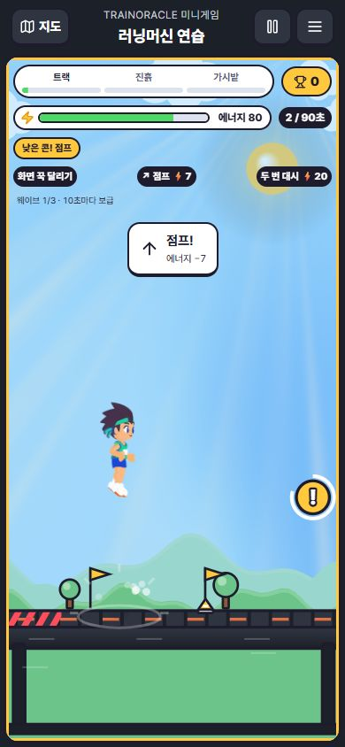
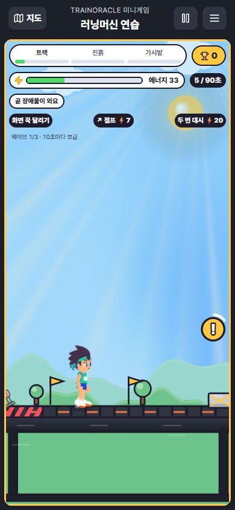

# 장애물 밀도·종류와 점프 여유 — 2026-10-15

기존 PR #366 후속. 기준 bb909e45, 담당 Codex. 혼자 연습/투어의 허구 게임 수치만 변경하며 친구 경기 서버·훈련 데이터와 무관하다.

## 결과
- 연습/서울 90초 배치: 36 → 51개. 구간별 9/12/15 → 15/18/18개. 후반 도시는 최대 63개.
- 허들·가시에 낮은 콘과 넓은 상자를 추가했다. 콘은 좁고 낮으며, 상자는 넓어서 조금 일찍 점프한다. 네 모양은 같은 충돌 치수로 그려진다. 콘/상자 충돌은 기존 허들처럼 밀림·에너지 손실이며 가시의 즉시 실패 규칙은 유지한다.
- 첫 구간은 1.3초 연속 박자와 2.4초 여유를 섞고, 뒤 구간은 더 촘촘하게 혼합한다. 다음 웨이브는 순서를 뒤집으며, 도시별 추가 배치도 최소 1.1초 이상 간격을 유지한다. 예고와 화면 밖 접근 표시는 유지한다.
- 점프 에너지 8 → 7. 초기 속도 470 → 560, 중력 1150 유지(이론 체공 약 0.82 → 0.97초). 허들 높이 26 → 20, 가시 16 → 12. 콘 높이 12/폭 0.032, 상자 높이 18/폭 0.072. 폭은 트랙 비율, 높이는 논리 픽셀이다.
- 안내는 ‘낮은 콘! 점프’, ‘넓은 상자! 일찍 점프’ 등으로 구분한다. 강화 미리보기는 새 기본 비용을 그대로 반영한다.

## 저장 호환
규칙 버전 4. 버전 3 저장의 스폰 인덱스는 새 코스와 맞지 않으므로 해당 구간 체크포인트에서 재개한다. 완료한 구간 점수와 강화는 유지하고 화면에 재출발 안내를 표시한다. 체크포인트가 없는 예외 저장은 해당 구간의 새 출발 상태로 복구한다. 강화 선택 대기 상태는 그대로 유지한다. 읽기는 원본 저장을 변경하지 않으며, 기존 충돌 방지 저장/소비 절차를 유지한다.

## 검증
- 관련 7파일 51개 통과. 8개 도시 × 3개 동일 강화 경로 완주, 무입력/단순 반복 실패, 장애물 간격, 네 종류의 지상 충돌과 3개 점프 타이밍, 새 종류 저장/복원과 구버전 이행을 포함한다.
- 초기 조정에서 런던 접지 2회 조합이 마지막 가시 직전 에너지 부족으로 실패했다. 점프 비용을 7로 조정한 뒤 기존 완주 검사를 유지한 채 통과했다.
- 점프 속도를 이전 470으로 임시 복원하자 새 허용 구간 검사가 실패했다. 560으로 원복 후 전체 관련 51개 통과.
- 실제 앱 390×844에서 점프 비용 7, 콘 등장·이름 안내, 넓은 상자 출현을 확인했다. 전 도시의 실제 수동 완주나 실제 휴대폰 터치 검증을 뜻하지 않는다.
- Node 24.19.0 타입 검사와 Vite 배포 빌드 통과. 기존 폰트 경로·혼합 import·대형 chunk 경고는 남아 있다. 공개 Pages 배포 완료 기록이 아니다.

