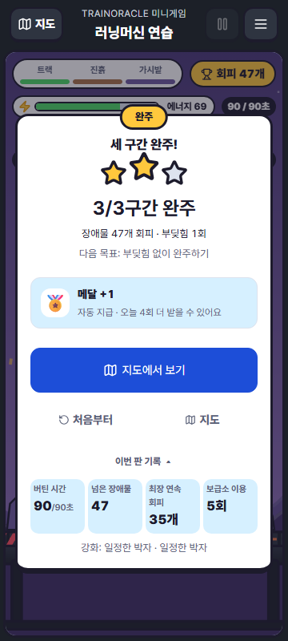

# 미니게임 성취와 보급소 — 2026-10-15

구현 담당: Codex. 통합 기준: `2b42210eec82f5d1ddc6e1acfb5e7db7c04f998e`.
범위: 솔로 연습·도시 투어. 친구 밀어내기, 실제 훈련, 계정 보상 계약은 변경하지 않는다.

## 해결한 문제

장애물 하나에 100~350점, 구간마다 300점이 붙어 숫자에 비해 성취를 설명하기 어려웠다.
10초마다 자동으로 에너지 75를 받던 보급도 행동이나 이유가 드러나지 않았다.

## 성취

- 점수 증가·배수·최고 점수 표시는 제거한다. HUD는 실제 회피한 장애물 수를 표시한다.
- 연속 회피는 실제 개수로 표시하며 5개 단위로만 짧게 축하한다.
- 결과 첫 줄은 완주한 구간 수, 다음 줄은 장애물 회피 수·부딪힘 횟수다.
- 별 기준을 시작 화면에도 명시한다: 완주 1개, 부딪힘 1회 이하 2개, 무충돌 3개.
  구간 재시작 사용 시 기존처럼 최대 1개다.
- 결과에 다음 목표를 표시한다. 실패 시 다음 구간 완주, 완주 시 충돌을 줄이는 목표다.
- 기존 도시 완주·별에 따른 도시/캐릭터 해금을 유지한다. 최고 별 갱신을 알려준다.
- 보호 시간에 장애물을 몸으로 통과하면 피해는 막지만 회피 성공으로 세지 않는다.

## 보급소의 근거와 규칙

보급은 다음 장애물 묶음의 에너지 예산을 준비하는 짧은 선택이다.
코스의 세 웨이브 사이인 구간 시간 10초·20초에 각각 3초간 열린다.
초록 안전 구역(x ≥ 0.1, 낙하 경계 0.06)에서 착지한 채 0.3초간 손을 놓으면 한 번 받는다.
달리기·점프·대시·피격·일시정지는 준비 동작을 끊는다. 쉬는 동안 바닥은 계속 밀린다.

보급 상한 73은 **기본 달리기 5초(5 × 9) + 기본 점프 4회(4 × 7)**다.
이는 게임 내 비용에 근거한 예산이며 실제 러닝 영양/수분 기준을 뜻하지 않는다.
에너지는 100을 넘지 않고 실제 받은 양만 영수증과 이펙트에 표시한다.
에너지가 충분하면 그대로 진행하라고 안내한다. 무조건 받거나 축적하는 보상이 아니다.
강화별 비용 차이는 유지한다. 구간 완주 후 기존 최대 +30은 안전 발판의 회복으로 설명한다.

처음 검토한 28(기본 점프 4회)·앞쪽 위치 제한·0.6초 대기는 후반 도시와 특정 강화에서
완주 가능성을 지나치게 줄였다. 최종 조건에서는 연습과 8개 도시 각각의 접지/스프링/박자
동일 강화 2회 선택 경로(27개)가 보급소를 이용하는 입력 전략으로 완주한다.
이는 시뮬레이션의 가능성 증명이며 모든 사람에게 쉬운 난이도라는 사용자 시험 결과는 아니다.

## 저장 호환

게임 규칙은 v5. 과거 `score`·`bestScore` 필드는 삭제하거나 새 값으로 환산하지 않는다.
새 플레이는 점수를 증가시키지 않고, 기존 계정 점수 최대값은 그대로 보존한다.
기기 중간 저장에 보급소 수령 여부를 포함해 다시 이어도 같은 보급을 중복 수령하지 않는다.
v3/v4 중간 저장은 안내와 함께 현재 구간 출발점으로 이동하며 강화와 체크포인트 기록을 유지한다.
기존 별·도시·캐릭터·메달 기록과 저장 키는 유지한다. 계정 스키마 변경은 없다.

## 검증

- 관련 단위/계약 검사 16파일 116건: 115건 첫 통과. 기존 보상 경계 파일 탐색 검사 1건이
  디스크 읽기 시간 초과(6.3초)여서 해당 14건을 시간 제한 변경 없이 재실행했고 모두 통과.
- 타입 검사 통과. 배포용 Vite 번들 생성 통과(기존 큰 청크 경고 유지).
- 모바일 360×800 실제 입력 재생 2건 통과: 목표 안내·무입력 낙하·재시작·회복·정지,
  세 구간 완주·강화 선택·성취 화면·보급 이용·새 판 초기화.
- 완주 화면 실측: 3/3구간, 회피 47개, 충돌 1회, 별 2개, 보급소 5회,
  다음 목표 ‘부딪힘 없이 완주하기’. 화면 잘림 없이 확인.
- 결함 주입: 보급 비활성화, 점수 +100 복구, 보급 저장 누락, 잘못된 +75 영수증을 넣었을 때
  해당 이름의 검사들이 실패함을 확인. 원본 바이트 복원 후 관련 40건 재통과.
- 물리 iPhone, 실계정 동기화, 전체 앱 CI, 공개 배포 확인은 이 변경의 로컬 검증에 포함하지 않는다.

검수 로그/스크린샷은 작업실 `.scratch/achievement-*`와
`app/test-results/treadmill/treadmill-game-clears-thre-d5d49-e-offs-and-resets-the-build-phone/clear.png`에 있다.
공개 서버·Tripo·추가 에셋·결제는 사용하지 않았다.

