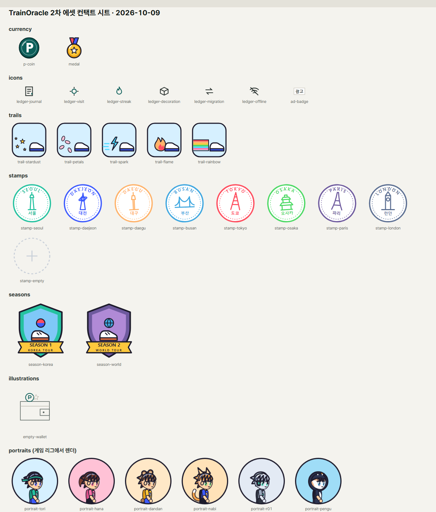

# 2차 디자인 에셋

작성·제작: 디자인·UX·문구 담당. 모든 에셋은 TrainOracle이 직접 만들었다(`TRAINORACLE_IN_HOUSE`). 외부 그림·AI 생성·폰트 외 서드파티 자산은 쓰지 않았다.



## 만드는 법 (재현 가능)

```sh
# 1) SVG 생성(토큰 색을 colors_and_type.css에서 읽음) — 결정적, 같은 입력이면 같은 파일
node app/scripts/phase2-assets/build-assets.mjs
node app/scripts/phase2-assets/build-assets.mjs --check   # 저장소 파일이 최신인지

# 2) PNG(1x·2x)·캐릭터 초상·컨택트 시트 렌더 (app/에서)
npx playwright test --config scripts/phase2-assets/playwright.assets.config.ts
```

- 색은 토큰에서만 가져온다. 토큰을 바꾸고 1)·2)를 다시 실행하면 에셋도 같이 바뀐다.
- **캐릭터 초상은 게임 리그(`anime-runner.ts`)에서 렌더한다.** 게임 속 캐릭터와 초상이 어긋날 수 없다.
- SVG가 원본이고, PNG는 SVG를 쓸 수 없는 곳(공유 이미지, 알림, 네이티브)에 쓰는 내보낸 파일이다.

## 목록

경로는 `app/public/phase2/` 기준이다. 모든 SVG에는 같은 이름의 `.png`와 `@2x.png`가 있다.

| 에셋 | 파일 | 규격 | 구역 | 쓰는 곳(UI_SPEC) | 대체 텍스트 |
|---|---|---|---|---|---|
| P 코인 | `currency/p-coin.svg` | 64, 표시 16·20·28·48 | 앱 크롬(브랜드 청록) | `PointAmount`, S1, S2 | "포인트" 또는 장식(aria-hidden, 옆에 "P" 글자가 있을 때) |
| 게임 메달 | `currency/medal.svg` | 64, 표시 20·28 | 게임 | `MedalCount`, G1, G2, 지도 | "메달" |
| 내역 아이콘 6종 | `icons/ledger-{journal,visit,streak,decoration,migration,offline}.svg` | 24, 1.6px 선 | 앱 크롬 | `LedgerRow`, S4, `StatusStrip` | 장식(행에 글자 사유가 있음) |
| 광고 배지 | `icons/ad-badge.svg` | 32×18 영역 | 앱 크롬 | `AdButton`, 전면 광고 앞 안내 | "광고" — **광고 진입점에는 반드시 붙인다** |
| 달리기 효과 5종 | `trails/trail-{stardust,petals,spark,flame,rainbow}.svg` | 96 | 게임 | G2 상점 목록 썸네일 | 효과 이름 |
| 도시 스탬프 8종 | `stamps/stamp-{seoul,daejeon,daegu,busan,tokyo,osaka,paris,london}.svg` | 128, 표시 72·112 | 게임 | G3 스탬프북, 도시 완주 연출 | "{도시} 스탬프" |
| 빈 스탬프 칸 | `stamps/stamp-empty.svg` | 128 | 게임 | G3 | "아직 받지 않은 스탬프" |
| 시즌 엠블럼 2종 | `seasons/season-{korea,world}.svg` | 192, 표시 40·96 | 게임 | G3 섹션 머리, G4 | "시즌 1 코리아 투어 엠블럼" 등 |
| 빈 지갑 | `illustrations/empty-wallet.svg` | 160 | 앱 크롬 | S2·S3 빈 상태 | 장식 |
| 캐릭터 초상 6종 | `portraits/portrait-{tori,hana,dandan,nabi,r01,pengu}@2x.png` | 320(표시 160) | 게임 | G5, 캐릭터 선택 큰 카드 | 캐릭터 이름 |

## 디자인 기준

- **P 코인과 메달은 일부러 다르게 생겼다.** P는 앱 크롬의 납작한 원형 동전(브랜드 청록)이고, 메달은 게임 팔레트의 리본 달린 메달이다. 둘을 같은 줄에 두지 않는 UX 규칙(UX_FLOWS §0-3)을 그림에서도 지킨다. 메달에는 숫자나 "원"을 새기지 않는다.
- 앱 크롬 아이콘은 1.6px 선과 직각 끝(`stroke-linecap` 기본)으로, 기존 lucide 아이콘과 같은 밀도다. 그림자와 그라데이션은 없다.
- 게임 에셋은 §6A를 따른다: 두꺼운 진한 외곽선(`--game-outline`), 단색 면, 둥근 형태.
- 스탬프는 고무도장처럼 외곽 원 + 점선 + 도시 영문 호 글자 + 랜드마크 선화 + 한글 이름으로 구성한다. 기울기는 도시 id 해시로 정해서(−5°~+5°) 늘 같고, 무작위는 쓰지 않는다. 랜드마크는 게임 속 실루엣과 같은 단순 형태이고, 로고나 사진을 옮기지 않았다.
- 글자가 들어간 에셋(스탬프, 엠블럼, 광고 배지)은 Pretendard로 그린다. PNG는 Pretendard가 로드된 상태에서 렌더했다.

## 개발 담당이 붙일 때

- 앱 안에서는 SVG를 ``로 쓴다(상대 경로, `base: "./"`). 서비스 워커는 `/collections/`와 달리 `/phase2/`를 캐시해도 된다(전부 합쳐 작다).
- 새 에셋이 필요하면 직접 그리지 말고 이 담당에게 요청한다(WORK_SPLIT D 티켓). 생성기에 함수를 추가하는 방식이다.
- 오픈소스 고지: 자체 제작이라 별도 고지가 필요 없다. 폰트(Pretendard OFL)는 기존 고지에 있다.
