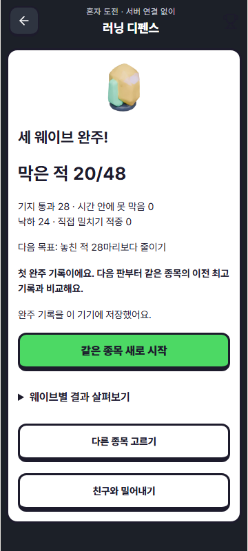

# Easypanel 소스 조사와 혼자 게임 재미 구조 검증

검토일: 2026-10-15. 기준 게임: `eaba0ac79142524eef0f4cf8bd5a713436cfe7be`, PR #368.
요청: 기능 흉내 수준인지 검증하고, https://easypanel.io/templates 의 오픈소스에서 근거를 찾아 차용한다.

## 결론

**기능 완주는 가능하지만 핵심 재미 구조는 합격 처리할 수 없다.** 직접 조작하지 않아도 완전 방어하는 시설 조합, 용도가 끝난 예산 보급, 긴 후반 공백을 재현했다. 자동 검사 통과를 재미·재방문 검증으로 해석하지 않는다.

Easypanel은 배포 템플릿 모음이다. 설치 템플릿의 공개 여부와 그 앱/게임/에셋의 재사용 권리는 다르다. 현재 공개 카탈로그에서 이 러닝 액션·디펜스에 바로 이식할 엔진을 찾지는 못했다. 다음 범위만 근거를 확인했다.

## 조사 범위와 후보

- 사이트 첫 화면: 845개 표시. 공식 저장소 `templates/list.json`은 아래 커밋에서 844항목. 수집 시점/노출 차이를 임의로 맞추지 않았다.
- 카탈로그 기준: [easypanel-io/templates @ a8ee6959](https://github.com/easypanel-io/templates/blob/a8ee6959e61e0b28defc283b9e2473f235f2a149/templates/list.json).
- 전체 메타데이터에서 Game/Gaming 태그 및 관련 이름을 검색하고, 아래 후보의 실제 저장소·라이선스·주요 파일을 확인했다. 844개 앱 전체를 실행해본 것은 아니다.
- Nakama는 과거 요청 이슈에 있지만 이 카탈로그에 없고 `/templates/nakama`는 404였다. 설치 가능 템플릿으로 추천하지 않는다.

| 후보 | 확인한 원본 | 현재 판단 |
|---|---|---|
| [Word Mastermind](https://easypanel.io/templates/word-mastermind) | [MIT / d3580e1](https://github.com/clupasq/word-mastermind/blob/d3580e1c906d0b1fd8b5f46efab2b6d77adf6e1f/LICENSE), `src/game.js`의 시도별 결과, `assets/client-app.js`의 `board`/`submitWord`/재시작 | **피드백 구조를 차용.** 시도마다 실제 결과가 남고 다음 선택에 쓰인다. Vue 단어게임 코드를 러닝 엔진에 복사하지 않는다. |
| [Umami](https://easypanel.io/templates/umami) | [MIT / ec0ff503](https://github.com/umami-software/umami/blob/ec0ff50388c264ed8ce46f00967e92f7e71476ae/LICENSE), 공식 [이벤트](https://docs.umami.is/docs/tracker-functions)·[퍼널](https://docs.umami.is/docs/funnel)·[재방문](https://docs.umami.is/docs/retention) 문서 | **후속 실제 사용 검증 후보.** 시작→완주→재도전과 이탈을 측정할 수 있다. 서버·DB가 필요하며 이번 변경에 설치/추적 코드를 넣지 않았다. |
| [Formbricks](https://easypanel.io/templates/formbricks) | [원본 LICENSE](https://github.com/formbricks/formbricks/blob/main/LICENSE): 본체 AGPLv3, 지정 SDK MIT, ee 별도 | **플레이 직후 선택형 질문 후보.** 본체를 앱에 복사하지 않는다. 템플릿은 앱·DB·캐시 3서비스여서 지금 단계의 짧은 플레이 검수만을 위해 추가하지 않는다. |
| [Aptabase](https://easypanel.io/templates/aptabase) | [AGPL-3.0 서버](https://github.com/aptabase/aptabase), 프로젝트 메타데이터 | 분석 후보지만 웹앱 이벤트·퍼널 목적에서는 우선 Umami를 검토한다. 설치하지 않았다. |
| [PufferPanel](https://easypanel.io/templates/pufferpanel) | [Apache-2.0](https://github.com/pufferpanel/pufferpanel), 게임 서버 관리 목적 | 현재 게임의 조작·웨이브·대전 규칙을 제공하는 엔진이 아니므로 채택하지 않는다. |
| Blender / Minecraft / CS2 / Dolphin / FoundryVTT 등 | 카탈로그의 제작도구·전용 서버·에뮬레이터 분류 | Blender 제작 경로는 이미 존재한다. 나머지는 현재 경량 웹 미니게임의 직접 재사용 후보가 아니다. 공개 배포 템플릿만 보고 원작 게임/ROM/모델을 오픈소스로 취급하지 않는다. |

**차용과 코드 재사용의 구분:** 이번에는 Word Mastermind의 피드백 패턴을 독립 구현했다. 외부 소스/아트 번들, SDK 설치, Easypanel 설치, 새 인프라 생성은 없다. 원본 코드 이식이나 Umami 연동 완료로 표시하지 않는다. 이 게임의 README는 무제한 플레이를 명시하며 일일 한 판·매일 동일 문제·친구 도전 공유가 구현되어 있다고 주장하지 않는다.

## 실제 비교 실험

실행: `cd app` 후 프로젝트 Node로 `node scripts/audit-solo-party.mjs`.
전체 결과: [solo-balance-audit.json](solo-balance-audit.json). 소스 3파일 SHA-256을 함께 기록했다.

- 합법적인 고정 시설 계획 5개 × 입력 전략 6개 = 디펜스 시리즈 30개.
- 밀어내기 입력 전략 6개 × 2라운드.
- 60Hz 고정 시간, 기존 적 스폰/규칙 그대로. 난수를 바꾸거나 엔진 내부 수치를 덮어쓰지 않는다.
- 입력: 방치, 계속 달리기, 위치·에너지 관리, 0.2초마다 점프 요청, 0.2초마다 대시 요청, 주변 적/장애물에 반응하는 단순 정책.
- 이 정책들은 반례 탐색용이다. 최적 플레이어/초보자/숙련자를 대표하지 않으며 참가자 수·승률·리텐션으로 보고하지 않는다.

| 시설 계획 | 입력 | 방어 / 48 | 낙하 | 해석 |
|---|---|---:|---:|---|
| 발사기 2개 → 각각 강화 | 방치 | 48 | 24 | 캐릭터가 계속 떨어져도 방어 성과는 최대치 |
| 발사기 2개 → 각각 강화 | 계속 누르기 | 48 | 0 | 점프·밀치기 판단 없이 최대 방어/무낙하 |
| 발사기 + 바람 → 발사기 강화 → 깃발 | 방치 | 36 | 24 | 기존 회귀 검사가 사용한 제한된 조합 |
| 같은 조합 | 반복 대시 | 48 | 0 | 적에 맞춰 판단하는 정책과 결과가 같음 |
| 같은 조합 | 반응 조작 | 48 | 0 | 직접 조작의 효과는 있으나 타이밍 선택의 우위는 입증하지 못함 |
| 발사기 + 깃발 → 각각 강화 | 반응 조작 | 44 | 0 | 현재 비교에서는 깃발 투자가 강한 선택임을 입증하지 못함 |

### 출시 전에 해결할 문제

1. **시설 편중/무판단 완전 방어 — P1.** 발사기만 사는 합법 조합이 한 번 누르기만으로 최고 결과를 낸다. 기존 `rewards active defense...` 테스트는 한 조합의 능동/수동 차이만 확인했으므로 이 반례를 잡지 못했다. 테스트가 틀렸다는 뜻이 아니라 보장 범위가 좁았다.
2. **마지막 보급의 용도 없음 — P2.** 3웨이브에서도 예산 캡슐 2개가 나오지만 이후 시설 구매가 없다. 이 정책들의 최종 미사용 예산은 0~7개였다. 마지막 보급을 없애거나 해당 판에서 실제 사용할 방법이 필요하며, 이름만 보상으로 바꾸지 않는다.
3. **후반 적 공백 — P2.** 발사기 2개/방치에서도 각 웨이브 끝 약 9.8/11.5/10.1초간 적이 없다. 세 웨이브 중 적이 없는 시간은 약 53.2/180초. 공백이 전부 나쁜 것은 아니지만 준비 화면까지 따로 있어 후반 종료 조건/다음 웨이브 선택을 재검토해야 한다.
4. **밀어내기 진입 난도 — 추가 확인.** 6개 단순 입력 정책 모두 시리즈 승점 0/4. 반응 정책은 총 KO 2회, 낙하 7회였다. 이것만으로 인간에게 불가능하거나 봇이 항상 우월하다고 단정하지 않는다. 공격 예고·맞은 원인·초보자의 첫 유효 밀치기를 실제 손 조작으로 검수해야 한다.
5. **커브 라운드의 변주 한계 — 확인.** 렌더링 곡률과 시작 위치는 바뀌지만 같은 엔진·적 간격·이동축을 쓴다. 다른 종목 수준의 기계적 변주로 소개하면 안 된다.

## 이번에 적용한 부분

- 디펜스 준비/결과에서 **웨이브별** 방어, 기지 통과, 시간 내 미처리, 낙하, 밀치기 적중, 수집 수를 함께 표시한다. 당시 시설 배치도 열어 볼 수 있다.
- 밀치기 적중을 처치로 합치지 않는다. 누적 합계를 그 웨이브 성과로 착각하지 않게 시작/종료 차이를 사용한다.
- 이어하기 이전의 상세 기록은 저장돼 있지 않으므로 합계만 존재한다고 표시한다. 과거 웨이브를 0회 또는 새로 관측한 결과로 만들지 않는다.
- 완주 결과에서 자기 자신을 제외한 같은 종목·규칙의 이전 최고 기록과 비교한다. 첫 완주는 가짜 비교값을 만들지 않는다.
- 종목 선택에서 기기에 저장된 최근 5판을 펼쳐 볼 수 있다. 기존 20판 보관·저장 실패·계정 분리 계약은 유지한다.
- 비교 실험 스크립트를 남겨 이후 밸런스 변경 시 똑같은 입력으로 재검증한다.

원본 레퍼런스는 다음 선택을 돕는 피드백 구조의 근거다. 새 수치의 재미·시설 간 균형을 보장하는 근거가 아니므로 이번에 임의의 HP/비용/속도로 덮지 않았다. **게임 엔진과 기존 결과 저장 형식은 변경하지 않았다.**

## 다음 검증·적용 기준

핵심 규칙의 다음 수정은 위 반례를 대상으로 진행한다. 최소한 방치/한 번 누르기가 완전 방어와 무낙하를 동시에 달성하지 않아야 하며, 여러 시설 조합의 능동 조작 효과를 비교해야 한다. 특정 조합을 일부러 불리하게 설정한 테스트 하나로 합격 처리하지 않는다. 보급에는 그 판 안의 사용처가 있어야 한다.

실제 반복 방문은 이번 시뮬레이션으로 측정할 수 없다. Umami를 도입한다면 최소 이벤트는 종목 시작, 라운드/웨이브 완료, 시리즈 완료, 자발적 같은 종목 재시작, 다른 종목 이동, 중도 이탈이다. 같은 세션 내 재도전과 다음 날 재방문은 다른 지표다. 계정ID/일지/건강/위치/자유 입력을 이벤트에 넣지 않는다. 실제 수집 대상·동의/보관·운영 호스트를 정한 다음 연결한다.

Formbricks 방식의 플레이 직후 질문은 선택 사항으로 두고, 예를 들어 `한 판 더 할래요 / 조작이 어려워요 / 선택이 별 차이 없어요 / 여기까지 할래요`를 구분할 수 있다. 응답 보상을 붙이거나 계속하기를 질문 응답에 묶지 않는다. 실제 사용자 응답은 아직 없다.

## 검증 상태

- 고정 입력 비교: 디펜스 30시리즈, 밀어내기 6시리즈 완료. 위 반례 때문에 재미 검증은 **미달**이다.
- 집중 단위 검사: 새 기록 비교 2개 + 기존 혼자 게임 8개, 총 10개 통과.
- 결함 주입: 웨이브 차이를 누적 합계로 바꾸기, 현재 판을 이전 기록에 포함하기를 각각 해당 테스트가 실패로 탐지했다. 원본 바이트와 SHA-256을 복원한 뒤 새 검사 2개가 다시 통과했다.
- 최종 모바일 Chromium 360×800: 연속 터치, 일시정지, 웨이브별 결과, 준비 단계 저장/새로고침/복귀, 이전 상세 기록 부재 안내, 3웨이브 완주, 첫 기록 비교, 최근 기록 표시 통과. 재도전 버튼이 상세 설명에 밀리지 않는 최종 화면을 확인했다.
- 실제 로컬 브라우저에서도 발사기 2개를 놓고 조작하지 않은 첫 웨이브의 `12/12 방어 · 낙하 8회`를 확인했다. 전체 시리즈 반례는 위 시뮬레이션 결과다.
- 앱/e2e 타입 검사와 Vite 프로덕션 빌드 통과. 기존 폰트 경로·정적/동적 import·큰 청크 경고는 남아 있다.
- 최신 `origin/main`은 `0b3c12f6`으로 확인했으며 이전 기준 `2b42210e` 이후 미니게임 도메인/화면/경기 서버 경로 변경은 없었다.
- 기존 초안 [PR #368](https://github.com/hojune0330/TRAINORACLE/pull/368)에 조사·독립 구현·실험 자료를 함께 반영한다. 새 운영 배포, 실사용자 재방문 측정, 실제 iPhone 조작 검수는 하지 않았다.
- 이전 head `eaba0ac7`의 [원격 CI](https://github.com/hojune0330/TRAINORACLE/actions/runs/38697258238)는 전체 검사 실패 상태였다. UTC 실패는 홈/더보기 2개와 `solo-party.css`가 게임 스타일 검사 목록에 빠진 1개였다. 이번에 실제 게임 파일을 명시 목록에 추가해 토큰 사용과 임의 색상 금지 검사를 함께 받도록 했다. 홈/더보기 변경이나 전체 CI 통과를 주장하지 않는다.
- 보완한 게임 스타일 검사 1개도 통과했다. 임의 색상 삽입 시 해당 검사가 이름으로 실패했고 원본 SHA-256 복원 후 다시 통과했다. 이전 10개와 합쳐 이번 변경의 집중 검사 범위는 11개다.

이 문서는 기능 검사 기록이며 재미 검증 완료나 배포 영수증이 아니다.

## 2026-10-15 후속 구현

이 문서 위의 결과는 v1 규칙의 기준선으로 보존한다. 오너의 우선순위 확정·개발 요청에 따라 [후속 구현 결정](IMPLEMENTATION_PRIORITY_2026-10-15.md)과 [v2 비교 원자료](defense-v2-audit.json)를 추가했다. v2는 껍질 파괴, 깃발 재충전, 마지막 재료 제거, 적 전멸 시 즉시 종료를 적용했다. 강한 발사기 조합의 방치/계속 누르기는 각각 41/48로 바뀌었고, 능동 조작의 완벽 방어는 유지된다. 새 수치가 사람에게 재미있다는 결론은 내리지 않는다.
