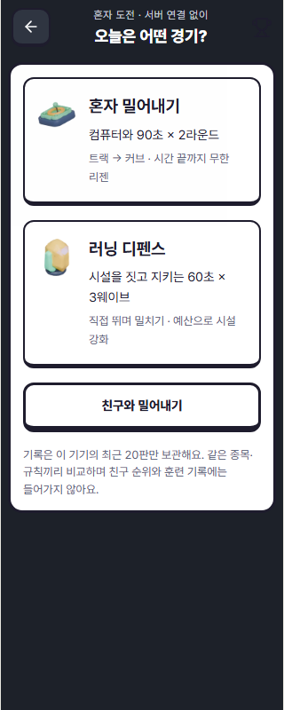
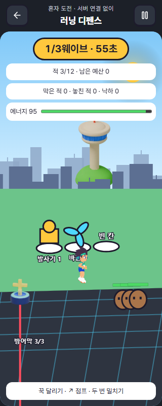
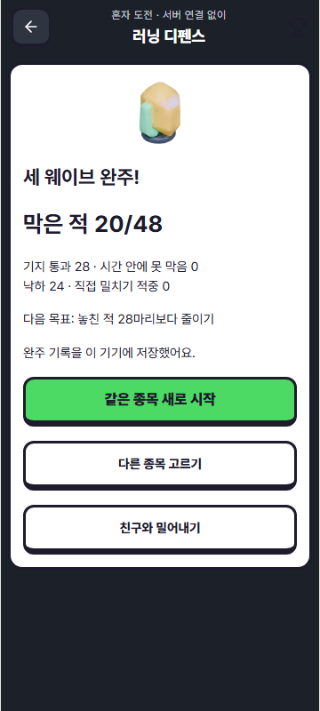

# 혼자 도전 확장 — 2026-10-15

> 후속 검증: [Easypanel 소스 조사와 재미 구조 검증](EASYPANEL_REUSE_AND_FUN_AUDIT.md)에서 시설 5조합 × 입력 6종을 비교했다. 발사기 2개 조합이 계속 누르기만으로 48/48 방어·무낙하를 달성했다. 아래의 기존 기능/회귀 검사 통과는 시설 균형이나 재미 검증 합격을 뜻하지 않는다. 핵심 밸런스 문제는 아직 해결되지 않았다.

## 계획과 이번 구현

요청: 같이하기를 준비하면서 만든 추가 종목을 혼자서도 바로 플레이하게 한다.
기준 기획은 [러닝 파티 v1](../handoff/minigame/RUN_PARTY_DESIGN_V1.md). 기존 러닝 투어·친구 경기·계정/훈련 데이터 계약을 유지한다.

1. 기존 1:1 밀어내기 엔진을 재사용하는 컴퓨터 상대 2라운드.
2. 기획 단계였던 러닝 디펜스를 혼자 3웨이브로 구현.
3. 종목 선택 → 준비 → 플레이 → 결과 → 재도전/다른 종목을 연결.
4. 디펜스 준비 상태 저장·복구와 종목별 완주 기록 비교.

| 종목 | 현재 구현 | 목표/기록 | 시간 |
|---|---|---|---|
| 러닝 투어 | 기존 구현 유지 | 구간 완주·회피·충돌·별 | 기존 코스 |
| 혼자 밀어내기 | 컴퓨터 상대, 트랙→커브, 2라운드 | 실제 밀어냄→적은 낙하로 각 판 순위. 승리2/공동1로 시리즈 비교 | 90초×2 + 각3초 출발; 사이 준비는 사용자가 결정 |
| 러닝 디펜스 | 3시설·3적 유형·3웨이브 | 놓친 적(기지 통과+미처리)이 적은 순→낙하 적은 순 | 60초×3 + 각3초 출발; 준비는 제한 없음 |
| 친구 밀어내기 | 기존 서버·초대방 그대로 | 기존 90초 1:1, 무한 리젠 | 기존 규칙 |

혼자 디펜스의 준비는 기획의 온라인 공통 10초 마감 대신 **사용자 확정**으로 진행한다. 휴대폰에서 시설 선택과 저장을 서두르게 하지 않는다. 컴퓨터 상대도 기존 에너지·공격 재사용·점프·보호 규칙을 따르고 180ms 간격으로 입력을 선택한다. 커브는 그림과 몸체·장애물에 같은 지면 투영을 적용하며 조작 방향은 유지한다.

## 실제 성취와 보급 근거

- 임의 점수를 매 순간 지급하지 않는다. 두 종목 모두 완주 후 실제 사건 횟수로 결과를 보여준다. 중간 이탈은 완주 기록을 만들지 않는다.
- 밀어내기 승점은 각 라운드 승패를 합치는 0~4점이며 무한 누적 재화가 아니다.
- 디펜스 적은 12/16/20마리의 고정표, 총48마리. 각 적은 처치/기지 통과/시간 종료 미처리 중 정확히 하나로 분류한다.
- 시설 예산은 6 + 다음 웨이브4 + 다음 웨이브4 = 기본14개. 보급품은 웨이브당2개, 총6개까지 추가하므로 총14~20개다.
- 보급품은 **달리는 상태로 직접 접촉**해야 예산+1. 에너지 충전·처치/죽음 파밍은 없다. 수집ID를 저장하고 리젠 시 재생성하지 않는다.
- 에너지는 손을 놓으면 회복한다. 보급 깃발은 범위 안 휴식 회복을 1.25/1.5배로 높이되 공격 시설 한 칸을 포기한다.
- 시설 설치3, 강화4, 최대2레벨. 준비 화면에서 임시 편집하고 무료 취소하거나 출발/저장 시 확정한다. 최초 무설치 출발만 발사기1개를 3예산으로 설치한다.
- 일반/돌진/단단형 HP3/2/6. 발사기 초당1/2피해, 바람25/40%감속. 직접 대시는 최대3체에 피해1과 밀림, 1초 밀림 저항.
- 초기 사거리0.24·적속도0.075는 시설만으로48마리 완전 방어가 가능해 검증에서 기각했다. v1 시범값은 발사기 사거리0.16·일반속도0.09. 동일 시설 조합에서 직접 조작이 방어 수·낙하를 개선하는 회귀 검사를 둔다. 사람 대상 재미 검증을 대신하지 않는다.
- 낙하는 2초 후 무한 복귀·2초 보호. 방어막은 통과3회마다 복구하고 세 웨이브를 끝까지 진행한다.

모든 수치는 게임 시범값이며 실제 훈련, 부상 위험, 영양 섭취 또는 생리학적 효과를 뜻하지 않는다.

## 저장·이탈·접근

- 진입: 더보기 → 미니게임 → **혼자 도전 · 밀어내기와 러닝 디펜스**.
- 혼자 게임은 경기 서버/WebSocket 연결이 필요 없다. 정적 앱 파일은 먼저 로드돼야 하며 완전 오프라인 설치 지원을 새로 보장하는 것은 아니다.
- 화면 꾹 달리기, 연속 상방 스와이프 점프, 더블탭 대시. 키보드 → / Space·↑ / D도 지원한다.
- 명시적 일시정지, 탭 숨김·창 포커스 이탈, 나가기 확인 시 혼자 경기를 멈춘다. 기존 온라인 경기는 별도 규칙이다.
- 디펜스는 준비 단계에서만 `확정·저장하고 종목 선택으로`. 웨이브/예산/시설/누적 성취/수집ID/규칙버전/경기ID를 보관한다. 알 수 없는 저장은 덮어쓰지 않고 안내한다. 실패하면 경기를 유지한다.
- 새 혼자 기록 키2개만 사용한다. 기존 투어/계정 저장 키·스키마·포인트·순위에 쓰지 않는다. 완료 기록은 기기의 최근20판이며 같은 종목·버전끼리 최고 기록을 표시한다. 로그인 계정이나 다른 기기로 동기화하지 않는다.
- 같은 경기 저장은 중복 결과를 만들지 않는다. 완료 시 해당 경기의 이어하기만 해제한다. 다른 저장은 보존한다.

## 에셋·후속 확장

토리와 서울 배경, Tripo track-island/upgrade-core/supply-capsule/respawn-beacon을 재사용했다. 시설3종과 적3실루엣은 원본 도형으로 표시한다. 새 모델 생성·추가 결제·외부 API 호출은 없다. 아트가 실패하면 원본 도형과 문자로 게임은 계속된다.

다음 확장 순서:

1. 실제 플레이로 컴퓨터 상대 난도, 직접 방어·시설 편중, 작은 화면 가독성을 검수한다.
2. 시설·적 도형의 검증된 크기를 기준으로 Tripo 아트를 교체한다. 그림이 판정이나 공격 범위를 바꾸지 않게 한다.
3. 디펜스 규칙을 서버 권위 방식에 연결하고 2인 시설 소유권·원자적 예산·재접속·중단을 검증한다.
4. 친구 경기의 두 라운드 시리즈와 공통 코스 기록 비교를 연결한다.

**아직 구현하지 않은 것:** 2인 협동 디펜스, 친구2라운드 시리즈, 서버 장기 순위, 계정 동기화, 새 3D 모델. 기존 친구 경기를 이 기능까지 지원하는 것으로 표시하지 않는다.

## 검증과 인계

소유/통합: 현재 미니게임 작업자, 기존 `codex/minigame-friend-race` / PR #368.
기준: main `2b42210e` 위 기존 성취·보급 변경 `7360b53c`.

- 집중 단위/계약: 12파일55개 통과. 신규 규칙·저장 테스트8개 포함.
- 기존 친구 엔진/실제 로컬 소켓: 8개 통과.
- 모바일 Chromium 360×800: 혼자 밀어내기 2라운드 완주·새 경기·이탈, 디펜스 연속 터치·준비 취소·일시정지·저장 후 새로고침 복구·3웨이브 완주·기록 저장 통과.
- 디펜스 일시정지 시 마지막 화면 시간이 뒤늦게 반영되는 문제가 최초 브라우저 검사에서 발견되어, 일시정지 즉시 최신 상태를 표시하도록 수정 후 재검증했다.
- 추가 브라우저 2건 통과: 320×800 작은 화면, 900×900 이미지 실패·모션 감소, 친구 경기 화면 왕복. 이미지 차단 첫 검사는 개발용 JSON 모듈까지 막는 시험 설정 문제로 중단 후 실제 이미지 요청만 차단해 재검증했다.
- 신규 규칙·저장 테스트 8개는 진행/예산/수집/복구/버전/중복에 결함을 주입해 각각 이름으로 실패를 확인했다. 원본 바이트를 복원한 뒤 8개 재통과.
- 앱 타입 검사, e2e 타입 검사, Vite 빌드 통과. 기존 대형 청크 경고는 남아 있다.
- 실제 iPhone, 사람 대상 난도 검수, 계정 저장, 새 운영 배포는 위 검사에 포함하지 않는다.

원격 CI 경계: 직전 PR head `7360b53c`의 전체 UTC 검사는 홈/더보기의 기존 테스트2개(`AppShell.archive.contract.test.tsx`의 훈련 배우기 제목, `HomeCoachingSummary.test.tsx`의 프리뷰 래퍼)에서 실패했다. [run 38691977871](https://github.com/hojune0330/TRAINORACLE/actions/runs/38691977871)에서 확인했고 이번 변경 영역의 통과와 구분한다. 이 확장으로 기존 전체 CI가 해결되었다고 표시하지 않는다.

코드: `app/src/domain/minigame/solo-*`, `screens/treadmill/SoloParty.tsx`, `solo-defense-render.ts`, `solo-party.css`. 친구 엔진의 실행 코드는 변경하지 않고 타입 선언만 추가했다. 기존 `arena-render.ts`에 선택적 커브 투영을 추가했다.

### 확인 화면

