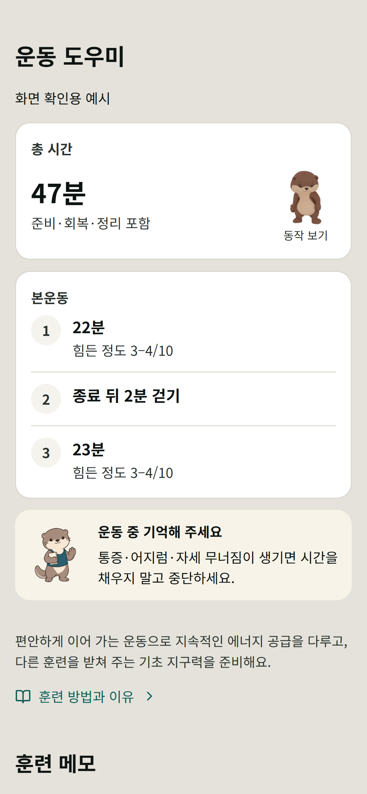
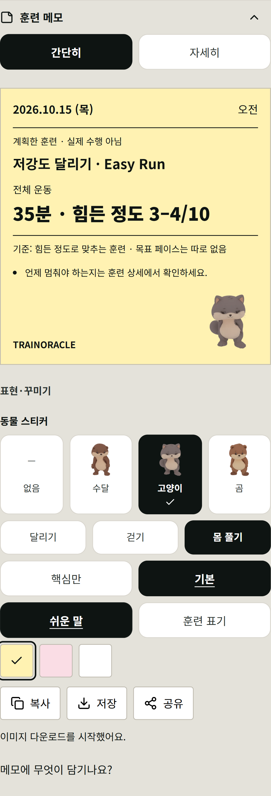
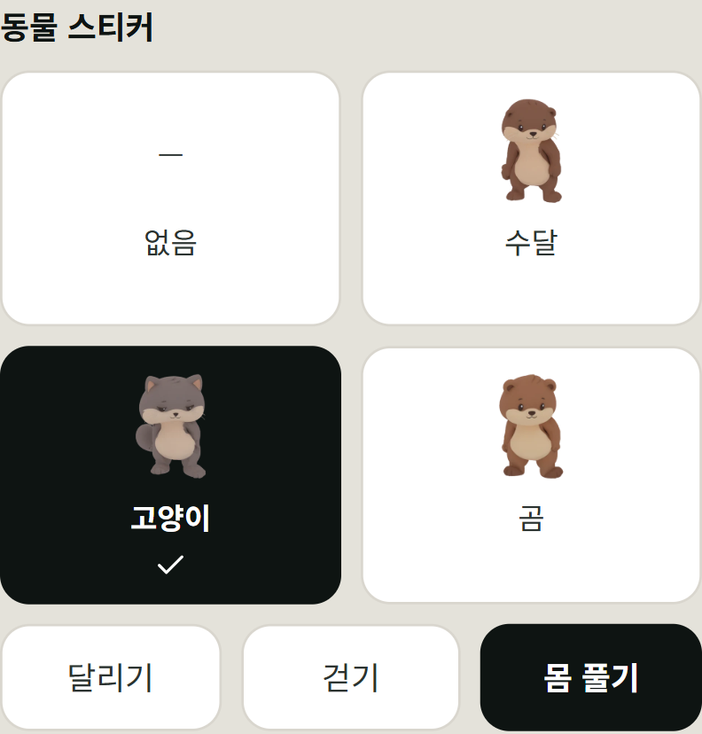
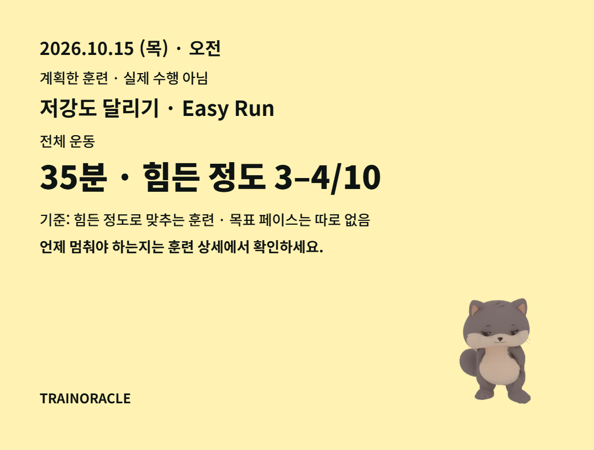

# 운동 도우미 적용 검토 — 2026-10-15

기준 main: `72f08db0176d7196adcb8fa0edb43de6a50d8218`. 승인 범위는 `docs/TRAINING_COMPANION_UI.md`를 따른다. 아래 이미지는 실제 컴포넌트와 합성 예시 데이터로 만든 로컬 검토 자료이며 사용자 기록이 아니다.

## 결과

- 훈련 설명: 보이는 동안 수달이 천천히 숨을 쉬고 고개를 조금 움직인다. 누르면 몸 풀기 발췌 동작을 한 번 보여 준 뒤 대기 동작으로 돌아간다. 훈련량·진행률과 무관하다.
- 일지 저장·재료 받기: 기존 성공 확인 경로에서만 한 번 끄덕인다. 계정 전송 대기, 실패, 검토 경고를 성공으로 표시하지 않는다.
- 메모: 기본값은 동물 없음. 수달·고양이·곰과 달리기·걷기·몸 풀기를 직접 선택한다. PNG에는 본문 아래 전용 영역을 사용한다.
- 일지: 9종 무료 컬렉션을 기존 받기·배치·저장 경로에 등록했다. 포인트 적립 규칙을 변경하지 않았다.
- 앱 제공 이미지: 16개, 총 479,438바이트. 대기 동작 추가분은 76,260바이트다. GLB 3개는 저작 원본으로 별도 보관하며 앱 화면에서 로드하지 않는다.

## 첫 적용 검증 (`7ed24f07`)

- 변경 영향 단위 검사 8개 파일, 합계 85개 통과. 애니메이션 단회 재생·움직임 줄이기·이미지 실패, 확인된 저장과 보류 구분, 메모 선택·캐시 무효화, 무료 획득·재로드, 컬렉션 문서 일치, 훈련 설명을 확인했다.
- 좁은 모바일/데스크톱 꾸미기 흐름 30개 통과: 기존 26개와 동물 받기·배치·새로고침/현재 홈 진입 4개. 오래된 홈 버튼 명칭을 찾던 검사는 현재 직접 진입에 맞췄다.
- 로컬 시각 검토 1개 통과: 390px, 320px, 글자 크기 200%, 실제 PNG 다운로드, 확인된 저장 화면. 320px에서는 동물 선택을 2열로 바꿔 이름이 한 글자씩 끊기지 않게 했다.
- 새 검사 3개에 결함 주입: 자동 재생 강제, 내보내기 동물 누락, 무료 가격 변경을 각각 해당 검사 이름으로 탐지했다. 주입 코드는 복원했다.
- Node 24.19.0 타입 검사·배포 빌드 및 생성된 계정 저장 검증 파일 일치/서버 검사 2개 통과. 기존 번들 크기 및 폰트 경로 경고는 남아 있다.
- GitHub의 Node 직접 실행에서 드러난 컬렉션 import 확장자와 스티커 파일명 규칙을 수정했다. 저장된 아이템 ID와 동작 이름은 유지했다. 실제 파일·해시·라이선스·용량 및 손상 탐지 에셋 검사 34개가 통과했다.
- 초기 Windows forks 실행은 검사에 진입하기 전에 실패했다. 동일 검사 내용을 단일 threads 실행으로 확인했다. 최초 실패를 통과로 계산하지 않았다.
- 기존 메모/훈련 설명 검사는 현재 저장소 초기화를 빠뜨리고 있었다. 원본 설명 파일에서도 같은 실패 14개를 확인했고, 기존 `initializeCanonicalJournalFixture`를 적용해 실제 앱과 같은 초기 상태로 검증했다.

## 평상시 움직임 후속 승인

- 수달의 별도 대기 동작은 5.6초, 16프레임이다. 원본 메시·재질·운동 클립을 유지하고 가슴과 머리 관절만 움직인다. 렌더 시 발 관절 이동과 처음·끝 포즈 차이가 모두 0임을 기록했다. 이는 모든 메시 변형의 수치 검증이나 화면 승인과는 다르다.
- 사용자가 정지/재개할 수 있고, 화면 밖·숨겨진 탭에서는 재생하지 않는다. 복귀 후 저장 완료 끄덕임을 반복하지 않는다. OS·앱 움직임 줄이기는 정지 그림으로 대체한다.
- 대기 반복·동작 전환·정지·화면 밖 중단 등 컴포넌트 검사 6개와 훈련 카드 검사 2개가 통과했다. 저장 결과의 정지 이미지 선택자를 새 이미지에 맞췄으나 수정 후 해당 파일의 worker가 시작하지 못해 전체 15개 통과로 계산하지 않았다.
- Node 24.19.0 타입 검사와 실제 컴포넌트를 사용한 별도 정적 미리보기 빌드는 통과했다. 기존 번들 크기 경고가 남아 있다.
- 미완료: 후속 모바일 화면 검수, 저장 결과 검사 재확인, 새 검사 3개의 결함 주입 증명. 로컬 worker 응답 시간 초과와 브라우저 페이지 생성/접속 지연으로 검증에 진입하지 못했다. 일반/VM 실행 및 별도 캐시 시도는 통과로 계산하지 않았다. 임시 결함 코드는 복원했으며 제한 시간을 늘리거나 검사를 건너뛰도록 제품 설정을 바꾸지 않았다.

[대기 동작 미리보기](idle-motion.webp)는 실제 앱 에셋 16프레임을 같은 5.6초 속도로 재생하는 검토용 파일이다. 아래 모바일 캡처는 후속 변경 전 첫 적용 화면이다.

## 병렬 통합 경계

검토 당시 게임 PR #366 (`299e14cb095121439959ef7ea1e2be0c37c9e4cc`)과 겹치는 경로는 테스트 2개 및 생성 파일 `supabase/functions/_shared/account-state-validator.mjs`다. 테스트 초기화는 같은 기존 도우미로 통일했다. 두 PR을 통합할 때 생성 파일은 어느 한쪽을 선택해 덮어쓰지 말고, 합쳐진 TypeScript 소스에서 `node app/scripts/build-account-state-validator.mjs`로 다시 생성한다.

게임·홈 기능 파일은 변경하지 않았다. 이 자료와 로컬 결과는 원격 CI, 병합, 정식 Pages 배포 또는 실계정 검증을 뜻하지 않는다. 계정 공개 보류 정책을 유지한다.

## 화면

