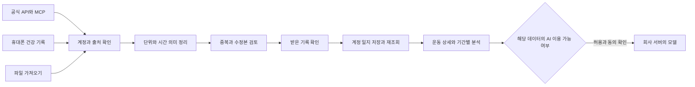

# TrainOracle 운동 데이터 연동과 화면 개발 전략

작성일: 2026-10-30

지위: 다음 구현을 위한 작업 순서와 설계 제안. 런타임 계약 변경·제공자 승인·배포 완료 기록이 아니다.

소스 확인 기준: `6ede1866e99bad57e601fb3f8218e7d132931855`

## 목표와 완료 기준

공식적으로 이용 가능한 기기·앱의 운동 데이터를 연결하고, 실제 기록을 일지·비교·허용된 AI 코칭으로 이어간다. 업체 수보다 사용자가 자기 운동을 정확히 찾고 이해할 수 있는 완결된 흐름을 우선한다. 지원 범위는 제공자와 기능별로 관리하고 공식 조건에 따라 확장한다.

한 연결의 완료는 사용자 인증, 실제 운동 수신, 값 확인, 계정 저장, 새로고침 후 재조회, 반복 수신의 중복 방지, 연결 해제·철회 처리까지 증거가 있을 때 선언한다. 합성 데이터 검사와 실제 계정 검증을 구분한다. 운영 공개는 필수 검사와 해당 환경 검증을 통과한 이후의 별도 단계다.

## 현재 재사용할 기반

- 파일 선택·검토·저장 결과: `app/src/screens/ImportActivities.tsx`, `import-activities/ImportStages.tsx`.
- 현재 파서: TCX·GPX·지원 구조의 CSV/JSON. FIT와 ZIP은 현재 거절한다. 센서 시계열 전체 지원으로 해석하지 않는다.
- 파일 관측과 계정 일지 보관: 기존 파일 관측·계정 저장·중복 검토 경로를 확장한다.
- 분석: `FileAnalysisPanel`, `FilePlanComparison`, `ImportedRecordPreview`, `Trends`.
- 출처와 AI 자격: `app/src/domain/provider-data-rights.ts`, `SelfHostedCoachingPanel`, `server/self-hosted-coaching/`.
- 모바일: HealthKit·Health Connect 후보는 별도 모바일 저장소에 있으며 실제 건강 권한·본인 운동 수신은 미검증이다.
- `DeviceTrainingDataPanel`은 로그인 전 로컬 자료의 계정 귀속 기능이다. 워치 연결 화면으로 이름만 바꾸어 재사용하지 않는다.

현재 전체 CI [41017270528](https://github.com/hojune0330/TRAINORACLE/actions/runs/41017270528)는 실패 상태다. 원인 비교 없이 기존 결함 또는 새 기능 탓으로 단정하지 않는다. 새 연동 공개 전 실패 단계 진단과 수리가 필요하다.

## 지원 경로의 세 가지 축

| 경로 | 용도 | 별도로 확인할 조건 |
|---|---|---|
| 제공자 공식 API 또는 MCP | 사용자 인증 후 허용된 운동 조회·수신 | 개발 앱 등록, 계약·권한, 조회와 지속 저장의 차이, 호출 한도, 수정·삭제 이벤트 |
| HealthKit 또는 Health Connect | 휴대폰에 공유된 운동·건강 기록 읽기 | 실제 OS·기기 지원, 항목별 권한, 원 작성 앱, 실제 제공 필드, 네이티브 백그라운드 제한 |
| 사용자가 내보낸 파일 | 자동 연결이 없거나 과거 운동을 가져오는 경로 | 형식·필드 지원, 원출처, 누락·시간 의미, 파일별 사용 조건 |

휴대폰 건강 플랫폼을 지원한다는 이유로 모든 제조사의 모든 필드를 지원한다고 표시하지 않는다. 조회할 수 있다는 사실을 상시 동기화·일지 영구 보관·AI 사용 권한과 합치지 않는다.

## 확장 순서와 공식 조건

1. **기존 Garmin·COROS·애플·삼성·WHOOP 경로를 실사용까지 연결한다.** Garmin 프로그램 승인과 자체 호스팅 AI 문의 접수는 별도 증거다. 아직 실제 수신·AI 허용으로 승격하지 않는다.
2. **Polar·Suunto·Wahoo·Google Health·Oura·Withings를 추가 후보로 관리한다.** 각사의 공식 개발 경로, 데이터 종류, 공개 서비스 조건을 확인한 뒤 개별 어댑터를 붙인다.
3. **Strava는 현재 통합 분석·AI 기능의 일반 입력으로 채택하지 않는다.** 2026-06-01 정책 §5.3은 AI 컨텍스트 등 운영과 파생 데이터까지 제한하며 §5.4는 분석·다른 고객 데이터와 결합을 제한한다. 공식 MCP 예외도 개인용 범위다. TrainOracle의 사용 사례에 대한 별도 조건 확인이 필요하다. [공식 정책](https://www.strava.com/legal/api_policy)
4. **COROS MCP를 우선 실증 후보로 둔다.** 공식 문서는 별도 신청 없이 사용자별 OAuth를 통한 조회와 AI 코칭 앱을 안내한다. 웹훅·양방향 활동 동기화 등은 Partner API와 구분한다. MCP 조회 결과를 TrainOracle 일지에 지속 저장하는 범위와 한도도 구현 전에 확인한다. [공식 개발 안내](https://support.coros.com/hc/en-us/articles/53181619102996-Build-on-COROS-MCP)
5. **Fitbit 신규 개발은 Google Health API 기준으로 설계한다.** 최신 공식 안내는 구 Fitbit API의 2026-09-30 지원 종료와 2026-11-02 API·OAuth 중단을 구분한다. Google OAuth와 제한된 건강 데이터 권한의 검토 절차를 반영한다. [공식 안내](https://developers.google.com/health/about)

이 목록은 출시된 지원 목록이 아니다. Huawei·Zepp/Xiaomi 등은 공식 데이터 권한·지역·기기 범위가 확인되면 같은 절차로 편입한다. 새 회사를 `OTHER` 하나의 공통 AI 승인으로 묶지 않는다.

### 회사별 후보 경로

| 회사 또는 플랫폼 | 우선 검토할 경로 | 개발 전에 확인할 사항과 공식 근거 |
|---|---|---|
| Garmin | 승인된 Connect Developer API | 실제 계정의 제품·사용자 수·과거 데이터·AI 허용 범위. [프로그램](https://developer.garmin.com/gc-developer-program/overview/) |
| COROS | 공식 MCP 조회, Partner API 동기화 | 각 경로의 조회·지속 보관·push 범위. [MCP](https://support.coros.com/hc/en-us/articles/53181619102996-Build-on-COROS-MCP) |
| Apple | HealthKit 네이티브 앱 | 데이터 종류별 사용자 권한과 실기기 읽기. [권한](https://developer.apple.com/documentation/healthkit/authorizing-access-to-health-data) |
| Samsung·Android | Health Connect | Samsung Health의 공유 설정·전달 필드와 앱 권한. 직접 Data SDK는 별도 파트너 경로. [삼성 FAQ](https://developer.samsung.com/health/health-connect-faq.html), [직접 SDK](https://developer.samsung.com/health/data/process.html) |
| WHOOP | OAuth와 공식 API | 개발 계정·시험 사용자·공개 승인·용도별 조건. [개발 안내](https://developer.whoop.com/docs/developing/overview/), [승인](https://developer.whoop.com/docs/developing/app-approval/) |
| Polar | AccessLink | Flow 개발 앱·사용자 OAuth와 등록, 운동 데이터 범위. [공식 API](https://www.polar.com/accesslink-api/) |
| Suunto | Workout·DailyActivity API | 기업 파트너 신청·계약·운영 전환. [API Zone](https://apizone.suunto.com/), [FAQ](https://apizone.suunto.com/faq) |
| Wahoo | Cloud API | 앱 목적·scope 승인. Sandbox와 production 별도 등록, 타사 생성 활동 공유 제한. [Cloud](https://developers.wahooligan.com/cloud), [변경 이력](https://cloud-api.wahooligan.com/) |
| Fitbit·Pixel Watch | Google Health API | 새 OAuth·restricted scope 검증과 데이터 정책. [검증](https://developers.google.com/health/app-verification), [정책](https://developers.google.com/health/policies/health-api-developer-user-data-policy) |
| Oura | V2 OAuth | 운동 요약과 수면·건강 지표를 구분. AI 동의·학습 제한 및 중개사업자 조건 별도 검토. [인증](https://cloud.ouraring.com/docs/authentication), [약관](https://cloud.ouraring.com/legal/api-agreement) |
| Withings | Public API OAuth | 실제 사용자 지역·기기·구독에 따른 데이터 범위. [개발 안내](https://developer.withings.com/developer-guide/v3/withings-solutions/app-to-app-solution/), [약관](https://www.withings.com/en-eu/policies/terms-of-service) |
| Strava | 용도별 검토 보류 | 현행 통합 분석·AI 제한 확인. [정책](https://www.strava.com/legal/api_policy) |

위 순서는 기존 구현과 운동 기록의 활용도를 기준으로 한 개발 권고다. 외부 승인 완료나 모든 지표의 제공을 보장하지 않는다. Huawei는 [공식 Health Kit](https://developer.huawei.com/consumer/en/hms/huaweihealth)와 권한 신청 경로가 있는 추가 후보이며, Zepp/Xiaomi의 상용 운동 API 조건은 이번 조사에서 확정하지 못했다.

## 공통 데이터 흐름



### 공통 어댑터가 다룰 정보

- 제공자와 연결 방식, 해당 계정, 읽기 가능한 데이터 종류, 인증·재인증·해제 상태.
- 공급자 운동 ID·수정 정보·원 작성 앱·수신 경로·가져온 시각. 원출처가 확인되지 않으면 추측하지 않는다.
- 운동의 UTC 시작 시각, 원래 시간대·오프셋, 사용자에게 표시할 날짜. 기기 이동이나 재수신으로 운동 날짜를 조용히 바꾸지 않는다.
- 거리, 타이머 시간, 이동 시간, 전체 경과 시간, 구간. 단위와 필드별 누락·측정·계산·사용자 정정 여부를 보존한다.
- 제공되는 경우에만 심박·케이던스·파워·고도 시계열을 별도 확장한다. 요약값과 시계열을 혼동하지 않는다.
- 수면·HRV·체성분 같은 일상 건강 관측은 운동 한 건과 별도의 데이터 종류로 둔다. 각사의 회복 점수를 공통 점수로 합치지 않는다.
- 호출 한도, 페이지·커서, 마지막 완료 범위, 재시도·부분 실패, 연결 해제 후 허용되는 보관·삭제 동작.

### 중복과 수정본

동일 계정·제공자 운동 ID·수정 정보로 정확한 반복 수신을 먼저 식별한다. 여러 경로의 원 운동 ID가 같다면 수신 경로를 보존하면서 같은 운동으로 연결한다. 날짜·거리·시간이 비슷하다는 이유만으로 다른 운동이나 기존 일지를 삭제·덮어쓰지 않는다.

교차 제공자 중복 후보는 사용자에게 비교를 제시한다. 같은 운동으로 확인된 경우 집계 대상은 하나지만 필드별 출처와 수신 흔적은 남긴다. 사용자 메모·계획 연결·꾸미기는 제공자 수정본으로 교체하지 않는다. 삭제된 기록이 재동기화로 되살아나지 않도록 삭제 정책과 최소 표식을 함께 설계한다.

### 데이터 이용 자격

`수신`, `보관`, `본인에게 표시`, `설명형 분석`, `계획 비교`, `AI 추론`, `워치로 계획 전송`을 개별 기능으로 평가한다. 사용자 동의·제공자 조건·앱 운영 준비는 별도 축이다. 모델 학습·미세조정·평가·공용 지식 저장소는 이번 자체 호스팅 추론 범위에 포함하지 않는다.

공급자 목록·필드·용도·정책 버전은 서버와 앱이 같은 계약을 사용하도록 한다. 현재의 보수적인 출처 검사와 서버 소유 승인을 확장하며, 화면의 표시 상태를 접근 권한으로 신뢰하지 않는다.

### 구현 전에 정리할 현재 구조

- `supabase/functions/device-integration-status/index.ts`의 2026-08-29 정적 신청 상태를 실제 승인·연결·수신 상태의 원본으로 사용하지 않는다.
- 기존 DB의 Garmin/COROS 제공자 제약과 앱 enum을 함께 확장한다. 개별 `providerId`를 출처와 허용조건 양쪽에 결속한다.
- `external_activity_inbox`의 일반 컬럼 저장과 암호화 Daily·계정 일지 저장을 대조해, 조회에 필요한 최소 메타데이터와 암호화할 건강 본문을 명시한다.
- 최종 `ingest_coros_activity_batch`의 같은 ID 무시 동작은 수정본까지 흡수하므로 원본 revision·삭제·충돌 처리로 보완한다.
- 페이지 cursor는 저장 성공 후 전진하고, 재연결 시 이전 연결의 진행 중 작업을 무효화한다.
- UTC offset만 있는 데이터에 존재하지 않는 IANA 시간대를 만들어 넣지 않는다. 현 준비 계약의 시간대 필수 조건을 새 어댑터와 대조한다.

## UX와 화면 역할

전체 하단 메뉴를 늘리지 않는다. 기존 `More`의 기기 연동 상태 진입을 실제 내부 화면으로 연결하고, 계정 설정에서도 같은 화면으로 진입한다. 운동·메모는 기존 일지, 기간별 비교는 기존 오라클을 사용한다.

| 화면 | 처음 보이는 정보 | 주 행동 | 기존 경로와 구현 방향 |
|---|---|---|---|
| 운동기록 연결 | 연결한 기기·앱, 최근 정상 수신, 확인할 기록 수 | 기기·앱 연결 또는 파일 가져오기 | More·Account 진입, AppShell과 DeferredMobileScreens의 기존 탐색 계약 사용 |
| 연결 상세 | 읽는 데이터 종류, 허용 범위, 마지막 수신, 필요한 조치 | 연결·다시 연결·수신 확인 | 공통 상세 신규. 연결 해제와 저장 기록 삭제의 효과를 명시 |
| 받은 기록 확인 | 날짜별 운동, 새 기록·이미 저장됨·확인 필요·실패 | 선택한 기록 일지에 반영 | ImportStages의 검토·부분 결과 동작 재사용 |
| 일지 상세 | 운동 종류, 실제 거리·시간, 구간, 메모·계획 연결 | 기존 수정·계획 비교 | JournalDayReader·LogDetail. 원본 관측과 사용자 정정 구분 |
| 분석과 AI 풀이 | 기간별 실제 수치, 비교 기준, 빠진 자료 | 근거 보기·허용된 AI 풀이 | Trends·FileAnalysisPanel·FilePlanComparison·SelfHostedCoachingPanel 확장 |

### 연결 목록의 상태

`연결 가능`, `승인 대기`, `이 기기에서 지원 안 됨`, `인증 완료·첫 수신 전`, `기록 수신 완료`, `다시 연결 필요`, `일부 수신 실패`, `연결 해제`를 서로 다르게 보여준다. 연결 버튼만 누른 상태를 완료로 표시하지 않는다. 읽기 실패를 기록 0개로 바꾸지 않는다.

제공자 행은 이름·짧은 상태·최근 수신·관련 행동 순서로 정렬한다. 개발 용어인 OAuth·토큰·스키마는 일반 사용자 화면의 제목으로 쓰지 않는다. 처리 중에는 이미 받은 기록과 남은 작업을 구분하고, 재시도해도 저장이 반복되지 않아야 한다.

### 운동 상세의 정보 위계

아래는 화면 구조이며 실제 사용자 수치나 구현된 화면이 아니다.

```text
선택한 날짜 · 운동 종류
거리                     시간 종류와 값
평균 페이스              심박수 등 제공되는 주요 값

원 기록: 제공자 · 받은 경로 · 저장 상태
확인 필요: 누락 또는 시간 의미가 있을 때 표시

요약 / 구간 / 그래프
계획과 실제 비교
내 메모와 컨디션
기록 출처와 수정 이력
```

첫 화면의 주요 수치는 종목과 실제 제공 필드에 맞춘다. 값이 없는 필드는 0으로 채우지 않는다. 시간 종류가 불명확하면 해당 값 바로 옆에 표시하고 평균 페이스 계산을 보류한다. 원 기록에 없는 구간·심박 그래프를 만들어 보여주지 않는다.

구간은 거리·시간·페이스·가능한 센서 항목을 정렬된 행으로 비교한다. 시계열은 사용자가 고른 지표에 집중하고 누락 구간을 연결선으로 숨기지 않는다. 지도·GPS는 목적과 권한이 있는 경우에만 별도 상세로 제공한다. 차트에는 같은 데이터의 접근 가능한 표와 반영·제외 건수를 둔다.

### 시각·탐색 원칙

- 기존 틸·아이보리·먹색, Pretendard, Lucide, 일지 앰버·오라클 보라 토큰을 유지한다.
- 독립 목적은 카드, 반복 운동과 제공자는 행, 비교는 표·차트로 구성한다.
- 제목 24px, 섹션 18px와 기존 공통 컴포넌트 역할을 우선한다. 본문을 줄여 정보를 억지로 넣지 않는다.
- 공급자 로고·색이 앱 전체의 새 시각 체계를 만들지 않게 한다. 승인 대기·오류는 텍스트와 상태 아이콘으로 함께 표시한다.
- 한 작업의 주 행동 하나를 강조하며 연결·저장·동의·삭제를 선택만으로 실행하지 않는다.
- 상세 왕복 때 날짜·기간·필터·스크롤·포커스를 복원한다. 계정 전환 후 이전 계정의 자료와 복귀 정보를 폐기한다.
- 320/375/430px·넓은 화면·200% 글씨·키보드·동작 줄이기에서 하단 행동과 마지막 행이 가리지 않는지 검수한다.

## 개발 순서

| 순서 | 결과물 | 완료 증거 |
|---|---|---|
| 1 | 기존 CI 실패 진단, 연결 상태·기능 목록·공통 데이터 계약 정리 | 실패 원인별 집중 검사, 서버와 앱 상태의 일치 |
| 2 | 실제 TCX 한 건과 공통 받은 기록 확인 → 일지 → 분석 흐름 | 원값 대조, 계정 저장·재조회, 중복 재가져오기, 정확한 원본 일지 이동 |
| 3 | COROS 공식 MCP 실제 조회, HealthKit·Health Connect 실기기 수신, Garmin 권한 연결 | 각 경로의 본인 운동 수신. 지속 저장은 해당 경로의 허용 범위 검증 포함 |
| 4 | FIT 가져오기와 추가 제공자 어댑터, 필요한 센서 필드·상세 화면 | 실제 형식/제공자별 기록 대조, 시간 의미·단위·누락·수정·중복 검사 |
| 5 | 일반 분석과 회사 자체 호스팅 모델의 허용된 풀이 | 승인·동의·철회 전후 동작, 최소 데이터 전송, 실제 근거 일지 왕복 |
| 6 | 회사별 지원 범위 공개 | 필수 CI, 실제 배포 버전, 실제 계정 경로 검증과 지원표 일치 |

Garmin의 외부 회신 대기와 공통 수신함·화면·다른 제공자 구현은 독립적으로 진행한다. 추가 업체는 공식 경로와 필요한 권한이 준비되는 순서로 묶어 확장한다. 파일 내보내기는 대체 입력 경로로 유지하되 원출처의 조건을 없애는 수단으로 취급하지 않는다.

운동 기록 수신과 워치에 훈련 계획을 보내는 기능은 서로 다른 개발 항목이다. 후자는 기존 처방·계획 검토와 해당 제공자의 쓰기 권한을 함께 확인한 후 연결한다. 읽기 연동 완료만으로 자동 계획 변경을 활성화하지 않는다.

## 사용자 관점의 최종 검수

1. 사용자가 연결한 기기와 실제 수신 여부를 한 화면에서 이해한다.
2. 같은 운동이 두 경로로 들어와도 훈련량이 두 배가 되지 않는다.
3. 수신함·일지·분석에서 날짜·거리·시간의 의미·출처가 일치한다.
4. 누락·지연·실패·충돌이 보이며 기존 기록은 유지된다.
5. 앱 재실행·다른 로그인·인증 만료·연결 해제에서 계정 간 자료가 섞이지 않는다.
6. AI를 사용하지 못하는 기록도 허용된 조회·분석 기능을 계속 사용할 수 있다.
7. 연결 해제·데이터 삭제·AI 동의 철회의 각각의 효과를 사용자가 구분하고 확인한다.
8. UI 시안·합성 시험·실계정 시험·공개 배포 결과를 각각 기록한다.

## 이번 전략 정리의 범위

현재 코드·최신 공식 자료를 대조하여 지원 후보, 공통 흐름, 화면 역할, 구현 순서와 합격 기준을 정리했다. 앱 런타임 코드, 운영 계정, 제공자 등록, DB와 배포 설정은 이번 전략 정리로 변경하지 않았다. 실제 연동 구현과 UI 화면 검수는 위 순서에 따라 남아 있다.
