# 런비티아이 캐릭터 32명

친구에게는 “난 거리·숫자야. 펭귄 나왔어”라고 말할 수 있다. 카드에는 **거리·숫자 | 황제펭귄**을 한 줄에 쓴다. 취향은 거리·속도, 숫자·감각, 단골·탐험, 계획·즉흥 순서로 적고 한쪽만 뚜렷하면 그쪽 하나만 쓴다. 캐릭터 이름을 누르면 해당 원화가 열린다.

## 기본 여덟 명

| 카드 이름 | 뜻 한 줄 |
| --- | --- |
| **거리 &#124; [성큼성큼 코끼리](../../../app/public/run-bti/art/club-animal-distance.webp)**  | 길게 달리는 날이 좋아. |
| **속도 &#124; [질주 치타](../../../app/public/run-bti/art/club-animal-speed.webp)** <a href="../../../app/public/run-bti/art/club-animal-speed.webp">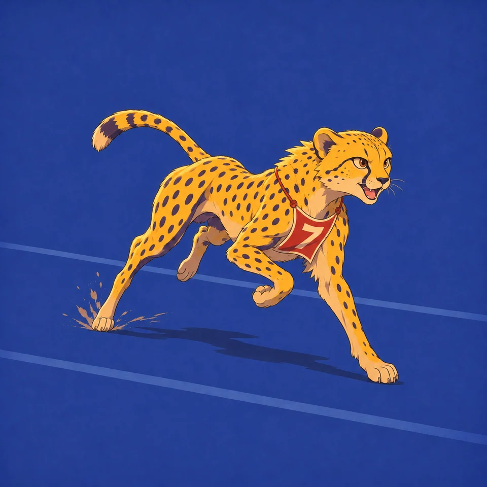</a> | 뛰다가 속도가 붙을 때가 재밌어. |
| **숫자 &#124; [문어](../../../app/public/run-bti/art/club-animal-numbers.webp)**  | 내가 어떻게 뛰었는지 숫자로 알면 더 재밌어. |
| **감각 &#124; [손수건 고양이](../../../app/public/run-bti/art/club-animal-senses.webp)**  | 뛰면서 내 몸이 어떤지 느껴 보는 게 좋아. |
| **단골 &#124; [동네 단골 강아지](../../../app/public/run-bti/art/club-animal-familiar.webp)**  | 다시 뛰어도 아는 길이 반가워. |
| **탐험 &#124; [흰꼬리 여우](../../../app/public/run-bti/art/club-animal-explore.webp)**  | 처음 보는 길은 한번 뛰어 보고 싶어. |
| **계획 &#124; [비버](../../../app/public/run-bti/art/club-animal-plan.webp)** <a href="../../../app/public/run-bti/art/club-animal-plan.webp">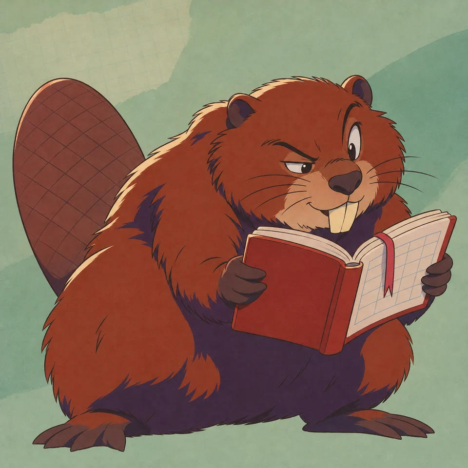</a> | 뛸 계획을 미리 정해 두면 마음이 편해. |
| **즉흥 &#124; [날개 편 앵무새](../../../app/public/run-bti/art/club-animal-improvise.webp)** <a href="../../../app/public/run-bti/art/club-animal-improvise.webp">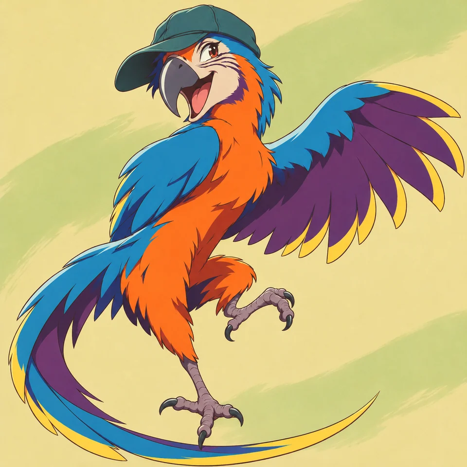</a> | 어떻게 뛸지는 그날 정하는 게 편해. |

## 귤색 · 거리와 속도 × 숫자와 감각

|  | 숫자 | 감각 |
| --- | --- | --- |
| 거리 | **거리·숫자 &#124; [황제펭귄](../../../app/public/run-bti/art/club-animal-distance-numbers.webp)**  오래 달리는 게 좋고 내 달리기를 숫자로 보는 재미도 있어. | **거리·감각 &#124; [타월 거북이](../../../app/public/run-bti/art/club-animal-distance-senses.webp)**  오래 뛰고 싶어. 뛰는 동안 내 몸이 어떤지도 궁금해. |
| 속도 | **속도·숫자 &#124; [송골매](../../../app/public/run-bti/art/club-animal-speed-numbers.webp)** <a href="../../../app/public/run-bti/art/club-animal-speed-numbers.webp">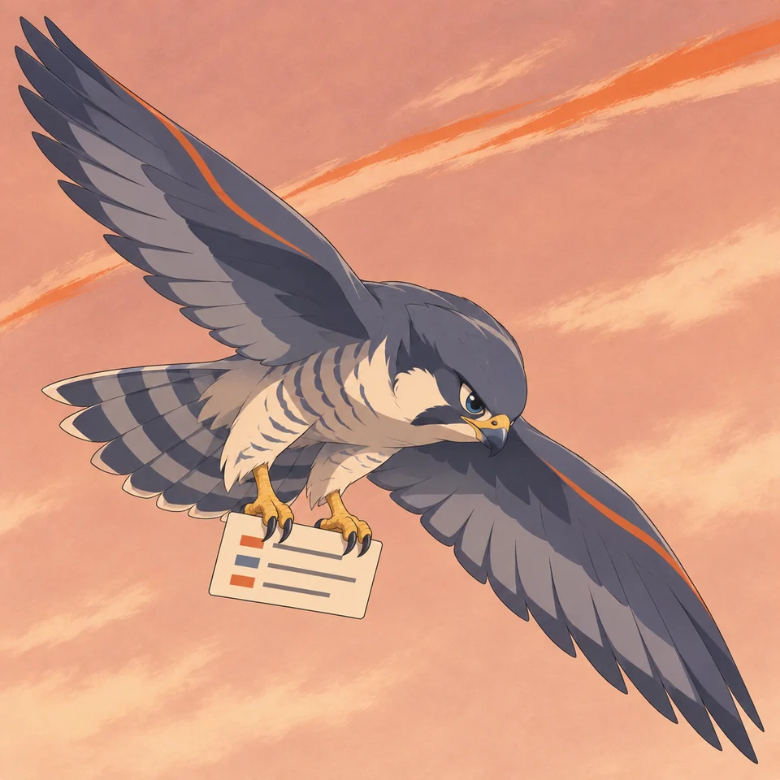</a> 속도가 붙는 맛도 좋고 내가 어떻게 뛰었는지 숫자로 아는 것도 좋아. | **속도·감각 &#124; [물살 타는 돌고래](../../../app/public/run-bti/art/club-animal-speed-senses.webp)** <a href="../../../app/public/run-bti/art/club-animal-speed-senses.webp">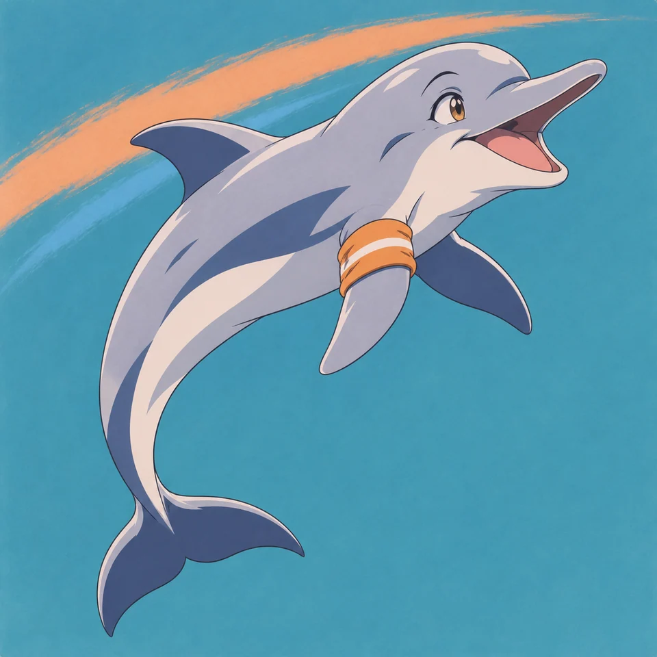</a> 속도를 내는 것도 좋고 달릴 때 몸에서 느껴지는 변화도 재밌어. |

## 청록색 · 거리와 속도 × 단골과 탐험

|  | 단골 | 탐험 |
| --- | --- | --- |
| 거리 | **거리·단골 &#124; [보온병 판다](../../../app/public/run-bti/art/club-animal-distance-familiar.webp)** <a href="../../../app/public/run-bti/art/club-animal-distance-familiar.webp">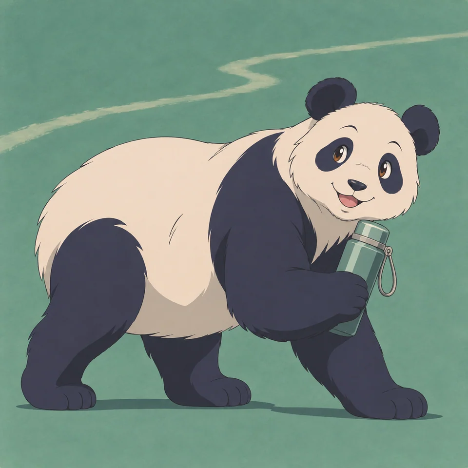</a> 길게 뛰는 게 좋아. 코스는 아는 길이면 더 반가워. | **거리·탐험 &#124; [먼 바다 혹등고래](../../../app/public/run-bti/art/club-animal-distance-explore.webp)** <a href="../../../app/public/run-bti/art/club-animal-distance-explore.webp">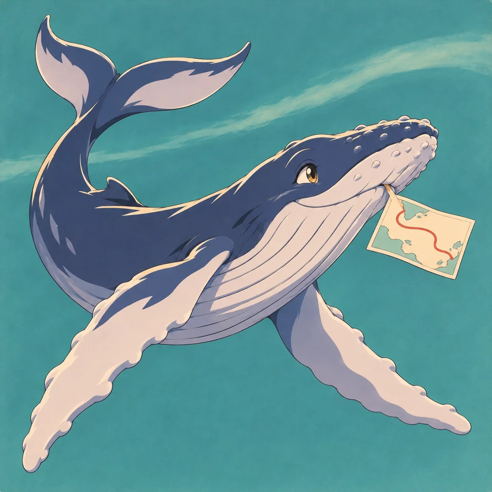</a> 길게 달리는 날이 좋아. 처음 보는 길도 궁금해. |
| 속도 | **속도·단골 &#124; [돌아오는 제비](../../../app/public/run-bti/art/club-animal-speed-familiar.webp)**  아는 길은 또 뛰어도 좋고 속도가 붙는 순간도 좋아해. | **속도·탐험 &#124; [선글라스 상어](../../../app/public/run-bti/art/club-animal-speed-explore.webp)** <a href="../../../app/public/run-bti/art/club-animal-speed-explore.webp">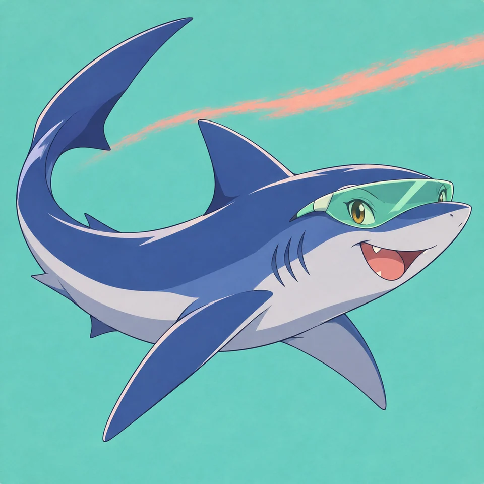</a> 속도 내는 재미도 있고 새 길을 찾아가는 재미도 있어. |

## 파란색 · 거리와 속도 × 계획과 즉흥

|  | 계획 | 즉흥 |
| --- | --- | --- |
| 거리 | **거리·계획 &#124; [배낭 멘 낙타](../../../app/public/run-bti/art/club-animal-distance-plan.webp)**  오래 달리는 게 좋아. 뛸 계획은 미리 잡아 두면 편해. | **거리·즉흥 &#124; [한 모금 캥거루](../../../app/public/run-bti/art/club-animal-distance-improvise.webp)** <a href="../../../app/public/run-bti/art/club-animal-distance-improvise.webp">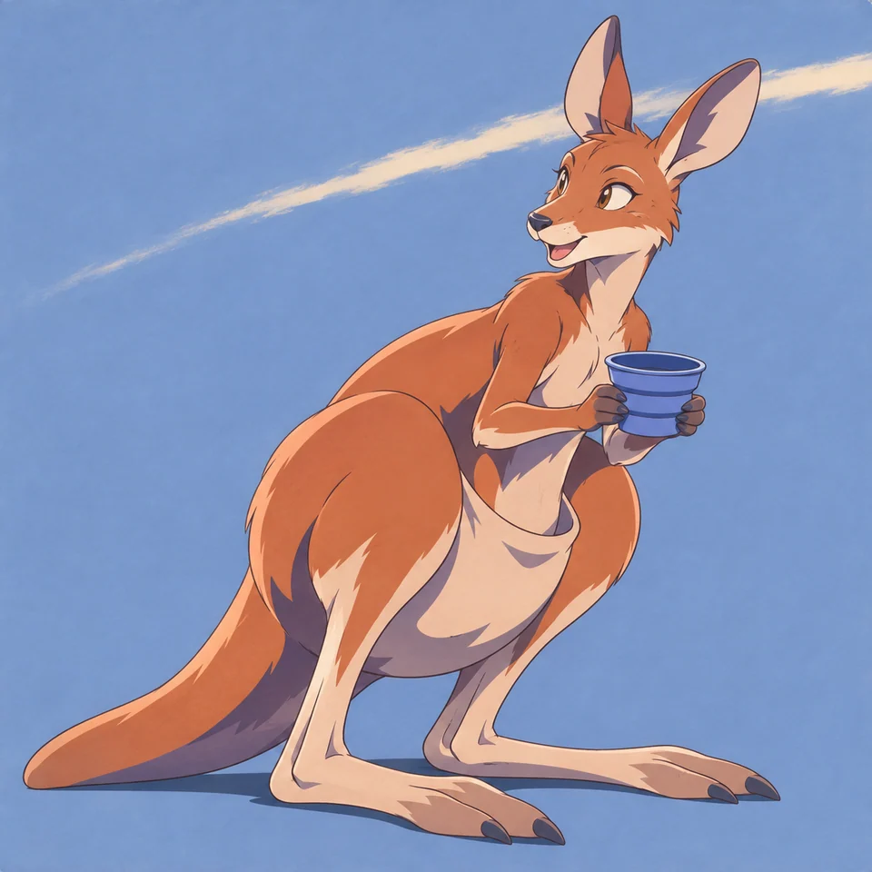</a> 오래 뛰는 게 좋아. 어떻게 뛸지는 그날 정하고 싶어. |
| 속도 | **속도·계획 &#124; [운동화 챙긴 토끼](../../../app/public/run-bti/art/club-animal-speed-plan.webp)** <a href="../../../app/public/run-bti/art/club-animal-speed-plan.webp">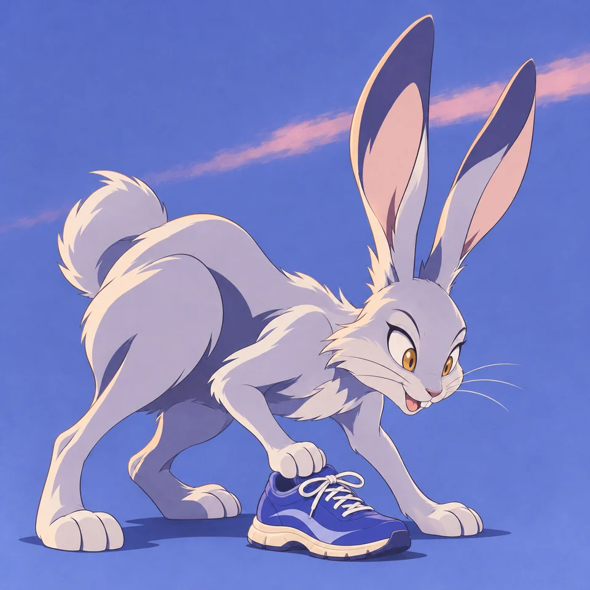</a> 달릴 땐 속도 내는 재미가 있고 뛸 건 미리 정해 두면 편해. | **속도·즉흥 &#124; [후다닥 다람쥐](../../../app/public/run-bti/art/club-animal-speed-improvise.webp)** <a href="../../../app/public/run-bti/art/club-animal-speed-improvise.webp">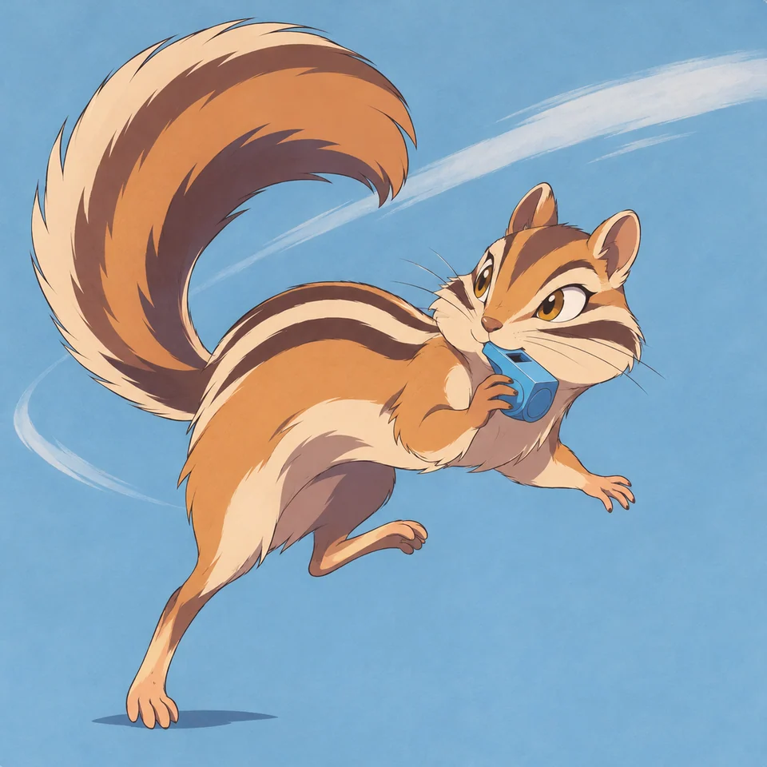</a> 속도 내는 걸 좋아해. 오늘 어떻게 뛸지는 그때 가서 정할래. |

## 보라색 · 숫자와 감각 × 단골과 탐험

|  | 단골 | 탐험 |
| --- | --- | --- |
| 숫자 | **숫자·단골 &#124; [고리꼬리 라쿤](../../../app/public/run-bti/art/club-animal-numbers-familiar.webp)** <a href="../../../app/public/run-bti/art/club-animal-numbers-familiar.webp">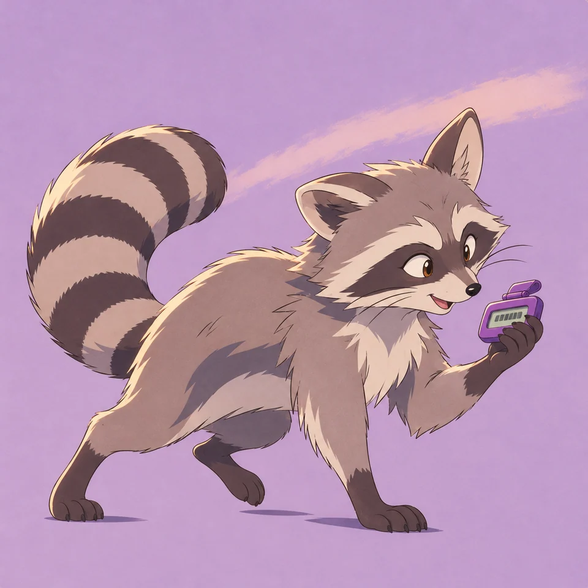</a> 아는 길에서 뛰는 게 편해. 내가 어떻게 뛰었는지 숫자로 아는 것도 좋아. | **숫자·탐험 &#124; [길 찾는 기린](../../../app/public/run-bti/art/club-animal-numbers-explore.webp)**  안 가 본 길이 궁금해. 내 달리기를 숫자로 보는 재미도 있어. |
| 감각 | **감각·단골 &#124; [밴드 찬 코알라](../../../app/public/run-bti/art/club-animal-senses-familiar.webp)**  익숙한 길이 반갑고 달릴 때 내 몸이 어떤지 살피는 게 좋아. | **감각·탐험 &#124; [호랑나비](../../../app/public/run-bti/art/club-animal-senses-explore.webp)** <a href="../../../app/public/run-bti/art/club-animal-senses-explore.webp">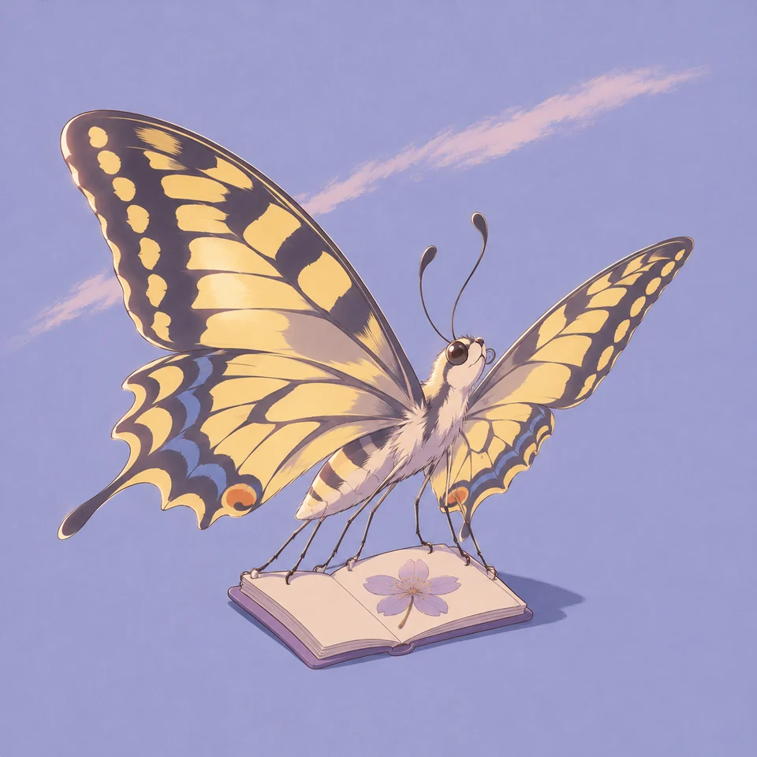</a> 새 길에 들어서는 재미도 있고 뛰면서 몸의 변화를 느끼는 재미도 있어. |

## 산호색 · 숫자와 감각 × 계획과 즉흥

|  | 계획 | 즉흥 |
| --- | --- | --- |
| 숫자 | **숫자·계획 &#124; [올빼미](../../../app/public/run-bti/art/club-animal-numbers-plan.webp)** <a href="../../../app/public/run-bti/art/club-animal-numbers-plan.webp">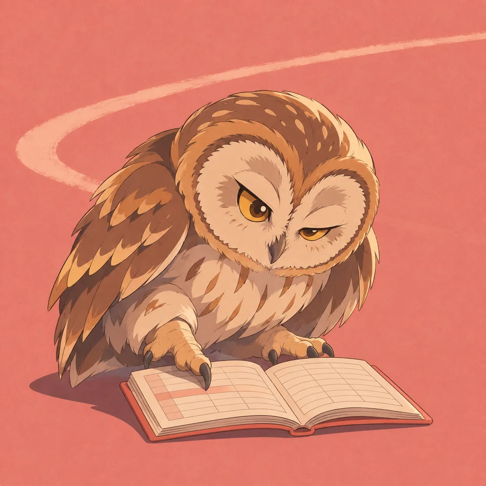</a> 뛸 계획은 미리 잡고 싶어. 내 달리기도 숫자로 보면 감이 와. | **숫자·즉흥 &#124; [폴짝 개구리](../../../app/public/run-bti/art/club-animal-numbers-improvise.webp)**  어떻게 뛸지는 그날 정할래. 내가 어떻게 뛰었는지는 숫자로 알고 싶어. |
| 감각 | **감각·계획 &#124; [곱슬 양](../../../app/public/run-bti/art/club-animal-senses-plan.webp)**  뛸 건 미리 정해 두는 게 편해. 달릴 땐 내 몸이 어떤지도 살피고 싶어. | **감각·즉흥 &#124; [둥실 해파리](../../../app/public/run-bti/art/club-animal-senses-improvise.webp)**  뛸 건 그날 정하는 게 편해. 달리면서 내 몸이 어떤지 느껴 보는 것도 좋아. |

## 올리브색 · 단골과 탐험 × 계획과 즉흥

|  | 계획 | 즉흥 |
| --- | --- | --- |
| 단골 | **단골·계획 &#124; [고슴도치](../../../app/public/run-bti/art/club-animal-familiar-plan.webp)**  코스는 익숙한 데가 좋고 뛸 계획은 미리 정해 두는 게 편해. | **단골·즉흥 &#124; [우리 동네 햄스터](../../../app/public/run-bti/art/club-animal-familiar-improvise.webp)** <a href="../../../app/public/run-bti/art/club-animal-familiar-improvise.webp">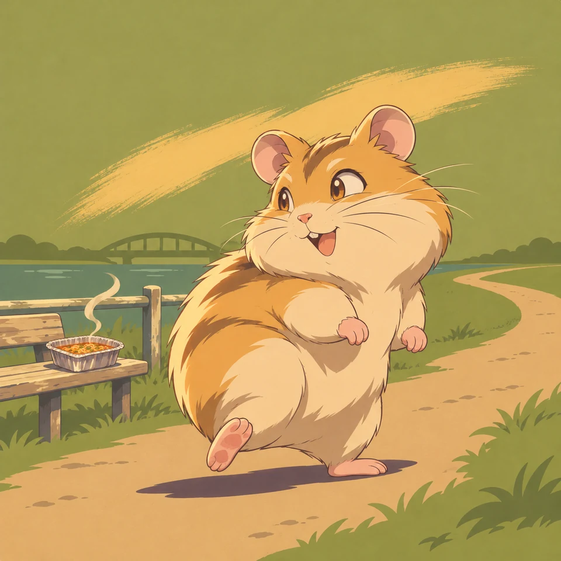</a> 뛰는 곳은 아는 데가 좋아. 거기서 어떻게 뛸지는 그날 정할래. |
| 탐험 | **탐험·계획 &#124; [새 코스 찜한 카멜레온](../../../app/public/run-bti/art/club-animal-explore-plan.webp)**  처음 가는 길이 궁금해. 뛸 계획은 미리 정해 두는 게 좋아. | **탐험·즉흥 &#124; [훌쩍 떠나는 바다코끼리](../../../app/public/run-bti/art/club-animal-explore-improvise.webp)**  처음 가는 길이 좋아. 어떻게 뛸지도 그날 가서 정하는 게 재밌어. |

## 이름과 그림의 근거

별명에는 해당 쪽 세 문항에 두루 맞는 취향 표현이나 그림 속 생김새와 소품을 쓴다. 러너의 특정 행동은 그 행동을 좋아한다고 직접 답했을 때만 결과에 담는다. ‘중간 시간을 듣는 게 좋아’와 ‘시계를 보는 게 좋아’에서 앞의 답으로 뒤의 행동을 추정하지 않는다. 손수건·보온병·초시계·구간표는 원화 속 캐릭터의 소품이다.

두 쪽을 함께 보는 여섯 표에서는 같은 행 옆의 두 마리와 같은 열 위아래의 두 마리를 비교한다. 기린이 갈림길에서 들여다보는 것은 방금 뛴 구간의 시간이고 개구리의 몸은 순간 방향을 바꾼다. 햄스터가 돌아보는 익숙한 강변 쉼터와 거기 놓인 라면은 동물의 이야기다. 카멜레온은 처음 가 볼 코스를 미리 찜한 동물이며, 실제 러너의 답으로는 탐험과 계획을 각각 읽는다.
