# 런비티아이 캐릭터 이름과 뜻 한 줄

친구에게는 “난 거리·숫자야. 펭귄 나왔어”라고 말할 수 있다. 카드에는 **거리·숫자 | 초시계 펭귄**을 한 줄에 쓴다. 취향은 거리·속도, 숫자·감각, 단골·탐험, 계획·즉흥 순서로 적고 한쪽만 뚜렷하면 그쪽 하나만 쓴다. 캐릭터 이름이나 그림을 누르면 체험판에서 쓰는 그림을 크게 볼 수 있다.

## 기본 여덟 명

| 카드 이름 | 뜻 한 줄 |
| --- | --- |
| **거리 &#124; [성큼성큼 코끼리](art/distance.webp)** <a href="art/distance.webp">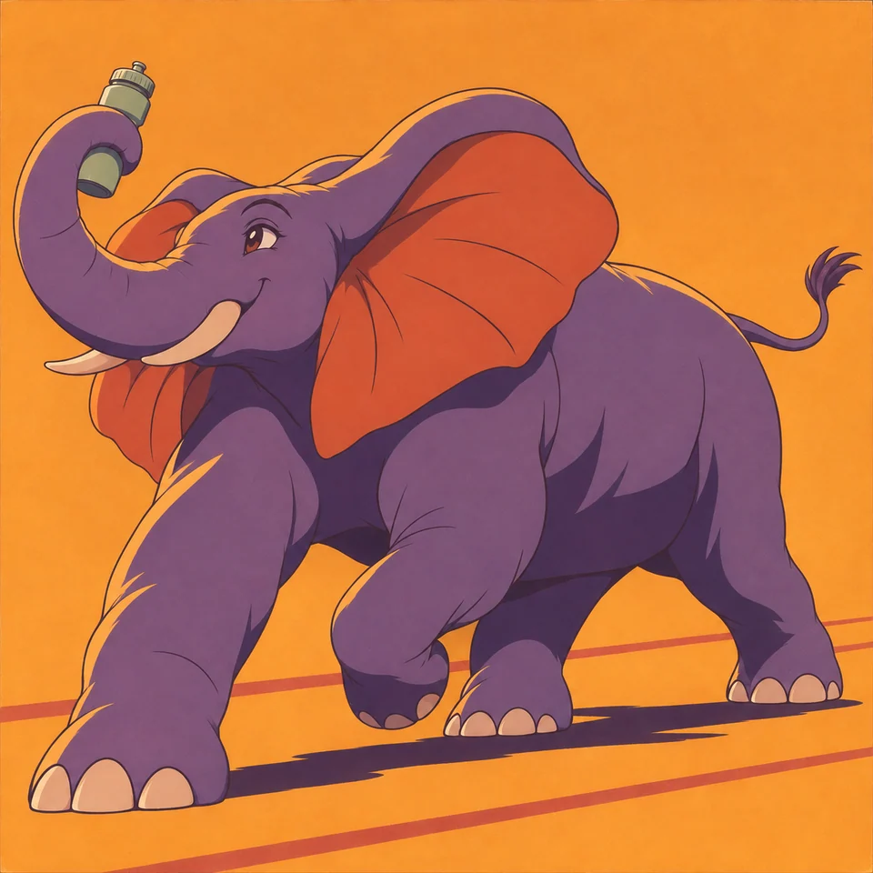</a> | 길게 달릴 수 있는 날이 좋아. |
| **속도 &#124; [질주 치타](art/speed.webp)**  | 뛰다가 속도가 붙을 때가 재밌어. |
| **숫자 &#124; [워치 문어](art/numbers.webp)** <a href="art/numbers.webp">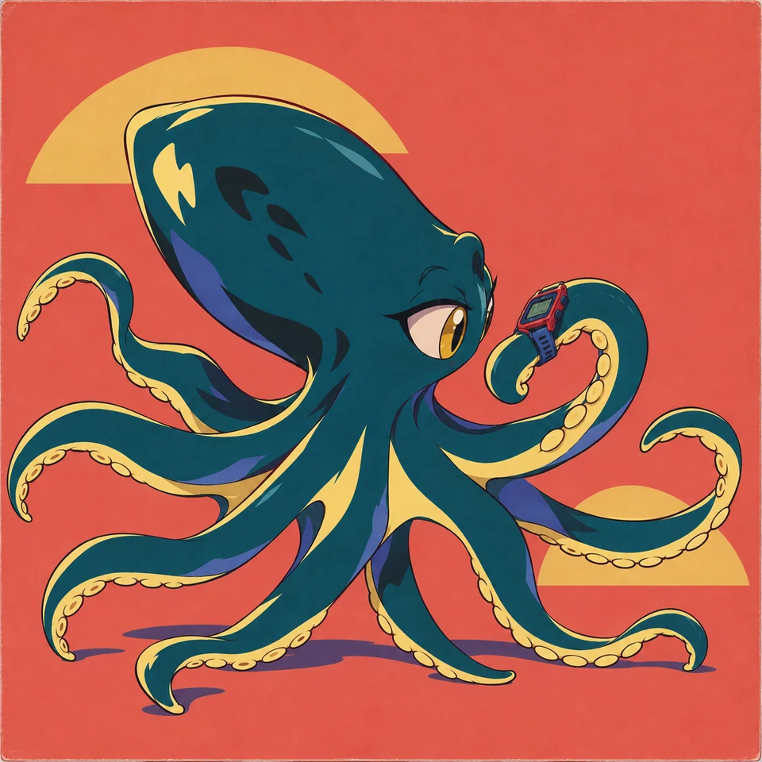</a> | 내가 어떻게 뛰었는지 숫자로 알면 더 재밌어. |
| **감각 &#124; [숨 고르는 고양이](art/senses.webp)** <a href="art/senses.webp">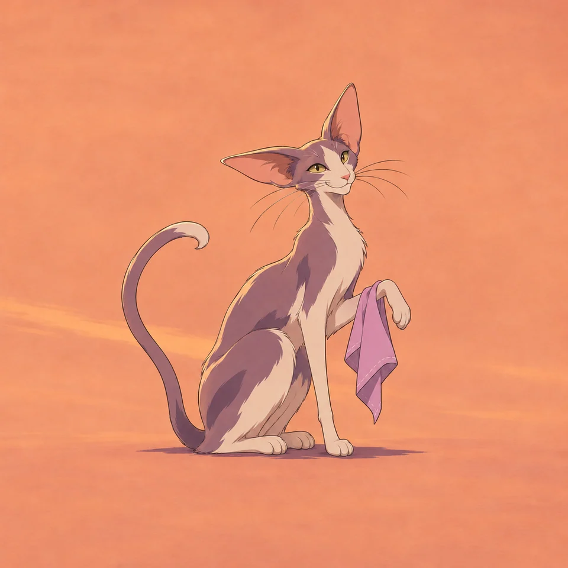</a> | 뛰면서 내 몸이 어떤지 느껴 보는 게 좋아. |
| **단골 &#124; [동네 단골 강아지](art/familiar.webp)** <a href="art/familiar.webp">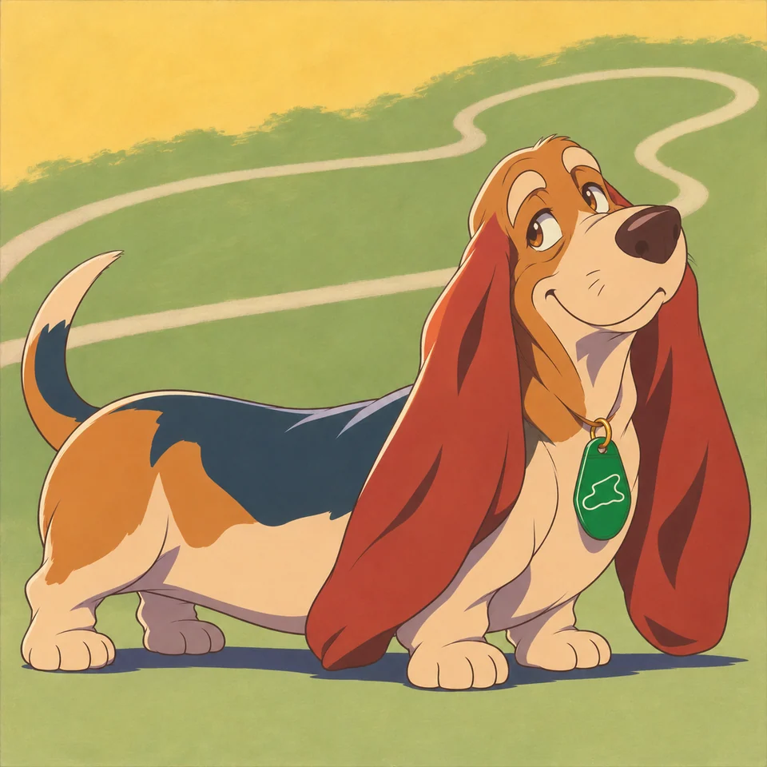</a> | 다시 뛰어도 아는 길이 반가워. |
| **탐험 &#124; [지도 물고 온 여우](art/explore.webp)** <a href="art/explore.webp">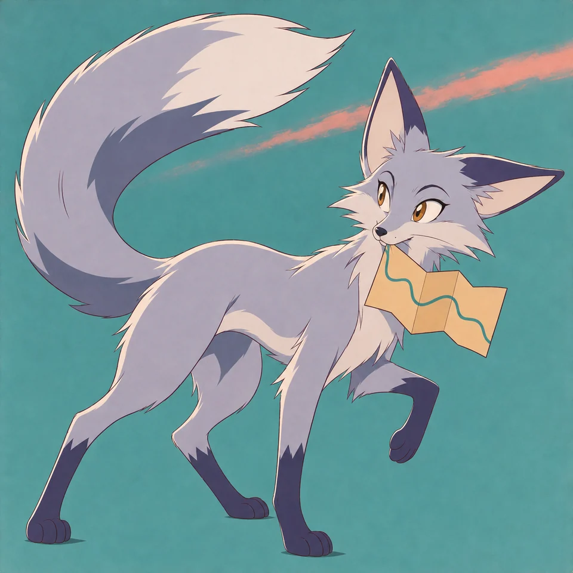</a> | 처음 보는 길은 한번 뛰어 보고 싶어. |
| **계획 &#124; [다이어리 비버](art/plan.webp)**  | 뛸 계획을 미리 정해 두면 마음이 편해. |
| **즉흥 &#124; [날개 편 앵무새](art/improvise.webp)**  | 어떻게 뛸지는 그날 정하는 게 편해. |

## 귤색 · 거리와 속도 × 숫자와 감각

|  | 숫자 | 감각 |
| --- | --- | --- |
| 거리 | **거리·숫자 &#124; [초시계 펭귄](art/distance-numbers.webp)** <a href="art/distance-numbers.webp">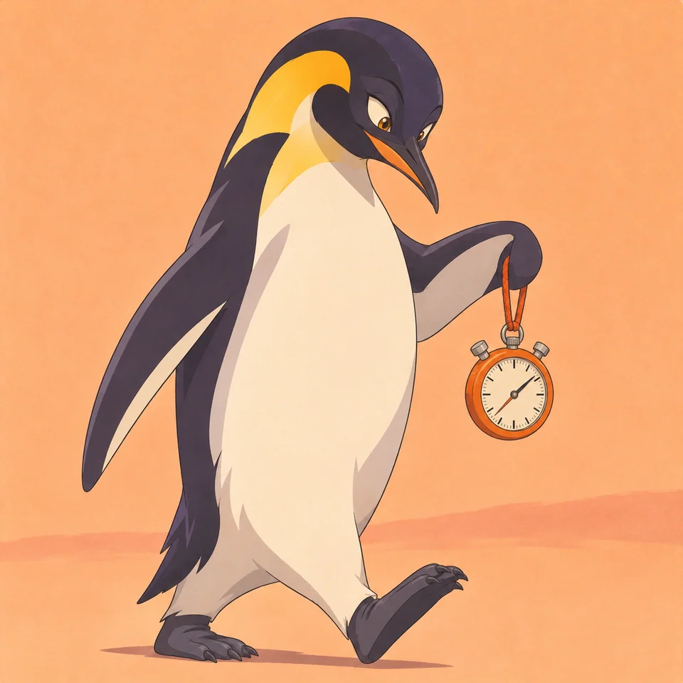</a> 오래 달리는 게 좋고 내 달리기를 숫자로 보는 재미도 있어. | **거리·감각 &#124; [제 박자 거북이](art/distance-senses.webp)** <a href="art/distance-senses.webp">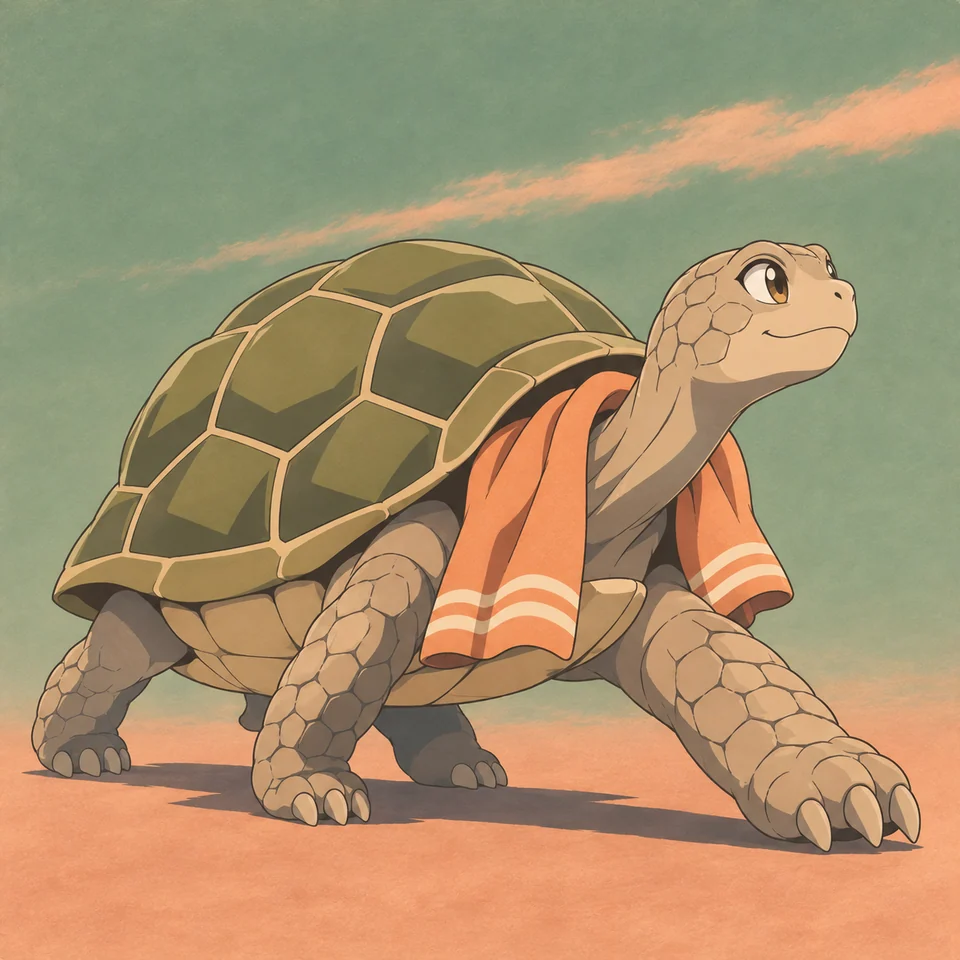</a> 오래 뛰고 싶어. 뛰는 동안 내 몸이 어떤지도 궁금해. |
| 속도 | **속도·숫자 &#124; [랩타임 송골매](art/speed-numbers.webp)**  속도가 붙는 맛도 좋고 내가 어떻게 뛰었는지 숫자로 아는 것도 좋아. | **속도·감각 &#124; [물살 타는 돌고래](art/speed-senses.webp)**  속도를 내는 것도 좋고 달릴 때 몸에서 느껴지는 변화도 재밌어. |

## 청록색 · 거리와 속도 × 단골과 탐험

|  | 단골 | 탐험 |
| --- | --- | --- |
| 거리 | **거리·단골 &#124; [보온병 판다](art/distance-familiar.webp)**  길게 뛰는 게 좋아. 코스는 아는 길이면 더 반가워. | **거리·탐험 &#124; [먼 바다 혹등고래](art/distance-explore.webp)**  길게 달리는 날이 좋아. 처음 보는 길도 궁금해. |
| 속도 | **속도·단골 &#124; [돌아오는 제비](art/speed-familiar.webp)** <a href="art/speed-familiar.webp">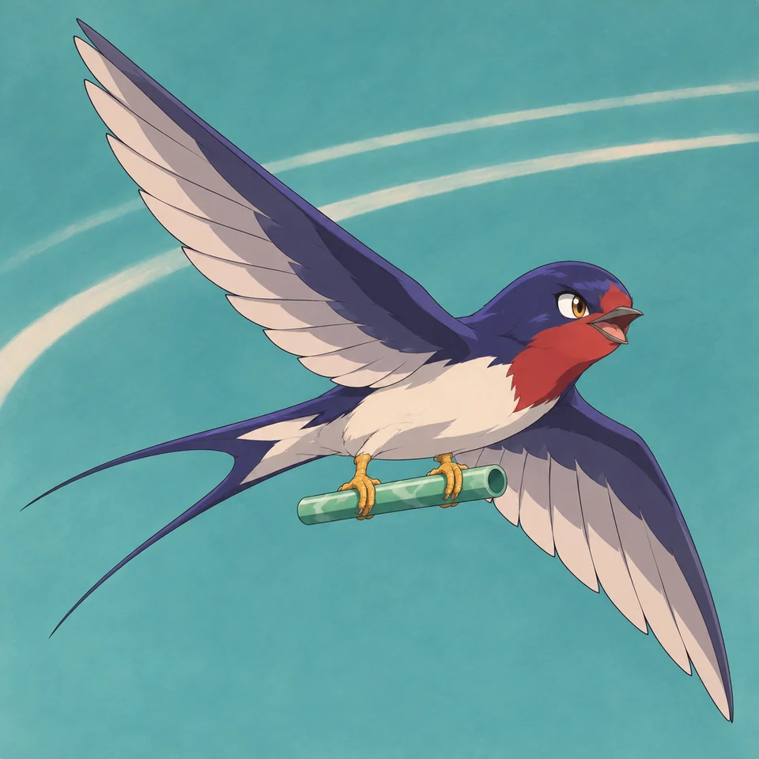</a> 아는 길은 또 뛰어도 좋고 속도가 붙는 순간도 좋아해. | **속도·탐험 &#124; [선글라스 상어](art/speed-explore.webp)**  속도 내는 재미도 있고 새 길을 찾아가는 재미도 있어. |

## 파란색 · 거리와 속도 × 계획과 즉흥

|  | 계획 | 즉흥 |
| --- | --- | --- |
| 거리 | **거리·계획 &#124; [배낭 멘 낙타](art/distance-plan.webp)** <a href="art/distance-plan.webp">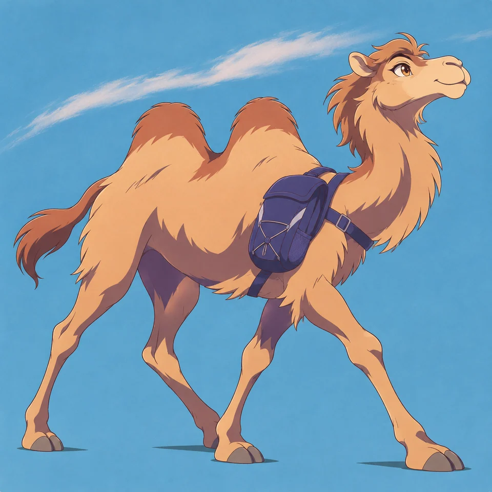</a> 오래 달리는 게 좋아. 뛸 계획은 미리 잡아 두면 편해. | **거리·즉흥 &#124; [한 모금 캥거루](art/distance-improvise.webp)**  오래 뛰는 게 좋아. 어떻게 뛸지는 그날 정하고 싶어. |
| 속도 | **속도·계획 &#124; [운동화 챙긴 토끼](art/speed-plan.webp)**  달릴 땐 속도 내는 재미가 있고 뛸 건 미리 정해 두면 편해. | **속도·즉흥 &#124; [후다닥 다람쥐](art/speed-improvise.webp)**  속도 내는 걸 좋아해. 오늘 어떻게 뛸지는 그때 가서 정할래. |

## 보라색 · 숫자와 감각 × 단골과 탐험

|  | 단골 | 탐험 |
| --- | --- | --- |
| 숫자 | **숫자·단골 &#124; [만보기 라쿤](art/numbers-familiar.webp)**  아는 길에서 뛰는 게 편해. 내가 어떻게 뛰었는지 숫자로 아는 것도 좋아. | **숫자·탐험 &#124; [길 찾는 기린](art/numbers-explore.webp)** <a href="art/numbers-explore.webp">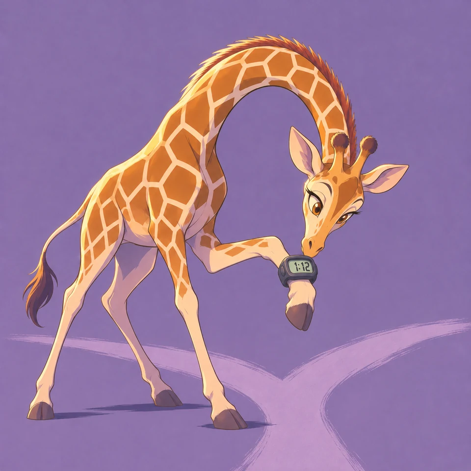</a> 안 가 본 길이 궁금해. 내 달리기를 숫자로 보는 재미도 있어. |
| 감각 | **감각·단골 &#124; [밴드 찬 코알라](art/senses-familiar.webp)** <a href="art/senses-familiar.webp">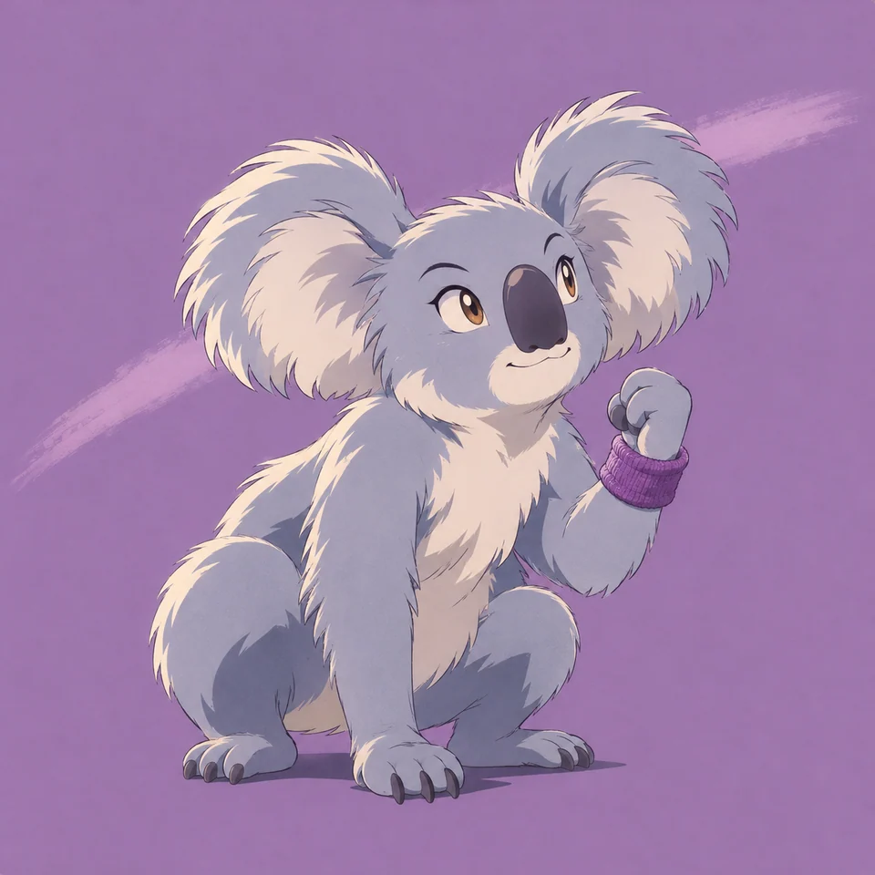</a> 익숙한 길이 반갑고 달릴 때 내 몸이 어떤지 살피는 게 좋아. | **감각·탐험 &#124; [꽃수첩 나비](art/senses-explore.webp)**  새 길에 들어서는 재미도 있고 뛰면서 몸의 변화를 느끼는 재미도 있어. |

## 산호색 · 숫자와 감각 × 계획과 즉흥

|  | 계획 | 즉흥 |
| --- | --- | --- |
| 숫자 | **숫자·계획 &#124; [수첩 올빼미](art/numbers-plan.webp)**  뛸 계획은 미리 잡고 싶어. 내 달리기도 숫자로 보면 감이 와. | **숫자·즉흥 &#124; [폴짝 개구리](art/numbers-improvise.webp)** <a href="art/numbers-improvise.webp">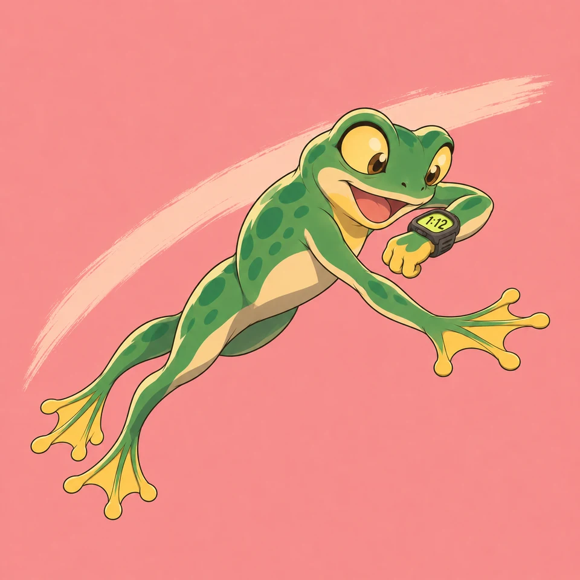</a> 어떻게 뛸지는 그날 정할래. 내가 어떻게 뛰었는지는 숫자로 알고 싶어. |
| 감각 | **감각·계획 &#124; [몸 푸는 양](art/senses-plan.webp)** <a href="art/senses-plan.webp">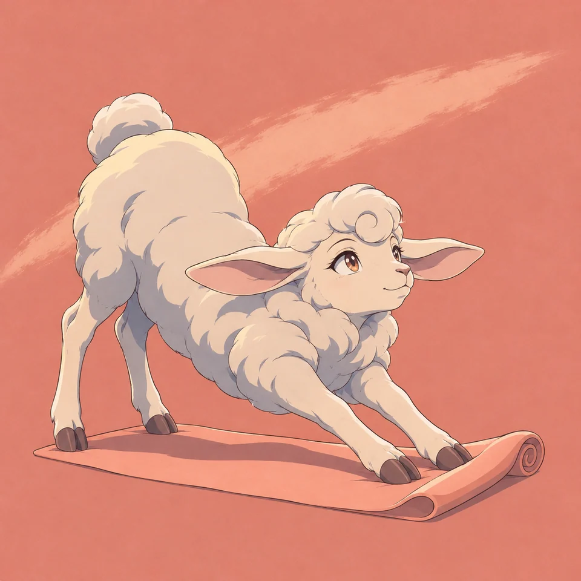</a> 뛸 건 미리 정해 두는 게 편해. 달릴 땐 내 몸이 어떤지도 살피고 싶어. | **감각·즉흥 &#124; [둥실 해파리](art/senses-improvise.webp)** <a href="art/senses-improvise.webp">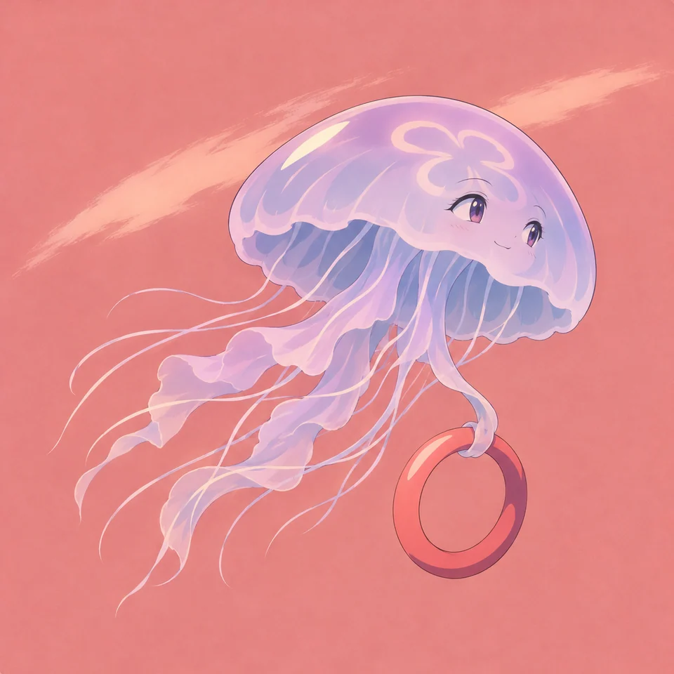</a> 뛸 건 그날 정하는 게 편해. 달리면서 내 몸이 어떤지 느껴 보는 것도 좋아. |

## 올리브색 · 단골과 탐험 × 계획과 즉흥

|  | 계획 | 즉흥 |
| --- | --- | --- |
| 단골 | **단골·계획 &#124; [달력 고슴도치](art/familiar-plan.webp)** <a href="art/familiar-plan.webp">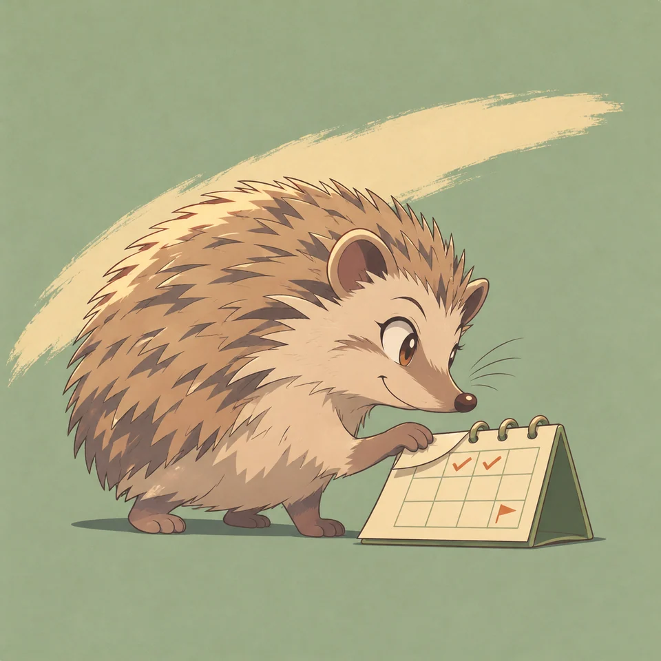</a> 코스는 익숙한 데가 좋고 뛸 계획은 미리 정해 두는 게 편해. | **단골·즉흥 &#124; [한강 단골 햄스터](art/familiar-improvise.webp)** <a href="art/familiar-improvise.webp">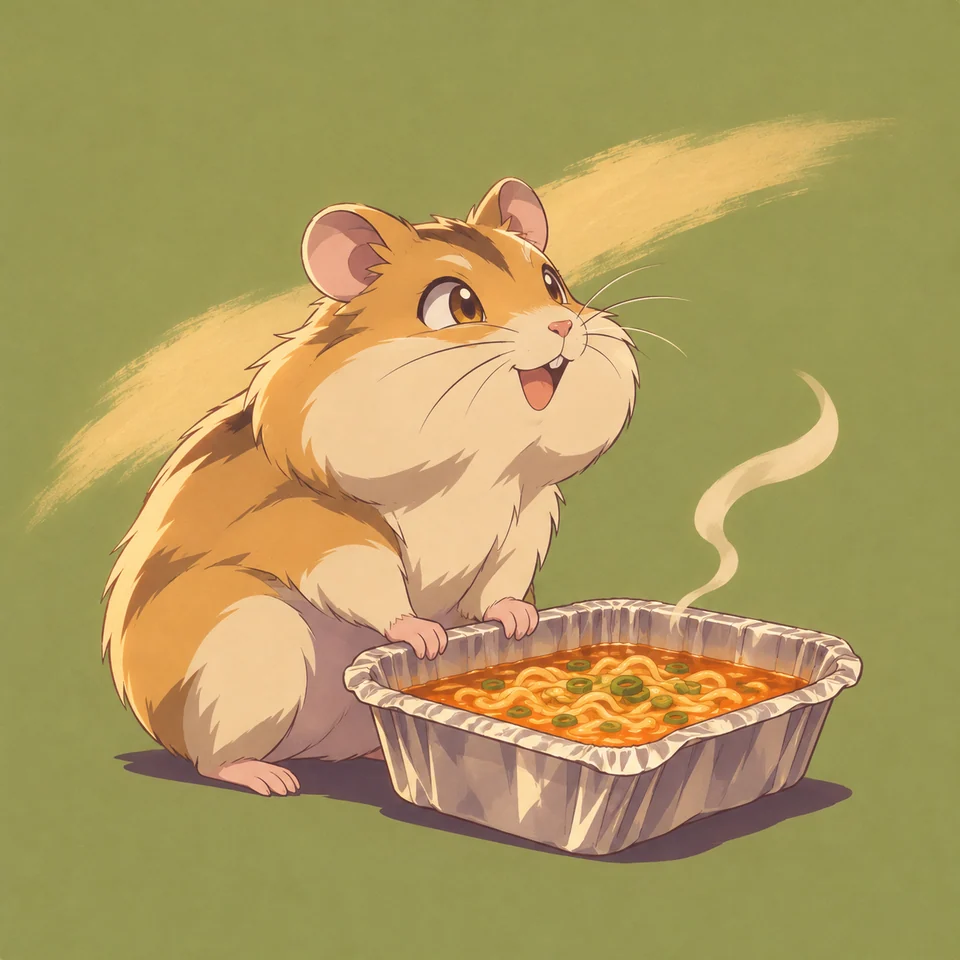</a> 뛰는 곳은 아는 데가 좋아. 거기서 어떻게 뛸지는 그날 정할래. |
| 탐험 | **탐험·계획 &#124; [새 코스 찜한 카멜레온](art/explore-plan.webp)** <a href="art/explore-plan.webp">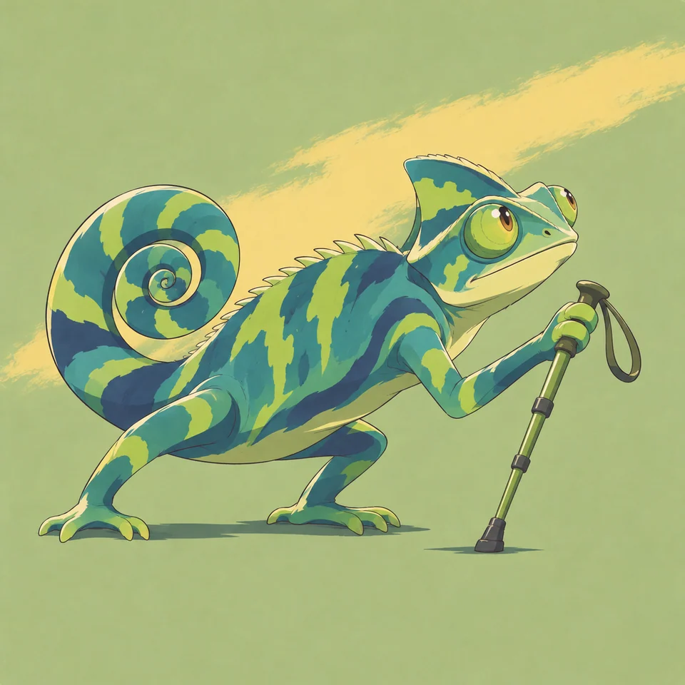</a> 처음 가는 길이 궁금해. 뛸 계획은 미리 정해 두는 게 좋아. | **탐험·즉흥 &#124; [가방 챙긴 바다코끼리](art/explore-improvise.webp)** <a href="art/explore-improvise.webp">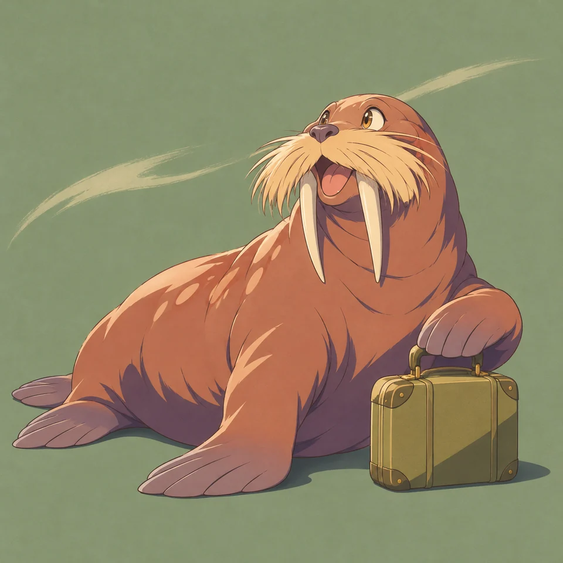</a> 처음 가는 길이 좋아. 어떻게 뛸지도 그날 가서 정하는 게 재밌어. |

## 원화와 함께 읽기

- **기린**은 긴 목을 숙여 길을 살핀다. 지금 원화에서 나침반이 보여 주는 건 방향이다. 다음 그림에서는 처음 만난 갈림길에서 방금 뛴 구간 시간을 확인하는 모습으로 숫자 쪽을 보탠다.
- **개구리**는 옆으로 폴짝 뛰어오른다. 현재는 귀에 이어폰이 보인다. 다음 그림에서는 착지할 방향을 틀면서 워치에 막 뜬 구간 시간을 힐끗 보는 동작을 준다.
- **햄스터**는 은박 그릇의 한강라면으로 알아본다. 다음 그림에서는 익숙한 강변 표식을 살리고 평소 뛰던 길에서 오늘은 잠깐 더 뛸지 돌아갈지 정하는 모습을 담는다. 한강과 라면은 캐릭터에게 속한 설정이다.
- **카멜레온**은 일단 유지하는 편집안이다. 스틱을 짚고 앞을 보는 원화에 다음번에는 미리 봐 둔 새 코스가 표시된 지도를 더하거나 코스 표시를 배경에 둔다. 캐릭터가 건네는 말은 “미리 봐 둔 새 코스가 있어. 오늘은 거기로 갈까?”다. 내 답에서 나온 뜻 한 줄은 표에 적은 문장까지다.
- **송골매**가 쥔 종이는 구간 기록표다. 작은 그림에서도 ‘랩타임’이 읽히도록 분·초 두 줄을 크게 보이는 편이 좋다. **고양이**의 손수건, **양**의 몸풀기, **나비**의 꽃수첩도 각 캐릭터를 알아보는 단서다. 사용자가 그 물건을 쓰거나 그 행동을 즐긴다고 풀이하려면 별도 응답이 있어야 한다.

이름과 문구를 검토하는 편집본이다. 이름과 대사는 제안 문구이고 그림은 현재 체험판에 들어 있는 제작본이다.
