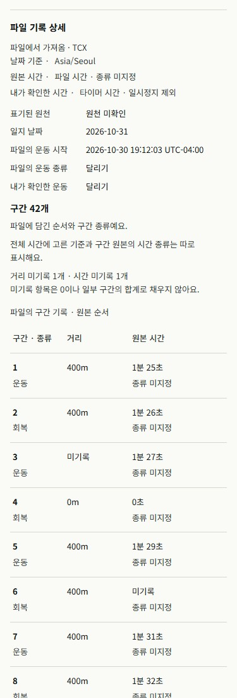
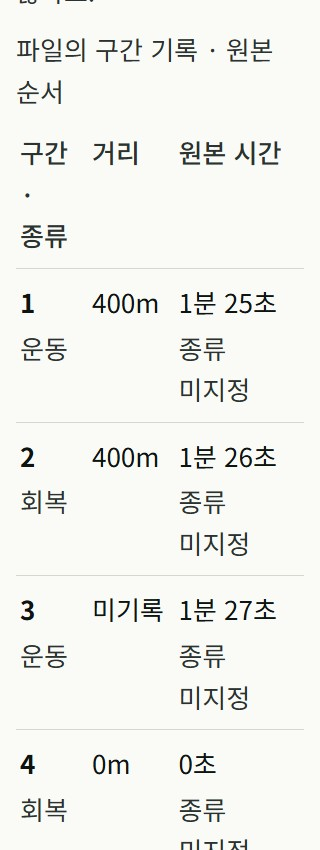
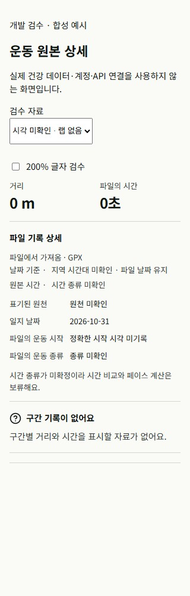

# 운동 상세 역설계 후속 — 로컬 구현·검증 결과

- 날짜: 2026-10-31 KST
- 기준: main `f6d19aef9cb0635aee77a42c93e97ea8ddc41a36`
- 상태: 로컬 후보. 커밋·푸시·운영 배포 없음.
- 원래 미추적 `reports/operations/CONNECTED_DATA_PROVIDER_PREP_2026-10-30.md` 및 `tmp/` 보존.

## 구현

- `app/src/components/ImportedActivityDetail.tsx`와 CSS: 기존 FileObservation의 시작 시각/원 offset, 날짜 기준 timezone, 출처 표기와 전달 경로, 원본/사용자 확인 종목·시간 의미, 원순서 랩.
- `app/src/screens/LogDetail.tsx`: 해당 일지의 fileObservation에 상세 컴포넌트 연결.
- 랩의 거리/시간이 없으면 미기록, 실제 0은 0. 활동 confirmation으로 개별 랩의 원래 시간 의미를 바꾸지 않음.
- 첫 20개 후 명시적 더 보기. 다른 observation으로 바뀌면 표시 수 초기화.
- 저장·수신·API 호출·새 분석 계산 없음. 파서/스키마/서버 변경 없음.
- DEV 전용 fixture는 합성 42랩/빈 기록을 사용. 개인 계정 또는 제공자 API 미사용.

## 실행 근거

| 검사 | 결과 | 범위 |
|---|---|---|
| 새 상세 계약 | 8/8 통과 | 실제 LogDetail 연결, 시작 시각/날짜 구분, 원본 불변, 저장 없음, 0/누락, 페이지 나눔, 출처 |
| 시각 규칙 계약 | 13/13 통과 | 새 상세와 함께 최종 실행. 기존 토큰/시각 규칙 |
| 기존 LogDetail revisit + ImportedRecords | 14/14 통과 | 구현 담당자의 같은 LogDetail 연결 후보 실행. 이후 출처 한 행 추가는 최종 상세 검사로 확인 |
| 앱 typecheck | 통과 | 최종 제품 코드 |
| E2E typecheck | 초기 fixture 통과 | 이후 fixture 큰 글자 CSS 변수 및 HMR dispose 추가. 최종 fixture는 브라우저 실행 확인 |
| 최종 production bundle | 통과, 34.88s | Node 24.19.0. 출력 LogDetail-2xHuL5oy.js에서 최종 출처 라벨 포함 확인 |
| 브라우저 | 확인 | 375px/320px, 큰 글자 본문26px, 20→40→42랩, 마지막 버튼 Enter, 빈 랩/0/시각 미확인 |
| git diff --check | 통과 | 제품 후보 및 문서 공백/충돌 확인 |

최종 새 상세+시각 규칙은 `final-focused.log`의 2 files / 21 tests PASS.
기존 14건은 구현 담당자의 별도 실행 결과이며 이 로그에 합쳐서 기록하지 않았다.
뷰포트/문서폭: 375/360, 320/305 (스크롤바 제외). 큰 글자 검사에서 상세 본문 computed font 26px.
브라우저 검수는 합성 컴포넌트 fixture다. 실제 일지 통합은 계약 검사 범위이며 개인 데이터 저장 왕복이나 공개 브라우저 증거가 아니다.

## 빌드·도구 이슈 처리

- 최초 기본 Node24.11.1은 저장소의 prebuild guard가 차단했다. 우회하지 않고 설치된 번들 Node24.19.0으로 성공.
- 최종 코드 변경 이후 production bundle을 다시 만들었으며 동일 범위 typecheck도 통과.
- 빌드의 기존 큰 청크/동적·정적 import 혼용/폰트 런타임 해석 경고는 남아 있다. 운영 font 로딩을 이번 로컬 build로 입증하지 않는다.
- fixture 편집 중 React createRoot HMR 경고 1건을 관찰하여 dispose를 추가했다. 새 페이지의 콘솔 오류는 0건. 과거 경고를 지우지 않고 browser-evidence.json에 기록.
- 브라우저 viewport 초기 설정은 새 탭에 적용되지 않아 최초 1280px 확인 후 375px로 재설정했다. 명시된 모바일 증거는 재설정 이후 값이다.

## 제품 코드 해시

- ImportedActivityDetail.tsx: `18840A9224F5D071DDF1ED2568012AD30ED8CFC8129D7886BA4644C8D3BA24AD`
- imported-activity-detail.css: `9433E05BB61B94BDD69D1CC15A747378D6A8D789F69127A98EB93F2AD2ED4C08`
- LogDetail.tsx: `6D69E8C77C1D00B50AA6E9A60341F0EB78C2B248E1B47690342157D28F10CB8F`

## 독립 검토 반영

- 필드 JSON을 제공자별 UI/API 확인 수준과 출처를 가진 v2로 변경.
- Garmin HRV Status·Stress를 추가: 총57묶음, P0 25/P1 32.
- 저장된 lineage의 표기된 원천과 FILE_UPLOAD 전달 경로 분리. 출처 표시가 인증이나 AI 이용 권한을 뜻하지 않도록 표시.

## 남은 범위

센서 수집·저장·심박/파워/고도 차트·GPS·건강 추세·실제 기기/API 필드 대조는 구현 대기다.
[통합 명세](../../plans/GARMIN_APPLE_DETAIL_IMPLEMENTATION_2026-10-31.md)와 제공자별 조사에 정확한 순서/완료조건을 남겼다.
현행 journal body 제한(655,360 bytes)에 시계열을 무제한 추가하지 않고 별도 버전/manifest 저장을 먼저 설계한다.
회사 LLM 도입·제공자 AI 이용 조건·운영 권한은 이 UI 작업의 성공 범위에 포함하지 않는다.

## 화면 증거

합성 기록이며 실제 사용자 건강 데이터가 아니다.

